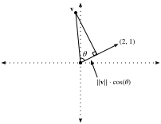
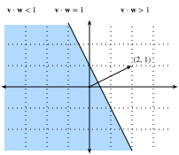
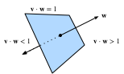
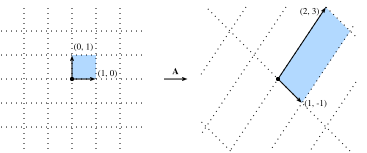

# 几何与线性代数运算
:label:`sec_geometry-linear-algebraic-ops`

在:numref:`sec_linear-algebra`中，我们学习了线性代数的基础知识，
并了解如何用它表示变换数据的常见运算。
线性代数是深度学习乃至更广泛的机器学习工作所依赖的关键数学支柱之一。
虽然:numref:`sec_linear-algebra`介绍的工具已经足以描述现代深度学习模型的运作机制，
但线性代数还有更多内容。
本节将进一步探索线性代数运算的若干几何解释，
并介绍包括特征值和特征向量在内的一些基本概念。

## 向量的几何解释

首先讨论向量的两种常见几何解释：空间中的点或方向。
从根本上说，向量是一列数字，例如下面的Python列表。

```{.python .input}
#@tab all
v = [1, 7, 0, 1]
```

数学家通常将它写成*列*向量或*行*向量，即

$$
\mathbf{x} = \begin{bmatrix}1\\7\\0\\1\end{bmatrix},
$$

或者

$$
\mathbf{x}^\top = \begin{bmatrix}1 & 7 & 0 & 1\end{bmatrix}.
$$

二者通常有不同解释：
数据样本是列向量，而用于形成加权和的权重是行向量。
不过，灵活处理也很有益。
正如:numref:`sec_linear-algebra`所述，
虽然单个向量默认视为列向量，
但对于表示表格数据集的矩阵，
更常见的约定是把每个数据样本视为矩阵中的一个行向量。

给定一个向量，第一种解释是把它看作空间中的点。
在二维或三维空间中，可以用向量各分量定义点相对于固定参考点（称为*原点*）的位置，
从而将这些点可视化，如:numref:`fig_grid`所示。


:label:`fig_grid`

这种几何视角使我们能在更抽象的层次上思考问题。
面对将图像分类为猫或狗这类看似难以解决的问题时，
可以把任务抽象成空间中的点集，
并将其想象为寻找一种方法来分开两个不同的点簇。

向量还有第二种常见解释：空间中的方向。
向量$\mathbf{v}=[3,2]^\top$不仅可以表示从原点向右$3$个单位、向上$2$个单位的位置，
也可以表示“向右走$3$步、向上走$2$步”这一方向本身。
从这个角度看，:numref:`fig_arrow`中的所有箭头都表示同一个向量。


:width:`360px`
:label:`fig_arrow`

这种视角转换的一个优点是，可以直观理解向量加法。
先沿一个向量给出的方向移动，
再沿另一个向量给出的方向移动，如:numref:`fig_add-vec`所示。


:width:`420px`
:label:`fig_add-vec`

向量减法也有类似解释。
由恒等式$\mathbf{u}=\mathbf{v}+(\mathbf{u}-\mathbf{v})$可知，
向量$\mathbf{u}-\mathbf{v}$就是从点$\mathbf{v}$指向点$\mathbf{u}$的方向。


## 点积与夹角

正如:numref:`sec_linear-algebra`所示，
对于两个列向量$\mathbf{u}$和$\mathbf{v}$，
可以按如下方式计算它们的点积：

$$\mathbf{u}^\top\mathbf{v} = \sum_i u_i\cdot v_i.$$
:eqlabel:`eq_dot_def`

由于:eqref:`eq_dot_def`具有对称性，仿照普通乘法的记号，写成

$$
\mathbf{u}\cdot\mathbf{v} = \mathbf{u}^\top\mathbf{v} = \mathbf{v}^\top\mathbf{u},
$$

以强调交换两个向量的顺序不会改变结果。

点积:eqref:`eq_dot_def`也有几何解释：它与两个向量之间的夹角密切相关。考虑:numref:`fig_angle`所示的夹角。


:width:`380px`
:label:`fig_angle`

首先考虑两个具体向量：

$$
\mathbf{v} = (r,0), \qquad \mathbf{w} = (s\cos(\theta), s \sin(\theta)).
$$

向量$\mathbf{v}$的长度为$r$且平行于$x$轴，
向量$\mathbf{w}$的长度为$s$且与$x$轴夹角为$\theta$。
计算二者的点积，得到

$$
\mathbf{v}\cdot\mathbf{w} = rs\cos(\theta) = \|\mathbf{v}\|\|\mathbf{w}\|\cos(\theta).
$$

经过简单的代数变形，可得

$$
\theta = \arccos\left(\frac{\mathbf{v}\cdot\mathbf{w}}{\|\mathbf{v}\|\|\mathbf{w}\|}\right).
$$

简而言之，对于这两个具体向量，点积与范数共同决定了二者之间的夹角。
这一事实在一般情况下也成立。这里不作推导；
只要用两种方式表示$\|\mathbf{v}-\mathbf{w}\|^2$——
一种使用点积，另一种从几何角度使用余弦定理——
就能得到完整关系。
因此，对于任意两个向量$\mathbf{v}$和$\mathbf{w}$，二者夹角为

$$\theta = \arccos\left(\frac{\mathbf{v}\cdot\mathbf{w}}{\|\mathbf{v}\|\|\mathbf{w}\|}\right).$$
:eqlabel:`eq_angle_forumla`

这是一个很好的结果，因为计算中没有任何部分依赖于二维空间。
无论在三维还是三百万维空间中，都可以直接使用它。

作为简单示例，下面计算一对向量之间的夹角：

```{.python .input}
#@tab mxnet
%matplotlib inline
from d2l import mxnet as d2l
from IPython import display
from mxnet import gluon, np, npx
npx.set_np()

def angle(v, w):
    return np.arccos(v.dot(w) / (np.linalg.norm(v) * np.linalg.norm(w)))

angle(np.array([0, 1, 2]), np.array([2, 3, 4]))
```

```{.python .input}
#@tab pytorch
%matplotlib inline
from d2l import torch as d2l
from IPython import display
import torch
from torchvision import transforms
import torchvision

def angle(v, w):
    return torch.acos(v.dot(w) / (torch.norm(v) * torch.norm(w)))

angle(torch.tensor([0, 1, 2], dtype=torch.float32), torch.tensor([2.0, 3, 4]))
```

```{.python .input}
#@tab tensorflow
%matplotlib inline
from d2l import tensorflow as d2l
from IPython import display
import tensorflow as tf

def angle(v, w):
    return tf.acos(tf.tensordot(v, w, axes=1) / (tf.norm(v) * tf.norm(w)))

angle(tf.constant([0, 1, 2], dtype=tf.float32), tf.constant([2.0, 3, 4]))
```

虽然暂时不会使用，但应当知道，
夹角为$\pi/2$（即$90^\circ$）的向量称为*正交*（orthogonal）。
考察上式可知，此时$\theta=\pi/2$，也就是$\cos(\theta)=0$。
这只有在点积本身为零时才会发生，
所以两个向量正交当且仅当$\mathbf{v}\cdot\mathbf{w}=0$。
在从几何角度理解对象时，这个公式会很有帮助。

很自然会问：计算夹角有什么用？
答案与我们期望数据具有的不变性有关。
考虑一幅图像及其副本，副本每个像素的值只有原图的$10\%$，也就是亮度更低。
各像素值通常与原值相差很大，
所以原图与暗图之间的距离可能很大。
然而，对大多数机器学习应用而言，二者的*内容*相同——
对于猫狗分类器，它仍然是一幅猫的图像。
如果考察夹角，则不难发现，对任意向量$\mathbf{v}$，
$\mathbf{v}$与$0.1\mathbf{v}$之间的夹角为零。
这是因为缩放向量只改变长度而不改变方向。
因此，夹角认为变暗后的图像与原图相同。

这样的例子随处可见。
在文本中，如果把表达同一内容的文档写得长一倍，
我们仍希望它所讨论的主题不变。
对于某些编码方式（例如统计词表中各词的出现次数），
这相当于把文档的编码向量扩大一倍，因此同样可以使用夹角。

### 余弦相似度

在机器学习中使用夹角衡量两个向量的接近程度时，
人们把下式称为*余弦相似度*（cosine similarity）：
$$
\cos(\theta) = \frac{\mathbf{v}\cdot\mathbf{w}}{\|\mathbf{v}\|\|\mathbf{w}\|}.
$$

当两个向量指向相同方向时，余弦取最大值$1$；
指向相反方向时取最小值$-1$；
两个向量正交时取值$0$。
注意，如果高维向量的各分量从均值为$0$的分布中随机采样，
它们的余弦几乎总是接近$0$。


## 超平面

除了向量，深入学习线性代数还必须理解另一个关键对象：
*超平面*（hyperplane）。它是二维空间中直线或三维空间中平面向更高维的推广。
在$d$维向量空间中，超平面具有$d-1$维，并把空间分成两个半空间。

先看一个例子。
假设有列向量$\mathbf{w}=[2,1]^\top$，想知道哪些点$\mathbf{v}$满足$\mathbf{w}\cdot\mathbf{v}=1$。
回顾:eqref:`eq_angle_forumla`中点积与夹角的关系，可知它等价于
$$
\|\mathbf{v}\|\|\mathbf{w}\|\cos(\theta) = 1 \; \iff \; \|\mathbf{v}\|\cos(\theta) = \frac{1}{\|\mathbf{w}\|} = \frac{1}{\sqrt{5}}.
$$


:width:`400px`
:label:`fig_vector-project`

从几何意义看，这等价于说，
$\mathbf{v}$在$\mathbf{w}$方向上的投影长度恰好为$1/\|\mathbf{w}\|$，
如:numref:`fig_vector-project`所示。
满足这一条件的所有点组成一条与向量$\mathbf{w}$垂直的直线。
可以求出该直线的方程为$2x+y=1$，等价地写为$y=1-2x$。

再考察满足$\mathbf{w}\cdot\mathbf{v}>1$或$\mathbf{w}\cdot\mathbf{v}<1$的点集，
可以看到，它们分别对应投影长度大于或小于$1/\|\mathbf{w}\|$的情况。
因此，这两个不等式分别定义了直线的两侧。
这样便把空间切分为两半：一侧所有点的点积低于阈值，
另一侧所有点的点积高于阈值，如:numref:`fig_space-division`所示。


:width:`480px`
:label:`fig_space-division`

高维情形基本相同。
取$\mathbf{w}=[1,2,3]^\top$，考察三维空间中满足$\mathbf{w}\cdot\mathbf{v}=1$的点，
会得到一个与向量$\mathbf{w}$垂直的平面。
两个不等式同样定义该平面的两侧，如:numref:`fig_higher-division`所示。


:width:`480px`
:label:`fig_higher-division`

虽然人类的可视化能力到此已达到极限，
但在数十、数百乃至数十亿维空间中进行同样的操作并无障碍。
思考机器学习模型时经常会遇到这种情况。
例如，可以把:numref:`sec_softmax`中的线性分类模型理解为寻找能够分隔不同目标类别的超平面。
在这种语境下，这些超平面通常称为*决策平面*（decision plane）。
大多数深度学习分类模型都以接入softmax的线性层结束，
因此可以把深度神经网络的作用理解为寻找一种非线性嵌入，
使目标类别能够被超平面清晰地分开。

作为手工构造的例子，只需取Fashion-MNIST数据集（参见:numref:`sec_fashion_mnist`）中
T恤与裤子两类图像均值之间的向量来定义决策平面，
再目测选取一个粗略阈值，
就能得到一个表现尚可的微型图像分类模型。
首先加载数据并计算均值。

```{.python .input}
#@tab mxnet
# 加载数据集
train = gluon.data.vision.FashionMNIST(train=True)
test = gluon.data.vision.FashionMNIST(train=False)

X_train_0 = np.stack([x[0] for x in train if x[1] == 0]).astype(float)
X_train_1 = np.stack([x[0] for x in train if x[1] == 1]).astype(float)
X_test = np.stack(
    [x[0] for x in test if x[1] == 0 or x[1] == 1]).astype(float)
y_test = np.stack(
    [x[1] for x in test if x[1] == 0 or x[1] == 1]).astype(float)

# 计算均值
ave_0 = np.mean(X_train_0, axis=0)
ave_1 = np.mean(X_train_1, axis=0)
```

```{.python .input}
#@tab pytorch
# 加载数据集
trans = []
trans.append(transforms.ToTensor())
trans = transforms.Compose(trans)
train = torchvision.datasets.FashionMNIST(root="../data", transform=trans,
                                          train=True, download=True)
test = torchvision.datasets.FashionMNIST(root="../data", transform=trans,
                                         train=False, download=True)

X_train_0 = torch.stack(
    [x[0] * 256 for x in train if x[1] == 0]).type(torch.float32)
X_train_1 = torch.stack(
    [x[0] * 256 for x in train if x[1] == 1]).type(torch.float32)
X_test = torch.stack(
    [x[0] * 256 for x in test if x[1] == 0 or x[1] == 1]).type(torch.float32)
y_test = torch.stack([torch.tensor(x[1]) for x in test
                      if x[1] == 0 or x[1] == 1]).type(torch.float32)

# 计算均值
ave_0 = torch.mean(X_train_0, axis=0)
ave_1 = torch.mean(X_train_1, axis=0)
```

```{.python .input}
#@tab tensorflow
# 加载数据集
((train_images, train_labels), (
    test_images, test_labels)) = tf.keras.datasets.fashion_mnist.load_data()


X_train_0 = tf.cast(tf.stack(train_images[[i for i, label in enumerate(
    train_labels) if label == 0]] * 256), dtype=tf.float32)
X_train_1 = tf.cast(tf.stack(train_images[[i for i, label in enumerate(
    train_labels) if label == 1]] * 256), dtype=tf.float32)
X_test = tf.cast(tf.stack(test_images[[i for i, label in enumerate(
    test_labels) if label == 0]] * 256), dtype=tf.float32)
y_test = tf.cast(tf.stack(test_images[[i for i, label in enumerate(
    test_labels) if label == 1]] * 256), dtype=tf.float32)

# 计算均值
ave_0 = tf.reduce_mean(X_train_0, axis=0)
ave_1 = tf.reduce_mean(X_train_1, axis=0)
```

仔细观察这些均值很有帮助，因此将它们绘制出来。可以看到，第一类的均值确实像一幅模糊的T恤图像。

```{.python .input}
#@tab mxnet, pytorch
# 绘制T恤的平均图像
d2l.set_figsize()
d2l.plt.imshow(ave_0.reshape(28, 28).tolist(), cmap='Greys')
d2l.plt.show()
```

```{.python .input}
#@tab tensorflow
# 绘制T恤的平均图像
d2l.set_figsize()
d2l.plt.imshow(tf.reshape(ave_0, (28, 28)), cmap='Greys')
d2l.plt.show()
```

第二类的均值同样像一幅模糊的裤子图像。

```{.python .input}
#@tab mxnet, pytorch
# 绘制裤子的平均图像
d2l.plt.imshow(ave_1.reshape(28, 28).tolist(), cmap='Greys')
d2l.plt.show()
```

```{.python .input}
#@tab tensorflow
# 绘制裤子的平均图像
d2l.plt.imshow(tf.reshape(ave_1, (28, 28)), cmap='Greys')
d2l.plt.show()
```

在完全由机器学习得到的方案中，阈值应从数据集中学习。这里仅凭观察手工选取了一个在训练数据上效果不错的阈值。

```{.python .input}
#@tab mxnet
# 使用目测阈值计算测试集准确率
w = (ave_1 - ave_0).T
predictions = X_test.reshape(2000, -1).dot(w.flatten()) > -1500000

# 准确率
np.mean(predictions.astype(y_test.dtype) == y_test, dtype=np.float64)
```

```{.python .input}
#@tab pytorch
# 使用目测阈值计算测试集准确率
w = (ave_1 - ave_0).T
# @是PyTorch中的矩阵乘法运算符
predictions = X_test.reshape(2000, -1) @ (w.flatten()) > -1500000

# 准确率
torch.mean((predictions.type(y_test.dtype) == y_test).float(), dtype=torch.float64)
```

```{.python .input}
#@tab tensorflow
# 使用目测阈值计算测试集准确率
w = tf.transpose(ave_1 - ave_0)
predictions = tf.reduce_sum(X_test * tf.nest.flatten(w), axis=0) > -1500000

# 准确率
tf.reduce_mean(
    tf.cast(tf.cast(predictions, y_test.dtype) == y_test, tf.float32))
```

## 线性变换的几何解释

通过:numref:`sec_linear-algebra`和上述讨论，
我们已经较好地理解了向量、长度和夹角的几何意义。
不过，还有一个重要对象尚未讨论：由矩阵表示的线性变换的几何意义。
要完全理解矩阵如何在两个可能不同的高维空间之间变换数据，需要大量练习，
这超出了本附录的范围。
但可以先在二维空间中建立直觉。

假设有矩阵

$$
\mathbf{A} = \begin{bmatrix}
a & b \\ c & d
\end{bmatrix}.
$$

将它作用于任意向量$\mathbf{v}=[x,y]^\top$，相乘可得

$$
\begin{aligned}
\mathbf{A}\mathbf{v} & = \begin{bmatrix}a & b \\ c & d\end{bmatrix}\begin{bmatrix}x \\ y\end{bmatrix} \\
& = \begin{bmatrix}ax+by\\ cx+dy\end{bmatrix} \\
& = x\begin{bmatrix}a \\ c\end{bmatrix} + y\begin{bmatrix}b \\d\end{bmatrix} \\
& = x\left\{\mathbf{A}\begin{bmatrix}1\\0\end{bmatrix}\right\} + y\left\{\mathbf{A}\begin{bmatrix}0\\1\end{bmatrix}\right\}.
\end{aligned}
$$

这个计算可能有些奇怪，似乎把原本清楚的内容变得难以理解。
但它告诉我们，矩阵对*任意*向量的变换方式，
都可以用它对两个特定向量$[1,0]^\top$和$[0,1]^\top$的变换来表示。
这值得仔细思考。
我们实际上把一个无限问题（任意一对实数会发生什么）
归约成了有限问题（这两个特定向量会发生什么）。
这些向量构成一组*基*（basis），
空间中的任意向量都可以写成这些*基向量*（basis vector）的加权和。

下面绘制特定矩阵作用后的结果：

$$
\mathbf{A} = \begin{bmatrix}
1 & 2 \\
-1 & 3
\end{bmatrix}.
$$

对于向量$\mathbf{v}=[2,-1]^\top$，有
$\mathbf{v}=2[1,0]^\top-[0,1]^\top$。
因此，矩阵$A$将它变换为
$2(\mathbf{A}[1,0]^\top)-\mathbf{A}[0,1]^\top=2[1,-1]^\top-[2,3]^\top=[0,-5]^\top$。
沿这一逻辑仔细考察所有整数点对组成的网格，
可以看到矩阵乘法能够剪切、旋转和缩放网格，
但必须保持网格结构，如:numref:`fig_grid-transform`所示。


:width:`480px`
:label:`fig_grid-transform`

这是理解矩阵所表示线性变换时最重要的直觉。
矩阵无法以不同方式扭曲空间的不同部分，
只能对空间中的原坐标进行剪切、旋转和缩放。

某些变换可能非常剧烈。例如矩阵

$$
\mathbf{B} = \begin{bmatrix}
2 & -1 \\ 4 & -2
\end{bmatrix},
$$

会把整个二维平面压缩到一条直线上。
识别和处理这类变换是后续小节的主题，
但从几何角度已经可以看出，它与上面的变换有本质区别。
例如，矩阵$\mathbf{A}$的结果可以“还原”为原网格，
而矩阵$\mathbf{B}$的结果不行，因为永远无法知道向量$[1,2]^\top$来自哪里——
是$[1,1]^\top$，还是$[0,-1]^\top$？

虽然这幅图针对$2\times2$矩阵，
但同样的认识可以推广到更高维空间。
取$[1,0,\ldots,0]$这样的基向量并观察矩阵把它们映射到何处，
就能开始理解矩阵乘法如何变换任意维度的整个空间。

## 线性相关

再次考虑矩阵

$$
\mathbf{B} = \begin{bmatrix}
2 & -1 \\ 4 & -2
\end{bmatrix}.
$$

它把整个平面压缩到直线$y=2x$上。
现在的问题是：能否仅通过观察矩阵本身检测出这一点？
答案是肯定的。
令$\mathbf{b}_1=[2,4]^\top$和$\mathbf{b}_2=[-1,-2]^\top$为$\mathbf{B}$的两列。
回顾一下，矩阵$\mathbf{B}$变换所得的任意结果都可以写成其列向量的加权和，
例如$a_1\mathbf{b}_1+a_2\mathbf{b}_2$。
这称为*线性组合*（linear combination）。
由于$\mathbf{b}_1=-2\mathbf{b}_2$，
两个列向量的任意线性组合都可以完全用$\mathbf{b}_2$表示，因为

$$
a_1\mathbf{b}_1 + a_2\mathbf{b}_2 = -2a_1\mathbf{b}_2 + a_2\mathbf{b}_2 = (a_2-2a_1)\mathbf{b}_2.
$$

这意味着其中一个列向量在某种意义上是冗余的，
因为它没有定义空间中的独立方向。
这并不令人意外，因为已经看到该矩阵把整个平面压缩成一条直线。
而线性关系$\mathbf{b}_1=-2\mathbf{b}_2$正好刻画了这一事实。
为了使两个向量在形式上更对称，将其写为

$$
\mathbf{b}_1  + 2\cdot\mathbf{b}_2 = 0.
$$

一般而言，如果存在*不全为零*的系数$a_1,\ldots,a_k$，使得
向量组$\mathbf{v}_1,\ldots,\mathbf{v}_k$满足

$$
\sum_{i=1}^k a_i\mathbf{v_i} = 0.
$$

就称这些向量*线性相关*（linearly dependent）。
此时可以用其他向量的组合表示其中一个向量，使它实际上成为冗余向量。
因此，矩阵列向量之间的线性相关关系表明，该矩阵把空间压缩到了较低维度。
如果不存在这种线性关系，就称这些向量*线性无关*（linearly independent）。
若矩阵的列向量线性无关，就不会发生压缩，变换可以撤销。

## 秩

对于一般的$n\times m$矩阵，很自然会问它映射到多少维的空间。
*秩*（rank）这一概念给出了答案。
上一节指出，线性相关意味着空间被压缩到较低维度，
因此可以利用它定义秩。
具体而言，矩阵$\mathbf{A}$的秩是其列向量子集中
线性无关列向量的最大数量。例如，矩阵

$$
\mathbf{B} = \begin{bmatrix}
2 & 4 \\ -1 & -2
\end{bmatrix},
$$

满足$\textrm{rank}(B)=1$，因为两列线性相关，
但任意单独一列都不是线性相关的。
再看一个更具挑战性的例子：

$$
\mathbf{C} = \begin{bmatrix}
1& 3 & 0 & -1 & 0 \\
-1 & 0 & 1 & 1 & -1 \\
0 & 3 & 1 & 0 & -1 \\
2 & 3 & -1 & -2 & 1
\end{bmatrix},
$$

可以证明$\mathbf{C}$的秩为二。例如，前两列线性无关，
但任取三列所组成的四种向量组都线性相关。

上述过程效率很低，需要检查给定矩阵列向量的每个子集，
因此复杂度可能随列数呈指数增长。
后文将介绍计算矩阵秩的更高效方法；
目前这一定义已经足以说明秩是良定义的，并理解其含义。

## 可逆性

前面已经看到，乘以列向量线性相关的矩阵后，变换无法撤销，
也就是说不存在总能恢复输入的逆运算。
但乘以满秩矩阵（即秩为$n$的$n\times n$矩阵$\mathbf{A}$）后，
应当总能撤销该变换。考虑矩阵

$$
\mathbf{I} = \begin{bmatrix}
1 & 0 & \cdots & 0 \\
0 & 1 & \cdots & 0 \\
\vdots & \vdots & \ddots & \vdots \\
0 & 0 & \cdots & 1
\end{bmatrix}.
$$

它的对角线元素为一，其他位置均为零，称为*单位矩阵*（identity matrix）。
它作用于数据后不会改变数据。
为了找到能够撤销矩阵$\mathbf{A}$所作变换的矩阵，
需要寻找$\mathbf{A}^{-1}$，使其满足

$$
\mathbf{A}^{-1}\mathbf{A} = \mathbf{A}\mathbf{A}^{-1} =  \mathbf{I}.
$$

把它视为方程组，共有$n\times n$个未知数（$\mathbf{A}^{-1}$的元素）
和$n\times n$个方程（$\mathbf{A}^{-1}\mathbf{A}$与$\mathbf{I}$的每个对应元素都要相等），
因此一般可以预期解存在。
下一节将介绍*行列式*；只要行列式不为零，就能找到解。
这样的矩阵$\mathbf{A}^{-1}$称为*逆矩阵*（inverse matrix）。
例如，如果$\mathbf{A}$是一般的$2\times2$矩阵

$$
\mathbf{A} = \begin{bmatrix}
a & b \\
c & d
\end{bmatrix},
$$

则其逆矩阵为

$$
 \frac{1}{ad-bc}  \begin{bmatrix}
d & -b \\
-c & a
\end{bmatrix}.
$$

可以通过实际乘以上式给出的逆矩阵来验证。

```{.python .input}
#@tab mxnet
M = np.array([[1, 2], [1, 4]])
M_inv = np.array([[2, -1], [-0.5, 0.5]])
M_inv.dot(M)
```

```{.python .input}
#@tab pytorch
M = torch.tensor([[1, 2], [1, 4]], dtype=torch.float32)
M_inv = torch.tensor([[2, -1], [-0.5, 0.5]])
M_inv @ M
```

```{.python .input}
#@tab tensorflow
M = tf.constant([[1, 2], [1, 4]], dtype=tf.float32)
M_inv = tf.constant([[2, -1], [-0.5, 0.5]])
tf.matmul(M_inv, M)
```

### 数值问题
尽管矩阵的逆在理论上很有用，
但在实践中求解问题时，我们大多数时候并不希望真正去*使用*矩阵的逆。
一般来说，对于形如

$$
\mathbf{A}\mathbf{x} = \mathbf{b},
$$

的线性方程，存在数值稳定性好得多的算法，
无需先计算逆矩阵，再通过乘法得到

$$
\mathbf{x} = \mathbf{A}^{-1}\mathbf{b}.
$$

正如除以一个很小的数可能导致数值不稳定一样，
对一个接近低秩的矩阵求逆也可能导致数值不稳定。

此外，矩阵$\mathbf{A}$常常是*稀疏的*（sparse），
也就是说，它只包含少量非零元素。
考察一些例子就会发现，这并不意味着它的逆矩阵也是稀疏的。
即使$\mathbf{A}$是一个$100$万乘$100$万的矩阵，
其中只有$500$万个非零元素（因而只需存储这$500$万个元素），
其逆矩阵通常也几乎处处非零，
需要存储全部$1\textrm{M}^2$个元素，也就是$1$万亿个元素！

这里无法深入讨论线性代数中经常遇到的棘手数值问题，
但我们希望读者能对何时需要谨慎有所直觉。
在实践中通常避免显式求逆，是一条很好的经验法则。

## 行列式
线性代数的几何视角为理解一个称为*行列式*（determinant）的基本量
提供了直观方式。再次考虑前面的网格图，
但这次突出显示其中一个区域（:numref:`fig_grid-filled`）。


:width:`480px`
:label:`fig_grid-filled`

观察突出显示的正方形。它的两条边由$(0, 1)$和$(1, 0)$给出，
所以面积为$1$。经$\mathbf{A}$变换后，
这个正方形变成了平行四边形。
这个平行四边形的面积不必与原正方形相同。
事实上，在图中所示的具体情形

$$
\mathbf{A} = \begin{bmatrix}
1 & 2 \\
-1 & 3
\end{bmatrix},
$$

下，利用坐标几何不难算出该平行四边形的面积为$5$。

一般地，若有矩阵

$$
\mathbf{A} = \begin{bmatrix}
a & b \\
c & d
\end{bmatrix},
$$

通过计算可以看出，所得平行四边形的有向面积为$ad-bc$。
这个量称为*行列式*。

下面用示例代码快速验证这一点。

```{.python .input}
#@tab mxnet
import numpy as np
np.linalg.det(np.array([[1, -1], [2, 3]]))
```

```{.python .input}
#@tab pytorch
torch.det(torch.tensor([[1, -1], [2, 3]], dtype=torch.float32))
```

```{.python .input}
#@tab tensorflow
tf.linalg.det(tf.constant([[1, -1], [2, 3]], dtype=tf.float32))
```

细心的读者会注意到，这个表达式可能为零，甚至可能为负。
负值源于数学中的一种通用约定：
如果矩阵将图形翻转，就认为有向面积变为负数。
接下来看看行列式为零时还能告诉我们什么。

考虑

$$
\mathbf{B} = \begin{bmatrix}
2 & 4 \\ -1 & -2
\end{bmatrix}.
$$

计算该矩阵的行列式，得到$2\cdot(-2)-4\cdot(-1)=0$。
根据上面的理解，这很合理。
$\mathbf{B}$把原图中的正方形压缩成一条线段，而线段的面积为零。
事实上，变换后面积为零，当且仅当图形被压缩到了更低维的空间。
由此可见：矩阵$A$可逆，当且仅当其行列式不为零。

最后，设想平面上画有任意图形。
从计算机科学的思路来看，可以把这个图形分解成许多小正方形，
于是图形的面积本质上就是这些小正方形的数量。
若用矩阵变换该图形，每个小正方形都会被映射成平行四边形，
其有向面积都按行列式给出的倍数缩放。
因此，对任意图形，行列式给出了矩阵缩放其有向面积的倍数。

较大矩阵的行列式可能很难计算，但背后的直觉相同：
行列式仍然是$n\times n$矩阵缩放$n$维体积的倍数。

## 张量和常见线性代数运算

在:numref:`sec_linear-algebra`中已经介绍了张量的概念。
本节将更深入地讨论*张量缩并*（tensor contraction，
即张量中与矩阵乘法对应的运算），
并说明它如何为许多矩阵和向量运算提供统一视角。

对于矩阵和向量，我们知道如何通过乘法来变换数据。
要让张量发挥作用，也需要为它定义类似的运算。考虑矩阵乘法：

$$
\mathbf{C} = \mathbf{A}\mathbf{B},
$$

等价地，

$$ c_{i, j} = \sum_{k} a_{i, k}b_{k, j}.$$

这种模式可以推广到张量。
但对于张量，并不存在一种普遍适用的求和维度选择，
因此必须明确指定要对哪些索引求和。例如，可以考虑

$$
y_{il} = \sum_{jk} x_{ijkl}a_{jk}.
$$

这样的变换称为*张量缩并*。
与单独的矩阵乘法相比，它能表示灵活得多的一类变换。

一种常用的记号简化是注意到：求和恰好针对表达式中重复出现的索引。
因此，人们常使用*爱因斯坦求和约定*（Einstein notation），
默认对所有重复索引求和。这样便得到紧凑的表达式：

$$
y_{il} = x_{ijkl}a_{jk}.
$$

### 线性代数中的常见例子

看看前面见过的线性代数定义如何用这种紧凑的张量记号表示：

* $\mathbf{v} \cdot \mathbf{w} = \sum_i v_iw_i$
* $\|\mathbf{v}\|_2^{2} = \sum_i v_iv_i$
* $(\mathbf{A}\mathbf{v})_i = \sum_j a_{ij}v_j$
* $(\mathbf{A}\mathbf{B})_{ik} = \sum_j a_{ij}b_{jk}$
* $\textrm{tr}(\mathbf{A}) = \sum_i a_{ii}$

这样就能用简短的张量表达式代替大量专用记号。

### 用代码表示
在代码中也可以灵活地对张量进行运算。
如:numref:`sec_linear-algebra`所示，可以按如下方式创建张量。

```{.python .input}
#@tab mxnet
# 定义张量
B = np.array([[[1, 2, 3], [4, 5, 6]], [[7, 8, 9], [10, 11, 12]]])
A = np.array([[1, 2], [3, 4]])
v = np.array([1, 2])

# 输出形状
A.shape, B.shape, v.shape
```

```{.python .input}
#@tab pytorch
# 定义张量
B = torch.tensor([[[1, 2, 3], [4, 5, 6]], [[7, 8, 9], [10, 11, 12]]])
A = torch.tensor([[1, 2], [3, 4]])
v = torch.tensor([1, 2])

# 输出形状
A.shape, B.shape, v.shape
```

```{.python .input}
#@tab tensorflow
# 定义张量
B = tf.constant([[[1, 2, 3], [4, 5, 6]], [[7, 8, 9], [10, 11, 12]]])
A = tf.constant([[1, 2], [3, 4]])
v = tf.constant([1, 2])

# 输出形状
A.shape, B.shape, v.shape
```

各框架都直接实现了爱因斯坦求和。
可以把其中的索引作为字符串传入，后面依次给出参与运算的张量。
例如，要实现矩阵乘法，可以考虑上面的爱因斯坦求和
（$\mathbf{A}\mathbf{v}=a_{ij}v_j$），
抽取其中的索引即可得到如下实现：

```{.python .input}
#@tab mxnet
# 重新实现矩阵乘法
np.einsum("ij, j -> i", A, v), A.dot(v)
```

```{.python .input}
#@tab pytorch
# 重新实现矩阵乘法
torch.einsum("ij, j -> i", A, v), A@v
```

```{.python .input}
#@tab tensorflow
# 重新实现矩阵乘法
tf.einsum("ij, j -> i", A, v), tf.matmul(A, tf.reshape(v, (2, 1)))
```

这是一种非常灵活的记号。例如，若要计算传统写法中的

$$
c_{kl} = \sum_{ij} \mathbf{b}_{ijk}\mathbf{a}_{il}v_j.
$$

可以用爱因斯坦求和实现为：

```{.python .input}
#@tab mxnet
np.einsum("ijk, il, j -> kl", B, A, v)
```

```{.python .input}
#@tab pytorch
torch.einsum("ijk, il, j -> kl", B, A, v)
```

```{.python .input}
#@tab tensorflow
tf.einsum("ijk, il, j -> kl", B, A, v)
```

这种记号便于人类阅读，写起来也很高效。
但如果出于某种原因需要用程序生成张量缩并表达式，它就显得有些繁琐。
因此，`einsum`还提供了另一种记法：为每个张量提供整数索引。
例如，同一个张量缩并也可以写成：

```{.python .input}
#@tab mxnet
np.einsum(B, [0, 1, 2], A, [0, 3], v, [1], [2, 3])
```

```{.python .input}
#@tab pytorch
# PyTorch不支持这种记法。
```

```{.python .input}
#@tab tensorflow
# TensorFlow不支持这种记法。
```

这两种记法都能在代码中简洁而高效地表示张量缩并。

## 小结
* 向量在几何上既可以解释为空间中的点，也可以解释为方向。
* 点积把角度的概念推广到了任意高维空间。
* 超平面是直线和平面在高维空间中的推广。它可以定义决策平面，常被用作分类任务的最后一步。
* 矩阵乘法在几何上可以解释为对底层坐标的均匀形变。它是一种限制很强但数学性质简洁的向量变换方式。
* 线性相关性可以判断一组向量是否位于比预期更低维的空间中，例如$3$个向量实际位于二维空间。矩阵的秩是其线性无关列的最大数量。
* 当矩阵的逆存在时，可以找到另一个矩阵来撤销原矩阵的作用。矩阵求逆在理论上很有用，但由于数值不稳定性，实践中需要谨慎。
* 行列式可以衡量矩阵使空间扩张或收缩的程度。行列式非零意味着矩阵可逆（非奇异），行列式为零意味着矩阵不可逆（奇异）。
* 张量缩并和爱因斯坦求和为机器学习中的许多计算提供了简洁清晰的表示法。

## 练习
1. 求下列两个向量之间的夹角：
$$
\vec v_1 = \begin{bmatrix}
1 \\ 0 \\ -1 \\ 2
\end{bmatrix}, \qquad \vec v_2 = \begin{bmatrix}
3 \\ 1 \\ 0 \\ 1
\end{bmatrix}?
$$
2. 判断正误：$\begin{bmatrix}1 & 2\\0&1\end{bmatrix}$和$\begin{bmatrix}1 & -2\\0&1\end{bmatrix}$互为逆矩阵。
3. 假设在平面上画了一个面积为$100\textrm{m}^2$的图形。用下列矩阵变换后，图形的面积是多少？
$$
\begin{bmatrix}
2 & 3\\
1 & 2
\end{bmatrix}.
$$
4. 下列哪些向量组是线性无关的？
 * $\left\{\begin{pmatrix}1\\0\\-1\end{pmatrix}, \begin{pmatrix}2\\1\\-1\end{pmatrix}, \begin{pmatrix}3\\1\\1\end{pmatrix}\right\}$
 * $\left\{\begin{pmatrix}3\\1\\1\end{pmatrix}, \begin{pmatrix}1\\1\\1\end{pmatrix}, \begin{pmatrix}0\\0\\0\end{pmatrix}\right\}$
 * $\left\{\begin{pmatrix}1\\1\\0\end{pmatrix}, \begin{pmatrix}0\\1\\-1\end{pmatrix}, \begin{pmatrix}1\\0\\1\end{pmatrix}\right\}$
5. 对某些$a,b,c,d$，矩阵可写成$A=\begin{bmatrix}c\\d\end{bmatrix}\cdot\begin{bmatrix}a & b\end{bmatrix}$。判断正误：这种矩阵的行列式恒为$0$。
6. 向量$e_1=\begin{bmatrix}1\\0\end{bmatrix}$和$e_2=\begin{bmatrix}0\\1\end{bmatrix}$相互正交。矩阵$A$需要满足什么条件，才能使$Ae_1$和$Ae_2$正交？
7. 对任意矩阵$A$，如何用爱因斯坦求和约定表示$\textrm{tr}(\mathbf{A}^4)$？

:begin_tab:`mxnet`
[讨论](https://discuss.d2l.ai/t/410)
:end_tab:

:begin_tab:`pytorch`
[讨论](https://discuss.d2l.ai/t/1084)
:end_tab:

:begin_tab:`tensorflow`
[讨论](https://discuss.d2l.ai/t/1085)
:end_tab:
