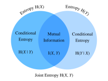

# 信息论
:label:`sec_information_theory`

宇宙中充满了信息。信息为不同学科提供了一种共同语言：从莎士比亚的十四行诗到研究人员上传到康奈尔arXiv的论文，从梵高的《星月夜》到贝多芬的《第五交响曲》，从早期编程语言Plankalkül到最先进的机器学习算法。无论采用何种形式，一切都必须遵循信息论的规律。利用信息论，可以度量并比较不同信号中包含的信息量。本节将探讨信息论的基本概念及其在机器学习中的应用。

开始之前，先概述机器学习与信息论的关系。机器学习旨在从数据中提取有意义的信号并作出关键预测；信息论则研究信息的编码、解码、传输和处理。因此，信息论为讨论机器学习系统中的信息处理提供了基础语言。例如，许多机器学习应用会使用 :numref:`sec_softmax`所述的交叉熵损失，而该损失可以直接从信息论推导出来。


## 信息

从信息论的“灵魂”——信息——说起。*信息*（information）可以通过一种或多种编码格式组成的特定序列，编码在任何事物中。如果要为信息这一概念下定义，应从哪里开始？

考虑下面的思想实验。一个朋友手中有一副扑克牌，他会洗牌、翻开一些牌，并告诉我们有关这些牌的陈述。我们尝试评估每条陈述包含的信息量。

首先，他翻开一张牌并说：“我看到了一张牌。”这完全没有提供信息，因为我们原本就确信会如此，所以希望其信息量为零。

接着，他翻开一张牌并说：“我看到了一张红桃。”这提供了一些信息，但牌只有$4$种等可能的花色，因此这个结果并不令人惊讶。无论怎样度量信息，这个事件的信息量都应该较低。

然后，他翻开一张牌并说：“这是黑桃$3$。”这提供了更多信息。一共有$52$种等可能的结果，而朋友明确告诉了我们是哪一种，因此它应当包含中等数量的信息。

把这个思想推到极端。假设最后他翻开整副牌，并依次读出洗牌后的完整顺序。一副牌有$52!$种等可能的排列，因此要知道具体是哪一种，需要大量信息。

任何信息概念都应符合上述直觉。后文将计算出，这些事件分别包含$0\textrm{ bit}$、$2\textrm{ bit}$、约$5.7\textrm{ bit}$和约$225.6\textrm{ bit}$的信息。

从这些思想实验中可以得到一个自然的想法：与其关注具体知识，不如从“信息表示惊讶程度或事件的抽象可能性”这一观点出发。例如，描述罕见事件需要大量信息，而描述常见事件所需的信息则不多。

1948年，克劳德·香农发表《通信的数学理论》 :cite:`Shannon.1948`，奠定了信息论。在这篇论文中，香农首次提出信息熵的概念。本节就从这里开始。


### 自信息

既然信息体现事件的抽象可能性，如何把这种可能性映射为比特数？香农采用最初由约翰·图基创造的术语*比特*（bit）作为信息单位。那么，比特是什么？为什么用它度量信息？早期的发报机只能发送或接收$0$和$1$两种编码；事实上，所有现代数字计算机仍普遍使用二进制编码。这样，任何信息都可以编码为一串$0$和$1$，长度为$n$的二进制数字串便包含$n$比特信息。

假设任意编码串中的每个$0$或$1$都以$\frac{1}{2}$的概率出现。那么，由长度为$n$的编码串表示的事件$X$，发生概率为$\frac{1}{2^n}$。与此同时，这个编码串包含$n$比特信息。能否推广出一个把概率$p$转换为比特数的数学函数？香农通过定义*自信息*（self-information）给出了答案：

$$I(X) = - \log_2 (p),$$

它表示从事件$X$中获得的信息比特数。注意，本节始终使用以2为底的对数。为简便起见，下文省略对数记号的下标2，即$\log(\cdot)$始终表示$\log_2(\cdot)$。例如，编码“0010”的自信息为

$$I(\textrm{"0010"}) = - \log (p(\textrm{"0010"})) = - \log \left( \frac{1}{2^4} \right) = 4 \textrm{ bits}.$$

可以按如下方式计算自信息。首先导入本节所需的全部软件包。

```{.python .input}
#@tab mxnet
from mxnet import np
from mxnet.metric import NegativeLogLikelihood
from mxnet.ndarray import nansum
import random

def self_information(p):
    return -np.log2(p)

self_information(1 / 64)
```

```{.python .input}
#@tab pytorch
import torch
from torch.nn import NLLLoss

def nansum(x):
    # 定义nansum，因为PyTorch没有内置该函数
    return x[~torch.isnan(x)].sum()

def self_information(p):
    return -torch.log2(torch.tensor(p)).item()

self_information(1 / 64)
```

```{.python .input}
#@tab tensorflow
import tensorflow as tf

def log2(x):
    return tf.math.log(x) / tf.math.log(2.)

def nansum(x):
    return tf.reduce_sum(tf.where(tf.math.is_nan(
        x), tf.zeros_like(x), x), axis=-1)

def self_information(p):
    return -log2(tf.constant(p)).numpy()

self_information(1 / 64)
```

## 熵

自信息只能度量单个离散事件的信息量，因此还需要一种更一般的度量，以适用于服从离散分布或连续分布的任意随机变量。


### 熵的由来

下面具体说明所需的性质，也就是非形式化地陈述*香农熵公理*（axioms of Shannon entropy）。可以证明，以下一组符合常识的陈述唯一确定了信息的定义。这些公理及其他公理的形式化版本可参见 :citet:`Csiszar.2008`。

1. 观测一个随机变量所获得的信息，不依赖于各元素的名称，也不受额外零概率元素的影响。
2. 观测两个随机变量所获得的信息不超过分别观测二者所得信息之和；若二者独立，则恰好等于其和。
3. 观测（几乎）必然发生的事件所获得的信息（几乎）为零。

虽然证明这一事实超出了本书范围，但重要的是，这些公理唯一确定了熵的形式。唯一的自由在于基本单位的选择；通常按前述约定进行归一化，即一次公平抛硬币所提供的信息为一比特。

### 定义

对于服从概率分布$P$的任意随机变量$X$，设其概率密度函数或概率质量函数为$p(x)$，可以用*熵*（entropy，也称*香农熵*）度量信息量的期望：

$$H(X) = - E_{x \sim P} [\log p(x)].$$
:eqlabel:`eq_ent_def`

具体而言，如果$X$是离散的，则$$H(X)=-\sum_i p_i\log p_i,\quad p_i=P(X_i).$$

如果$X$是连续的，则也将其称为*微分熵*（differential entropy）：

$$H(X) = - \int_x p(x) \log p(x) \; dx.$$

可以按如下方式定义熵。

```{.python .input}
#@tab mxnet
def entropy(p):
    entropy = - p * np.log2(p)
    # 运算符nansum对所有非nan值求和
    out = nansum(entropy.as_nd_ndarray())
    return out

entropy(np.array([0.1, 0.5, 0.1, 0.3]))
```

```{.python .input}
#@tab pytorch
def entropy(p):
    entropy = - p * torch.log2(p)
    # 运算符nansum对所有非nan值求和
    out = nansum(entropy)
    return out

entropy(torch.tensor([0.1, 0.5, 0.1, 0.3]))
```

```{.python .input}
#@tab tensorflow
def entropy(p):
    return nansum(- p * log2(p))

entropy(tf.constant([0.1, 0.5, 0.1, 0.3]))
```

### 解释

读者可能会问：在熵的定义 :eqref:`eq_ent_def`中，为什么要对负对数求期望？下面给出一些直观解释。

首先，为什么使用*对数*函数$\log$？假设$p(x)=f_1(x)f_2(x)\cdots f_n(x)$，其中各分量函数$f_i(x)$彼此独立。这意味着每个$f_i(x)$都独立地贡献$p(x)$所提供的总信息。前面提到，我们希望熵公式对独立随机变量具有可加性。恰好，$\log$能够自然地把概率分布的乘积转化为各项之和。

其次，为什么使用*负*对数？直观上，频繁发生的事件应比罕见事件包含更少的信息，因为异常情况通常比普通情况带来更多信息。然而，$\log$随概率单调递增，并且在$[0,1]$内取值非正。我们需要在事件概率与其熵之间建立单调递减关系，而且最好使熵始终非负（任何观测都不应迫使我们忘记已有知识）。因此，在$\log$前加上负号。

最后，*期望*从何而来？考虑随机变量$X$。可以把自信息$-\log(p)$解释为看到某个特定结果时的*惊讶程度*。当概率趋近于零时，惊讶程度趋于无穷。类似地，可以把熵解释为观测$X$时的平均惊讶程度。例如，假设一个老虎机系统以概率$p_1,\ldots,p_k$分别独立地产生符号$s_1,\ldots,s_k$，那么该系统的熵等于观测每个输出时自信息的平均值，即

$$H(S) = \sum_i {p_i \cdot I(s_i)} = - \sum_i {p_i \cdot \log p_i}.$$


### 熵的性质

根据上述例子和解释，可以推导出熵 :eqref:`eq_ent_def`的以下性质。这里把$X$视为事件，$P$为$X$的概率分布。

* 对所有离散$X$，都有$H(X)\geq0$（连续$X$的熵可能为负）。

* 如果$X\sim P$，其概率密度函数或概率质量函数为$p(x)$，并尝试用概率密度函数或概率质量函数为$q(x)$的新分布$Q$估计$P$，那么$$H(X)=-E_{x\sim P}[\log p(x)]\leq-E_{x\sim P}[\log q(x)],$$等号成立当且仅当$P=Q$。换言之，$H(X)$给出了编码从$P$中抽取的符号所需平均比特数的下界。

* 如果$X\sim P$，那么当概率均匀分布在所有可能结果上时，$X$传递的信息量最大。具体而言，如果$P$是具有$k$个类别$\{p_1,\ldots,p_k\}$的离散概率分布，那么$$H(X)\leq\log(k),$$等号成立当且仅当对所有$i$都有$p_i=\frac{1}{k}$。如果$P$是连续随机变量，情况会复杂得多。不过，如果进一步要求$P$的支撑集是有限区间（所有值都在$0$与$1$之间），那么$P$在该区间上为均匀分布时熵最大。


## 互信息

前面定义了单个随机变量$X$的熵，那么一对随机变量$(X,Y)$的熵又如何？这些技术试图回答这样的问题：“与分别考察$X$和$Y$相比，二者共同包含哪些信息？其中是否存在冗余信息，还是所有信息都互不相同？”

在下面的讨论中，始终用$(X,Y)$表示服从联合概率分布$P$的一对随机变量，其概率密度函数或概率质量函数为$p_{X,Y}(x,y)$；$X$和$Y$分别服从概率分布$p_X(x)$和$p_Y(y)$。


### 联合熵

类似于单个随机变量的熵 :eqref:`eq_ent_def`，一对随机变量$(X,Y)$的*联合熵*（joint entropy）$H(X,Y)$定义为

$$H(X, Y) = -E_{(x, y) \sim P} [\log p_{X, Y}(x, y)]. $$
:eqlabel:`eq_joint_ent_def`

具体来说，如果$(X,Y)$是一对离散随机变量，则

$$H(X, Y) = - \sum_{x} \sum_{y} p_{X, Y}(x, y) \log p_{X, Y}(x, y).$$

如果$(X,Y)$是一对连续随机变量，则定义*微分联合熵*（differential joint entropy）为

$$H(X, Y) = - \int_{x, y} p_{X, Y}(x, y) \ \log p_{X, Y}(x, y) \;dx \;dy.$$

可以把 :eqref:`eq_joint_ent_def`理解为一对随机变量的总随机性。考虑两个极端：如果$X=Y$，即二者是相同的随机变量，那么这对变量的信息恰好等于其中一个变量的信息，因此$H(X,Y)=H(X)=H(Y)$；如果$X$与$Y$独立，则$H(X,Y)=H(X)+H(Y)$。一般而言，一对随机变量所含的信息不少于任一变量的熵，也不超过二者熵之和。

$$
H(X), H(Y) \le H(X, Y) \le H(X) + H(Y).
$$

下面从零实现联合熵。

```{.python .input}
#@tab mxnet
def joint_entropy(p_xy):
    joint_ent = -p_xy * np.log2(p_xy)
    # 运算符nansum对所有非nan值求和
    out = nansum(joint_ent.as_nd_ndarray())
    return out

joint_entropy(np.array([[0.1, 0.5], [0.1, 0.3]]))
```

```{.python .input}
#@tab pytorch
def joint_entropy(p_xy):
    joint_ent = -p_xy * torch.log2(p_xy)
    # 运算符nansum对所有非nan值求和
    out = nansum(joint_ent)
    return out

joint_entropy(torch.tensor([[0.1, 0.5], [0.1, 0.3]]))
```

```{.python .input}
#@tab tensorflow
def joint_entropy(p_xy):
    joint_ent = -p_xy * log2(p_xy)
    # 运算符nansum对所有非nan值求和
    out = nansum(joint_ent)
    return out

joint_entropy(tf.constant([[0.1, 0.5], [0.1, 0.3]]))
```

注意，这与前面的*代码*相同，但现在有了不同解释：它处理的是两个随机变量的联合分布。


### 条件熵

上面定义的联合熵描述一对随机变量包含的信息量。它很有用，却往往不是我们真正关心的量。考虑机器学习场景：令$X$为描述图像像素值的随机变量（或随机变量向量），$Y$为类别标签。$X$应当包含大量信息，因为自然图像十分复杂；但看到图像后，$Y$中剩余的信息量应当很小。事实上，除非数字难以辨认，一幅数字图像应该已经包含它表示哪个数字的信息。因此，为继续扩展信息论词汇，需要能够讨论给定一个随机变量时另一个随机变量的信息量。

在概率论中，我们用*条件概率*衡量变量之间的关系。现在类似地定义*条件熵*（conditional entropy）$H(Y\mid X)$：

$$ H(Y \mid X) = - E_{(x, y) \sim P} [\log p(y \mid x)],$$
:eqlabel:`eq_cond_ent_def`

其中$p(y\mid x)=\frac{p_{X,Y}(x,y)}{p_X(x)}$是条件概率。具体而言，如果$(X,Y)$是一对离散随机变量，则

$$H(Y \mid X) = - \sum_{x} \sum_{y} p(x, y) \log p(y \mid x).$$

如果$(X,Y)$是一对连续随机变量，则类似地定义*微分条件熵*（differential conditional entropy）为

$$H(Y \mid X) = - \int_x \int_y p(x, y) \ \log p(y \mid x) \;dx \;dy.$$


自然要问，条件熵$H(Y\mid X)$与熵$H(X)$及联合熵$H(X,Y)$有什么关系？利用上述定义，可以简洁地表示为

$$H(Y \mid X) = H(X, Y) - H(X).$$

这有一个直观解释：给定$X$时$Y$中的信息$H(Y\mid X)$，等于$X$与$Y$共同包含的信息$H(X,Y)$减去$X$已经包含的信息。所得结果就是$Y$中未由$X$表示的信息。

下面从零实现条件熵 :eqref:`eq_cond_ent_def`。

```{.python .input}
#@tab mxnet
def conditional_entropy(p_xy, p_x):
    p_y_given_x = p_xy/p_x
    cond_ent = -p_xy * np.log2(p_y_given_x)
    # 运算符nansum对所有非nan值求和
    out = nansum(cond_ent.as_nd_ndarray())
    return out

conditional_entropy(np.array([[0.1, 0.5], [0.2, 0.3]]), np.array([0.2, 0.8]))
```

```{.python .input}
#@tab pytorch
def conditional_entropy(p_xy, p_x):
    p_y_given_x = p_xy/p_x
    cond_ent = -p_xy * torch.log2(p_y_given_x)
    # 运算符nansum对所有非nan值求和
    out = nansum(cond_ent)
    return out

conditional_entropy(torch.tensor([[0.1, 0.5], [0.2, 0.3]]),
                    torch.tensor([0.2, 0.8]))
```

```{.python .input}
#@tab tensorflow
def conditional_entropy(p_xy, p_x):
    p_y_given_x = p_xy/p_x
    cond_ent = -p_xy * log2(p_y_given_x)
    # 运算符nansum对所有非nan值求和
    out = nansum(cond_ent)
    return out

conditional_entropy(tf.constant([[0.1, 0.5], [0.2, 0.3]]),
                    tf.constant([0.2, 0.8]))
```

### 互信息

沿用前面对随机变量$(X,Y)$的设定，读者可能会问：“既然已经知道$Y$中有多少信息不包含在$X$中，能否类似地考察$X$与$Y$共享多少信息？”答案就是$(X,Y)$的*互信息*（mutual information），记为$I(X,Y)$。

先不急于给出形式化定义，而是完全利用此前构造的量，凭直觉推导互信息表达式。要寻找两个随机变量共享的信息，可以从$X$和$Y$共同包含的全部信息出发，再减去不共享的部分。二者共同包含的信息为$H(X,Y)$；还要减去$X$中不包含于$Y$的信息，以及$Y$中不包含于$X$的信息。上一小节表明，二者分别由$H(X\mid Y)$和$H(Y\mid X)$给出。因此，互信息应为

$$
I(X, Y) = H(X, Y) - H(Y \mid X) - H(X \mid Y).
$$

这确实是互信息的一个有效定义。展开各项定义并合并，经过简单的代数运算可知，它等价于

$$I(X, Y) = E_{x} E_{y} \left\{ p_{X, Y}(x, y) \log\frac{p_{X, Y}(x, y)}{p_X(x) p_Y(y)} \right\}. $$
:eqlabel:`eq_mut_ent_def`


这些关系可以总结在 :numref:`fig_mutual_information`中。思考为什么以下各式都等于$I(X,Y)$，是检验直觉的好方法。

* $H(X) - H(X \mid Y)$
* $H(Y) - H(Y \mid X)$
* $H(X) + H(Y) - H(X, Y)$


:width:`400px`
:label:`fig_mutual_information`


在许多方面，可以把互信息 :eqref:`eq_mut_ent_def`视为 :numref:`sec_random_variables`中相关系数的一种原理化推广。它不只考察变量之间的线性关系，还能度量两个随机变量以任意形式共享的最大信息量。

下面从零实现互信息。

```{.python .input}
#@tab mxnet
def mutual_information(p_xy, p_x, p_y):
    p = p_xy / (p_x * p_y)
    mutual = p_xy * np.log2(p)
    # 运算符nansum对所有非nan值求和
    out = nansum(mutual.as_nd_ndarray())
    return out

mutual_information(np.array([[0.1, 0.5], [0.1, 0.3]]),
                   np.array([0.2, 0.8]), np.array([[0.75, 0.25]]))
```

```{.python .input}
#@tab pytorch
def mutual_information(p_xy, p_x, p_y):
    p = p_xy / (p_x * p_y)
    mutual = p_xy * torch.log2(p)
    # 运算符nansum对所有非nan值求和
    out = nansum(mutual)
    return out

mutual_information(torch.tensor([[0.1, 0.5], [0.1, 0.3]]),
                   torch.tensor([0.2, 0.8]), torch.tensor([[0.75, 0.25]]))
```

```{.python .input}
#@tab tensorflow
def mutual_information(p_xy, p_x, p_y):
    p = p_xy / (p_x * p_y)
    mutual = p_xy * log2(p)
    # 运算符nansum对所有非nan值求和
    out = nansum(mutual)
    return out

mutual_information(tf.constant([[0.1, 0.5], [0.1, 0.3]]),
                   tf.constant([0.2, 0.8]), tf.constant([[0.75, 0.25]]))
```

### 互信息的性质

不必死记互信息的定义 :eqref:`eq_mut_ent_def`，只需记住以下重要性质：

* 互信息具有对称性，即$I(X,Y)=I(Y,X)$。
* 互信息非负，即$I(X,Y)\geq0$。
* 当且仅当$X$与$Y$独立时，$I(X,Y)=0$。例如，如果$X$与$Y$独立，那么知道$Y$不会提供关于$X$的任何信息，反之亦然，所以二者的互信息为零。
* 如果$X$是$Y$的可逆函数，那么$Y$与$X$共享全部信息，且$$I(X,Y)=H(Y)=H(X).$$

### 逐点互信息

在本章开头讨论熵时，可以把$-\log(p_X(x))$解释为看到特定结果时的*惊讶程度*。互信息中的对数项也有类似解释，通常称为*逐点互信息*（pointwise mutual information）：

$$\textrm{pmi}(x, y) = \log\frac{p_{X, Y}(x, y)}{p_X(x) p_Y(y)}.$$
:eqlabel:`eq_pmi_def`

可以把 :eqref:`eq_pmi_def`理解为：与两个独立随机结果的预期相比，特定结果组合$x$和$y$出现的可能性增大或减小了多少。如果该值很大且为正，这两个特定结果共同出现的频率远高于随机情形（注意，分母$p_X(x)p_Y(y)$正是二者独立时共同出现的概率）；如果该值很小且为负，则二者共同出现的频率远低于随机预期。

因此，可以把互信息 :eqref:`eq_mut_ent_def`解释为：与二者独立时的预期相比，看到两个结果共同出现所带来的平均惊讶程度。

### 互信息的应用

互信息的纯粹定义可能有些抽象，那么它与机器学习有何关系？自然语言处理中最困难的问题之一是*歧义消解*（ambiguity resolution），即从上下文中无法明确判断某个词的含义。例如，一条新闻标题写道“Amazon is on fire”，读者可能不知道它指亚马逊公司的建筑起火，还是亚马逊雨林发生火灾。

此时，互信息可以帮助消除歧义。首先找出一组与亚马逊公司互信息较大的词，如“电子商务”“技术”和“在线”；再找出另一组与亚马逊雨林互信息较大的词，如“降雨”“森林”和“热带”。需要消解“Amazon”的歧义时，可以比较这两组词中哪一组在上下文中出现得更多。假设文章随后继续描述森林，语境便明确了。


## Kullback–Leibler散度

正如 :numref:`sec_linear-algebra`所述，可以用范数度量任意维空间中两点之间的距离。我们也希望对概率分布进行类似度量。实现方式有很多，而信息论提供了一种非常优美的方法。下面讨论*Kullback–Leibler散度*（Kullback–Leibler divergence，KL散度），它可以衡量两个分布是否接近。


### 定义

给定服从概率分布$P$的随机变量$X$，其概率密度函数或概率质量函数为$p(x)$，并用另一个概率密度函数或概率质量函数为$q(x)$的概率分布$Q$估计$P$。那么，$P$与$Q$之间的Kullback–Leibler散度（也称*相对熵*（relative entropy））为

$$D_{\textrm{KL}}(P\|Q) = E_{x \sim P} \left[ \log \frac{p(x)}{q(x)} \right].$$
:eqlabel:`eq_kl_def`

与逐点互信息 :eqref:`eq_pmi_def`一样，也可以解释这里的对数项：如果$x$在$P$下出现的频率远高于在$Q$下的预期，那么$-\log\frac{q(x)}{p(x)}=-\log(q(x))-(-\log(p(x)))$会是很大的正数；如果该结果的出现频率远低于预期，它就会是绝对值很大的负数。因此，可以把它解释为：与从参考分布中观测到该结果时的惊讶程度相比，实际观测该结果的*相对*惊讶程度。

下面从零实现KL散度。

```{.python .input}
#@tab mxnet
def kl_divergence(p, q):
    kl = p * np.log2(p / q)
    out = nansum(kl.as_nd_ndarray())
    return out.abs().asscalar()
```

```{.python .input}
#@tab pytorch
def kl_divergence(p, q):
    kl = p * torch.log2(p / q)
    out = nansum(kl)
    return out.abs().item()
```

```{.python .input}
#@tab tensorflow
def kl_divergence(p, q):
    kl = p * log2(p / q)
    out = nansum(kl)
    return tf.abs(out).numpy()
```

### KL散度的性质

下面考察KL散度 :eqref:`eq_kl_def`的一些性质。

* KL散度不具有对称性，即存在$P,Q$使得$$D_{\textrm{KL}}(P\|Q)\neq D_{\textrm{KL}}(Q\|P).$$
* KL散度非负，即$$D_{\textrm{KL}}(P\|Q)\geq0.$$只有当$P=Q$时等号成立。
* 如果存在$x$使$p(x)>0$且$q(x)=0$，那么$D_{\textrm{KL}}(P\|Q)=\infty$。
* KL散度与互信息密切相关。除了 :numref:`fig_mutual_information`所示的关系外，$I(X,Y)$在数值上还等于以下各项：
    1. $D_{\textrm{KL}}(P(X, Y)  \ \| \ P(X)P(Y))$;
    1. $E_Y \{ D_{\textrm{KL}}(P(X \mid Y) \ \| \ P(X)) \}$;
    1. $E_X \{ D_{\textrm{KL}}(P(Y \mid X) \ \| \ P(Y)) \}$.

  对第一项，互信息可以解释为$P(X,Y)$与$P(X)P(Y)$之间的KL散度，因而衡量联合分布与二者独立时分布的差异。对第二项，互信息表示获知$X$的取值后，关于$Y$的不确定性平均减少了多少；第三项可以类似解释。


### 示例

下面通过一个简单例子直观地观察非对称性。

首先生成三个长度为10000的张量并排序：目标张量$p$服从正态分布$N(0,1)$，两个候选张量$q_1$和$q_2$分别服从正态分布$N(-1,1)$和$N(1,1)$。

```{.python .input}
#@tab mxnet
random.seed(1)

nd_len = 10000
p = np.random.normal(loc=0, scale=1, size=(nd_len, ))
q1 = np.random.normal(loc=-1, scale=1, size=(nd_len, ))
q2 = np.random.normal(loc=1, scale=1, size=(nd_len, ))

p = np.array(sorted(p.asnumpy()))
q1 = np.array(sorted(q1.asnumpy()))
q2 = np.array(sorted(q2.asnumpy()))
```

```{.python .input}
#@tab pytorch
torch.manual_seed(1)

tensor_len = 10000
p = torch.normal(0, 1, (tensor_len, ))
q1 = torch.normal(-1, 1, (tensor_len, ))
q2 = torch.normal(1, 1, (tensor_len, ))

p = torch.sort(p)[0]
q1 = torch.sort(q1)[0]
q2 = torch.sort(q2)[0]
```

```{.python .input}
#@tab tensorflow
tensor_len = 10000
p = tf.random.normal((tensor_len, ), 0, 1)
q1 = tf.random.normal((tensor_len, ), -1, 1)
q2 = tf.random.normal((tensor_len, ), 1, 1)

p = tf.sort(p)
q1 = tf.sort(q1)
q2 = tf.sort(q2)
```

由于$q_1$与$q_2$关于$y$轴（即$x=0$）对称，可以预期$D_{\textrm{KL}}(p\|q_1)$与$D_{\textrm{KL}}(p\|q_2)$的值相近。如下所示，二者的差异不到$3\%$。

```{.python .input}
#@tab all
kl_pq1 = kl_divergence(p, q1)
kl_pq2 = kl_divergence(p, q2)
similar_percentage = abs(kl_pq1 - kl_pq2) / ((kl_pq1 + kl_pq2) / 2) * 100

kl_pq1, kl_pq2, similar_percentage
```

相比之下，$D_{\textrm{KL}}(q_2\|p)$与$D_{\textrm{KL}}(p\|q_2)$相差很大，约为$40\%$，如下所示。

```{.python .input}
#@tab all
kl_q2p = kl_divergence(q2, p)
differ_percentage = abs(kl_q2p - kl_pq2) / ((kl_q2p + kl_pq2) / 2) * 100

kl_q2p, differ_percentage
```

## 交叉熵

下面通过一个简短例子说明信息论在深度学习中的应用。定义真实分布$P$的概率函数为$p(x)$，估计分布$Q$的概率函数为$q(x)$，本节余下内容都沿用这两个分布。

假设要根据$n$个数据样本$\{x_1,\ldots,x_n\}$解决二分类问题。分别用$1$和$0$编码正类与负类标签$y_i$，神经网络由$\theta$参数化。如果希望找到最佳$\theta$，使$\hat{y}_i=p_{\theta}(y_i\mid x_i)$，自然可以采用 :numref:`sec_maximum_likelihood`中的最大对数似然方法。具体而言，对于真实标签$y_i$和预测$\hat{y}_i=p_{\theta}(y_i\mid x_i)$，被分为正类的概率是$\pi_i=p_{\theta}(y_i=1\mid x_i)$。因此，对数似然函数为

$$
\begin{aligned}
l(\theta) &= \log L(\theta) \\
  &= \log \prod_{i=1}^n \pi_i^{y_i} (1 - \pi_i)^{1 - y_i} \\
  &= \sum_{i=1}^n y_i \log(\pi_i) + (1 - y_i) \log (1 - \pi_i). \\
\end{aligned}
$$

最大化对数似然函数$l(\theta)$等价于最小化$-l(\theta)$，从而可以找到最佳$\theta$。为把上述损失推广到任意分布，也把$-l(\theta)$称为*交叉熵损失*（cross-entropy loss）$\textrm{CE}(y,\hat{y})$，其中$y$服从真实分布$P$，$\hat{y}$服从估计分布$Q$。

以上推导完全基于最大似然视角。不过，仔细观察会发现$\log(\pi_i)$这样的项已经出现在计算中，这有力地表明还可以从信息论角度理解该表达式。


### 形式化定义

与KL散度类似，对于随机变量$X$，也可以用*交叉熵*（cross-entropy）度量估计分布$Q$与真实分布$P$之间的差异：

$$\textrm{CE}(P, Q) = - E_{x \sim P} [\log(q(x))].$$
:eqlabel:`eq_ce_def`

利用前面讨论的熵的性质，还可以把它解释为熵$H(P)$与$P$、$Q$之间KL散度之和，即

$$\textrm{CE} (P, Q) = H(P) + D_{\textrm{KL}}(P\|Q).$$


可以按如下方式实现交叉熵损失。

```{.python .input}
#@tab mxnet
def cross_entropy(y_hat, y):
    ce = -np.log(y_hat[range(len(y_hat)), y])
    return ce.mean()
```

```{.python .input}
#@tab pytorch
def cross_entropy(y_hat, y):
    ce = -torch.log(y_hat[range(len(y_hat)), y])
    return ce.mean()
```

```{.python .input}
#@tab tensorflow
def cross_entropy(y_hat, y):
    # tf.gather_nd用于选择张量中的特定索引
    ce = -tf.math.log(tf.gather_nd(y_hat, indices = [[i, j] for i, j in zip(
        range(len(y_hat)), y)]))
    return tf.reduce_mean(ce).numpy()
```

现在定义标签张量和预测张量，并计算二者的交叉熵损失。

```{.python .input}
#@tab mxnet
labels = np.array([0, 2])
preds = np.array([[0.3, 0.6, 0.1], [0.2, 0.3, 0.5]])

cross_entropy(preds, labels)
```

```{.python .input}
#@tab pytorch
labels = torch.tensor([0, 2])
preds = torch.tensor([[0.3, 0.6, 0.1], [0.2, 0.3, 0.5]])

cross_entropy(preds, labels)
```

```{.python .input}
#@tab tensorflow
labels = tf.constant([0, 2])
preds = tf.constant([[0.3, 0.6, 0.1], [0.2, 0.3, 0.5]])

cross_entropy(preds, labels)
```

### 性质

正如本节开头所暗示的，交叉熵 :eqref:`eq_ce_def`可以用来定义优化问题中的损失函数。以下目标彼此等价：

1. 最大化$Q$对分布$P$的预测概率（即$E_{x
\sim P}[\log(q(x))]$）；
1. 最小化交叉熵$\textrm{CE}(P,Q)$；
1. 最小化KL散度$D_{\textrm{KL}}(P\|Q)$。

只要真实数据的熵$H(P)$为常数，交叉熵的定义就间接证明了目标2与目标3等价。


### 作为多分类目标函数的交叉熵

深入考察采用交叉熵损失$\textrm{CE}$的分类目标函数，会发现最小化$\textrm{CE}$等价于最大化对数似然函数$L$。

首先，假设给定一个包含$n$个样本的数据集，可将样本分为$k$类。对每个数据样本$i$，使用*独热编码*（one-hot encoding）表示$k$分类标签$\mathbf{y}_i=(y_{i1},\ldots,y_{ik})$。具体而言，如果样本$i$属于类别$j$，就把第$j$个分量设为$1$，其他分量均设为$0$，即

$$ y_{ij} = \begin{cases}1 & j \in J; \\ 0 &\textrm{其他情况。}\end{cases}$$

例如，如果多分类问题包含$A$、$B$和$C$三个类别，那么标签$\mathbf{y}_i$可以编码为$\{A:(1,0,0);B:(0,1,0);C:(0,0,1)\}$。


假设神经网络由$\theta$参数化。对于真实标签向量$\mathbf{y}_i$，预测为$$\hat{\mathbf{y}}_i=p_{\theta}(\mathbf{y}_i\mid\mathbf{x}_i)=\sum_{j=1}^k y_{ij}p_{\theta}(y_{ij}\mid\mathbf{x}_i).$$

因此，交叉熵损失为

$$
\textrm{CE}(\mathbf{y}, \hat{\mathbf{y}}) = - \sum_{i=1}^n \mathbf{y}_i \log \hat{\mathbf{y}}_i
 = - \sum_{i=1}^n \sum_{j=1}^k y_{ij} \log{p_{\theta} (y_{ij}  \mid  \mathbf{x}_i)}.\\
$$

另一方面，也可以通过最大似然估计处理这个问题。先简要介绍$k$分类分布，它是伯努利分布从二分类到多分类的推广。如果随机变量$\mathbf{z}=(z_1,\ldots,z_k)$服从概率为$\mathbf{p}=(p_1,\ldots,p_k)$的$k$分类*多项分布*（multinoulli distribution），即$$p(\mathbf{z})=p(z_1,\ldots,z_k)=\textrm{Multi}(p_1,\ldots,p_k),\quad \sum_{i=1}^k p_i=1,$$那么$\mathbf{z}$的联合概率质量函数为
$$\mathbf{p}^\mathbf{z} = \prod_{j=1}^k p_{j}^{z_{j}}.$$


可以看出，每个数据样本的标签$\mathbf{y}_i$服从概率为$\boldsymbol{\pi}=(\pi_1,\ldots,\pi_k)$的$k$分类多项分布。因此，每个数据样本$\mathbf{y}_i$的联合概率质量函数为$\mathbf{\pi}^{\mathbf{y}_i}=\prod_{j=1}^k\pi_j^{y_{ij}}$。于是，对数似然函数为

$$
\begin{aligned}
l(\theta)
 = \log L(\theta)
 = \log \prod_{i=1}^n \boldsymbol{\pi}^{\mathbf{y}_i}
 = \log \prod_{i=1}^n \prod_{j=1}^k \pi_{j}^{y_{ij}}
 = \sum_{i=1}^n \sum_{j=1}^k y_{ij} \log{\pi_{j}}.\\
\end{aligned}
$$

在最大似然估计中，令$\pi_j=p_{\theta}(y_{ij}\mid\mathbf{x}_i)$来最大化目标函数$l(\theta)$。因此，对任何多分类问题，最大化上述对数似然函数$l(\theta)$都等价于最小化交叉熵损失$\textrm{CE}(y,\hat{y})$。


为了验证上述证明，下面应用内置指标`NegativeLogLikelihood`。使用与前例相同的`labels`和`preds`，所得损失值在小数点后5位与前例一致。

```{.python .input}
#@tab mxnet
nll_loss = NegativeLogLikelihood()
nll_loss.update(labels.as_nd_ndarray(), preds.as_nd_ndarray())
nll_loss.get()
```

```{.python .input}
#@tab pytorch
# PyTorch中的交叉熵损失实现结合了nn.LogSoftmax()
# 和nn.NLLLoss()
nll_loss = NLLLoss()
loss = nll_loss(torch.log(preds), labels)
loss
```

```{.python .input}
#@tab tensorflow
def nll_loss(y_hat, y):
    # 将标签转换为独热向量
    y = tf.keras.utils.to_categorical(y, num_classes= y_hat.shape[1])
    # 不直接根据定义计算负对数似然
    # 而是利用NLL与cross_entropy相同这一关系
    # 计算cross_entropy即可得到NLL
    cross_entropy = tf.keras.losses.CategoricalCrossentropy(
        from_logits = True, reduction = tf.keras.losses.Reduction.NONE)
    return tf.reduce_mean(cross_entropy(y, y_hat)).numpy()

loss = nll_loss(tf.math.log(preds), labels)
loss
```

## 小结

* 信息论研究信息的编码、解码、传输和处理。
* 熵可以度量不同信号中包含多少信息。
* KL散度可以度量两个分布之间的差异。
* 交叉熵可以作为多分类的目标函数。最小化交叉熵损失等价于最大化对数似然函数。


## 练习

1. 验证第一节扑克牌示例的熵确实等于文中所述的值。
1. 证明对所有分布$p$和$q$，KL散度$D(p\|q)$均非负。提示：使用詹森不等式，即利用$-\log x$是凸函数这一事实。
1. 计算以下几种数据源的熵：
    * 假设正在观察一只猴子敲打打字机产生的输出。猴子随机按下打字机的$44$个按键之一（可以假设它尚未发现任何特殊键或Shift键）。每个字符中能观察到多少比特的随机性？
    * 由于不满意猴子的表现，你用一个醉醺醺的排字工替代了它。他可以生成单词，尽管这些单词无法组成连贯语句；具体而言，他从包含2000个单词的词表中随机选词。假设英语单词的平均长度为$4.5$个字母，现在每个字符中能观察到多少比特的随机性？
    * 你仍然不满意，于是用高质量语言模型替换了排字工。当前语言模型可以达到低至每个单词$15$的困惑度。语言模型的字符*困惑度*（perplexity）定义为一组概率的几何平均值的倒数，其中每个概率对应单词中的一个字符。具体而言，如果给定单词的长度为$l$，则$\textrm{PPL}(\textrm{word})=\left[\prod_i p(\textrm{character}_i)\right]^{-\frac{1}{l}}=\exp\left[-\frac{1}{l}\sum_i\log p(\textrm{character}_i)\right]$。假设测试单词包含$4.5$个字母，现在每个字符中能观察到多少比特的随机性？
1. 直观解释为什么$I(X,Y)=H(X)-H(X\mid Y)$，再把等式两边都表示为关于联合分布的期望，以证明该等式。
1. 两个高斯分布$\mathcal{N}(\mu_1,\sigma_1^2)$和$\mathcal{N}(\mu_2,\sigma_2^2)$之间的KL散度是多少？

:begin_tab:`mxnet`
[讨论](https://discuss.d2l.ai/t/420)
:end_tab:

:begin_tab:`pytorch`
[讨论](https://discuss.d2l.ai/t/1104)
:end_tab:

:begin_tab:`tensorflow`
[讨论](https://discuss.d2l.ai/t/1105)
:end_tab:
