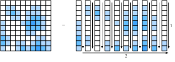

# 积分学
:label:`sec_integral_calculus`

微分只占传统微积分课程的一半内容。另一支柱——积分——起初似乎在研究一个毫不相干的问题：“这条曲线下方的面积是多少？”虽然表面上无关，积分却通过*微积分基本定理*（fundamental theorem of calculus）与微分紧密联系。

对于本书讨论的机器学习内容，并不需要深入掌握积分学。不过，本节仍会作简要介绍，为后续应用奠定基础。

## 几何解释

假设有一个函数$f(x)$。为简单起见，假设$f(x)$非负（永远不取小于零的值）。我们要理解的是：$f(x)$与$x$轴之间所围成的面积是多少？

```{.python .input}
#@tab mxnet
%matplotlib inline
from d2l import mxnet as d2l
from IPython import display
from mpl_toolkits import mplot3d
from mxnet import np, npx
npx.set_np()

x = np.arange(-2, 2, 0.01)
f = np.exp(-x**2)

d2l.set_figsize()
d2l.plt.plot(x, f, color='black')
d2l.plt.fill_between(x.tolist(), f.tolist())
d2l.plt.show()
```

```{.python .input}
#@tab pytorch
%matplotlib inline
from d2l import torch as d2l
from IPython import display
from mpl_toolkits import mplot3d
import torch

x = torch.arange(-2, 2, 0.01)
f = torch.exp(-x**2)

d2l.set_figsize()
d2l.plt.plot(x, f, color='black')
d2l.plt.fill_between(x.tolist(), f.tolist())
d2l.plt.show()
```

```{.python .input}
#@tab tensorflow
%matplotlib inline
from d2l import tensorflow as d2l
from IPython import display
from mpl_toolkits import mplot3d
import tensorflow as tf

x = tf.range(-2, 2, 0.01)
f = tf.exp(-x**2)

d2l.set_figsize()
d2l.plt.plot(x, f, color='black')
d2l.plt.fill_between(x.numpy(), f.numpy())
d2l.plt.show()
```

在大多数情况下，这个面积会是无穷大或没有定义（想想$f(x)=x^2$下方的面积），因此人们通常讨论两个端点（例如$a$与$b$）之间的面积。

```{.python .input}
#@tab mxnet
x = np.arange(-2, 2, 0.01)
f = np.exp(-x**2)

d2l.set_figsize()
d2l.plt.plot(x, f, color='black')
d2l.plt.fill_between(x.tolist()[50:250], f.tolist()[50:250])
d2l.plt.show()
```

```{.python .input}
#@tab pytorch
x = torch.arange(-2, 2, 0.01)
f = torch.exp(-x**2)

d2l.set_figsize()
d2l.plt.plot(x, f, color='black')
d2l.plt.fill_between(x.tolist()[50:250], f.tolist()[50:250])
d2l.plt.show()
```

```{.python .input}
#@tab tensorflow
x = tf.range(-2, 2, 0.01)
f = tf.exp(-x**2)

d2l.set_figsize()
d2l.plt.plot(x, f, color='black')
d2l.plt.fill_between(x.numpy()[50:250], f.numpy()[50:250])
d2l.plt.show()
```

用下面的积分符号表示该面积：

$$
\textrm{面积}(\mathcal{A}) = \int_a^b f(x) \;dx.
$$

积分号内的变量是哑变量，类似于求和符号$\sum$中的下标，因此可以任意更换而不改变含义：

$$
\int_a^b f(x) \;dx = \int_a^b f(z) \;dz.
$$

有一种理解如何近似这类积分的传统方法：把$a$与$b$之间的区域切分成$N$个竖直窄条。当$N$很大时，可以用矩形近似每个窄条的面积，再把这些面积相加，得到曲线下方的总面积。下面用代码演示。稍后将介绍如何得到真实值。

```{.python .input}
#@tab mxnet
epsilon = 0.05
a = 0
b = 2

x = np.arange(a, b, epsilon)
f = x / (1 + x**2)

approx = np.sum(epsilon*f)
true = np.log(2) / 2

d2l.set_figsize()
d2l.plt.bar(x.asnumpy(), f.asnumpy(), width=epsilon, align='edge')
d2l.plt.plot(x, f, color='black')
d2l.plt.ylim([0, 1])
d2l.plt.show()

f'近似值：{approx}，真实值：{true}'
```

```{.python .input}
#@tab pytorch
epsilon = 0.05
a = 0
b = 2

x = torch.arange(a, b, epsilon)
f = x / (1 + x**2)

approx = torch.sum(epsilon*f)
true = torch.log(torch.tensor([5.])) / 2

d2l.set_figsize()
d2l.plt.bar(x, f, width=epsilon, align='edge')
d2l.plt.plot(x, f, color='black')
d2l.plt.ylim([0, 1])
d2l.plt.show()

f'近似值：{approx}，真实值：{true}'
```

```{.python .input}
#@tab tensorflow
epsilon = 0.05
a = 0
b = 2

x = tf.range(a, b, epsilon)
f = x / (1 + x**2)

approx = tf.reduce_sum(epsilon*f)
true = tf.math.log(tf.constant([5.])) / 2

d2l.set_figsize()
d2l.plt.bar(x, f, width=epsilon, align='edge')
d2l.plt.plot(x, f, color='black')
d2l.plt.ylim([0, 1])
d2l.plt.show()

f'近似值：{approx}，真实值：{true}'
```

问题在于，虽然这种方法可以进行数值计算，但只有最简单的函数才能用它作解析计算，例如

$$
\int_a^b x \;dx.
$$

对于稍复杂的函数，例如上面代码中的

$$
\int_a^b \frac{x}{1+x^{2}} \;dx.
$$

这种直接方法就无能为力了。

因此采用另一种方法：从面积概念的直觉出发，学习计算积分的主要工具——微积分基本定理。这将成为学习积分的基础。

## 微积分基本定理

为了深入研究积分理论，引入函数

$$
F(x) = \int_0^x f(y) dy.
$$

这个函数度量从$0$到$x$的面积如何随$x$变化。注意，这已经足够，因为

$$
\int_a^b f(x) \;dx = F(b) - F(a).
$$

它用数学形式表达了这样一个事实：先计算到较远端点的面积，再减去到较近端点的面积，就能得到两端点之间的面积，如 :numref:`fig_area-subtract`所示。


:label:`fig_area-subtract`

因此，只要确定$F(x)$，就能求出任意区间上的积分。

为此，考虑一个思想实验。按照微积分中的常见做法，设想$x$发生微小变化时会怎样。根据上面的讨论，

$$
F(x+\epsilon) - F(x) = \int_x^{x+\epsilon} f(y) \; dy.
$$

这说明，函数值的变化量等于曲线下一个极窄条带的面积。

现在进行近似。观察这样一个极窄的面积条带，它接近于一个高为$f(x)$、底宽为$\epsilon$的矩形。可以证明，当$\epsilon\rightarrow0$时，这个近似会越来越准确。因此，

$$
F(x+\epsilon) - F(x) \approx \epsilon f(x).
$$

现在可以发现：这正是计算$F$的导数时所期待的形式！于是得到下面这个颇为惊人的事实：

$$
\frac{dF}{dx}(x) = f(x).
$$

这就是*微积分基本定理*。展开写为
$$\frac{d}{dx}\int_0^x  f(y) \; dy = f(x).$$
:eqlabel:`eq_ftc`

它把求面积这个原本相当困难的问题，归结为关于导数的陈述，而我们对导数的理解要充分得多。还必须指出，这并没有准确确定$F(x)$。事实上，对于任意常数$C$，$F(x)+C$都有相同的导数。这是积分理论中不可避免的现象。幸运的是，在定积分中常数会相消，因此不影响结果。

$$
\int_a^b f(x) \; dx = (F(b) + C) - (F(a) + C) = F(b) - F(a).
$$

这看起来或许很抽象，却为计算积分提供了全新的视角。我们的目标不再是通过切分再求和来恢复面积，而只需找到一个导数等于被积函数的函数。这样一来，只要反向查阅 :numref:`sec_derivative_table`中的导数表，就能列出许多原本很难计算的积分。例如，已知$x^n$的导数是$nx^{n-1}$，于是根据基本定理 :eqref:`eq_ftc`，

$$
\int_0^{x} ny^{n-1} \; dy = x^n - 0^n = x^n.
$$

类似地，已知$e^x$的导数是它自身，因此

$$
\int_0^{x} e^{x} \; dx = e^{x} - e^{0} = e^x - 1.
$$

借助微分学中的思想，可以由此发展出完整的积分理论。每条积分法则都源于这一事实。

## 变量替换
:label:`subsec_integral_example`

与微分一样，积分也有许多法则可以使计算更容易。事实上，微分学中的每条法则（如乘积法则、求和法则和链式法则）在积分学中都有对应法则（分别是分部积分、积分的线性性质和变量替换公式）。本节深入讨论其中最重要的一条：变量替换公式。

首先，假设有一个本身由积分定义的函数：

$$
F(x) = \int_0^x f(y) \; dy.
$$

假设想知道它与另一个函数复合得到$F(u(x))$后是什么形式。根据链式法则，

$$
\frac{d}{dx}F(u(x)) = \frac{dF}{du}(u(x))\cdot \frac{du}{dx}.
$$

利用基本定理 :eqref:`eq_ftc`，可以把它转化为关于积分的陈述：

$$
F(u(x)) - F(u(0)) = \int_0^x \frac{dF}{du}(u(y))\cdot \frac{du}{dy} \;dy.
$$

回顾$F$本身是一个积分，左边可以改写为

$$
\int_{u(0)}^{u(x)} f(y) \; dy = \int_0^x \frac{dF}{du}(u(y))\cdot \frac{du}{dy} \;dy.
$$

同样，因为$F$是积分，根据基本定理 :eqref:`eq_ftc`可知$\frac{dF}{dx}=f$，因此

$$\int_{u(0)}^{u(x)} f(y) \; dy = \int_0^x f(u(y))\cdot \frac{du}{dy} \;dy.$$
:eqlabel:`eq_change_var`

这就是*变量替换*（change of variables）公式。

为了得到更直观的推导，考虑$f(u(x))$在$x$到$x+\epsilon$之间的积分。当$\epsilon$很小时，该积分约为相应矩形的面积$\epsilon f(u(x))$。再与$f(y)$从$u(x)$到$u(x+\epsilon)$的积分比较。已知$u(x+\epsilon)\approx u(x)+\epsilon\frac{du}{dx}(x)$，所以后一矩形的面积约为$\epsilon\frac{du}{dx}(x)f(u(x))$。因此，为使两个矩形的面积一致，需要把前一个乘以$\frac{du}{dx}(x)$，如 :numref:`fig_rect-transform`所示。


:label:`fig_rect-transform`

由此可知

$$
\int_x^{x+\epsilon} f(u(y))\frac{du}{dy}(y)\;dy = \int_{u(x)}^{u(x+\epsilon)} f(y) \; dy.
$$

这就是针对单个小矩形表示的变量替换公式。

如果恰当地选择$u(x)$和$f(x)$，就能计算极为复杂的积分。例如，取$f(y)=1$和$u(x)=e^{-x^2}$（即$\frac{du}{dx}(x)=-2xe^{-x^2}$），可以得到

$$
e^{-1} - 1 = \int_{e^{-0}}^{e^{-1}} 1 \; dy = -2\int_0^{1} ye^{-y^2}\;dy,
$$

整理后得到

$$
\int_0^{1} ye^{-y^2}\; dy = \frac{1-e^{-1}}{2}.
$$

## 关于符号约定

细心的读者会发现，上面的计算中有些奇怪之处。例如，

$$
\int_{e^{-0}}^{e^{-1}} 1 \; dy = e^{-1} -1 < 0,
$$

会产生负数。讨论面积时出现负值似乎很奇怪，因此有必要深入了解这里的约定。

数学家采用有向面积的概念，具体体现在两个方面。首先，如果函数$f(x)$有时小于零，那么相应面积也为负。例如，

$$
\int_0^{1} (-1)\;dx = -1.
$$

类似地，从右向左而不是从左向右计算的积分也被视为负面积：

$$
\int_0^{-1} 1\; dx = -1.
$$

标准面积（从左向右对正函数积分）始终为正。将它翻转一次（例如绕$x$轴翻转得到负函数的积分，或绕$y$轴翻转得到反向积分）都会产生负面积。翻转两次则会得到两个相消的负号，面积重新为正：

$$
\int_0^{-1} (-1)\;dx =  1.
$$

如果这段讨论听起来很熟悉，那是因为 :numref:`sec_geometry-linear-algebraic-ops`曾以非常相似的方式讨论行列式如何表示有向面积。

## 多重积分

有时需要在更高维空间中工作。例如，假设有一个二元函数$f(x,y)$，想知道当$x$在$[a,b]$上、$y$在$[c,d]$上变化时，$f$下方的体积。

```{.python .input}
#@tab mxnet
# 构造网格并计算函数
x, y = np.meshgrid(np.linspace(-2, 2, 101), np.linspace(-2, 2, 101),
                   indexing='ij')
z = np.exp(- x**2 - y**2)

# 绘制函数
ax = d2l.plt.figure().add_subplot(111, projection='3d')
ax.plot_wireframe(x.asnumpy(), y.asnumpy(), z.asnumpy())
d2l.plt.xlabel('x')
d2l.plt.ylabel('y')
d2l.plt.xticks([-2, -1, 0, 1, 2])
d2l.plt.yticks([-2, -1, 0, 1, 2])
d2l.set_figsize()
ax.set_xlim(-2, 2)
ax.set_ylim(-2, 2)
ax.set_zlim(0, 1)
ax.dist = 12
```

```{.python .input}
#@tab pytorch
# 构造网格并计算函数
x, y = torch.meshgrid(torch.linspace(-2, 2, 101), torch.linspace(-2, 2, 101))
z = torch.exp(- x**2 - y**2)

# 绘制函数
ax = d2l.plt.figure().add_subplot(111, projection='3d')
ax.plot_wireframe(x, y, z)
d2l.plt.xlabel('x')
d2l.plt.ylabel('y')
d2l.plt.xticks([-2, -1, 0, 1, 2])
d2l.plt.yticks([-2, -1, 0, 1, 2])
d2l.set_figsize()
ax.set_xlim(-2, 2)
ax.set_ylim(-2, 2)
ax.set_zlim(0, 1)
ax.dist = 12
```

```{.python .input}
#@tab tensorflow
# 构造网格并计算函数
x, y = tf.meshgrid(tf.linspace(-2., 2., 101), tf.linspace(-2., 2., 101))
z = tf.exp(- x**2 - y**2)

# 绘制函数
ax = d2l.plt.figure().add_subplot(111, projection='3d')
ax.plot_wireframe(x, y, z)
d2l.plt.xlabel('x')
d2l.plt.ylabel('y')
d2l.plt.xticks([-2, -1, 0, 1, 2])
d2l.plt.yticks([-2, -1, 0, 1, 2])
d2l.set_figsize()
ax.set_xlim(-2, 2)
ax.set_ylim(-2, 2)
ax.set_zlim(0, 1)
ax.dist = 12
```

将其记为

$$
\int_{[a, b]\times[c, d]} f(x, y)\;dx\;dy.
$$

假设要计算这个积分。可以先对$x$积分，再对$y$积分，从而通过迭代计算得到结果，即

$$
\int_{[a, b]\times[c, d]} f(x, y)\;dx\;dy = \int_c^{d} \left(\int_a^{b} f(x, y) \;dx\right) \; dy.
$$

下面说明原因。

在上图中，将函数所在区域切分为$\epsilon\times\epsilon$的小正方形，并用整数坐标$i,j$作为索引。此时积分近似为

$$
\sum_{i, j} \epsilon^{2} f(\epsilon i, \epsilon j).
$$

问题离散化后，可以按任意顺序将这些正方形上的值相加，而不会改变结果，如 :numref:`fig_sum-order`所示。特别地，

$$
 \sum _ {j} \epsilon \left(\sum_{i} \epsilon f(\epsilon i, \epsilon j)\right).
$$


:label:`fig_sum-order`

内层求和恰好是下列积分的离散化：

$$
G(\epsilon j) = \int _a^{b} f(x, \epsilon j) \; dx.
$$

最后，将两个表达式结合起来可得

$$
\sum _ {j} \epsilon G(\epsilon j) \approx \int _ {c}^{d} G(y) \; dy = \int _ {[a, b]\times[c, d]} f(x, y)\;dx\;dy.
$$

综合以上结果，得到

$$
\int _ {[a, b]\times[c, d]} f(x, y)\;dx\;dy = \int _ c^{d} \left(\int _ a^{b} f(x, y) \;dx\right) \; dy.
$$

注意，离散化之后，我们所做的只是重新排列一列数字的求和顺序。这看似微不足道，但这个称为*富比尼定理*（Fubini's theorem）的结论并非总是成立。对于机器学习中通常遇到的数学对象（连续函数），无需担心这个问题；不过确实可以构造出失效的例子，例如矩形$[0,2]\times[0,1]$上的函数$f(x,y)=xy(x^2-y^2)/(x^2+y^2)^3$。

先对$x$积分再对$y$积分只是一种任意选择。同样可以先对$y$积分再对$x$积分，得到

$$
\int _ {[a, b]\times[c, d]} f(x, y)\;dx\;dy = \int _ a^{b} \left(\int _ c^{d} f(x, y) \;dy\right) \; dx.
$$

通常还会把它简写为向量记号。令$U=[a,b]\times[c,d]$，则

$$
\int _ U f(\mathbf{x})\;d\mathbf{x}.
$$

## 多重积分中的变量替换

与 :eqref:`eq_change_var`中的单变量情形一样，在高维积分中进行变量替换也是关键工具。下面直接总结结论，不作推导。

我们需要一个函数来重新参数化积分区域。可以取$\phi:\mathbb{R}^n\rightarrow\mathbb{R}^n$，也就是输入$n$个实变量并输出$n$个实变量的任意函数。为使表达式简洁，假设$\phi$是*单射*（injective），也就是说它不会折叠到自身上，即$\phi(\mathbf{x})=\phi(\mathbf{y})\implies\mathbf{x}=\mathbf{y}$。

此时有

$$
\int _ {\phi(U)} f(\mathbf{x})\;d\mathbf{x} = \int _ {U} f(\phi(\mathbf{x})) \left|\det(D\phi(\mathbf{x}))\right|\;d\mathbf{x}.
$$

其中$D\phi$是$\phi$的*雅可比矩阵*（Jacobian），即$\boldsymbol{\phi}=(\phi_1(x_1,\ldots,x_n),\ldots,\phi_n(x_1,\ldots,x_n))$的偏导数矩阵：

$$
D\boldsymbol{\phi} = \begin{bmatrix}
\frac{\partial \phi _ 1}{\partial x _ 1} & \cdots & \frac{\partial \phi _ 1}{\partial x _ n} \\
\vdots & \ddots & \vdots \\
\frac{\partial \phi _ n}{\partial x _ 1} & \cdots & \frac{\partial \phi _ n}{\partial x _ n}
\end{bmatrix}.
$$

仔细观察会发现，这与单变量变量替换公式 :eqref:`eq_change_var`相似，只是把$\frac{du}{dx}(x)$替换成了$\left|\det(D\phi(\mathbf{x}))\right|$。回顾一下，$\frac{du}{dx}(x)$表示应用$u$后$x$轴被拉伸了多少。在高维中，相应过程是确定应用$\boldsymbol{\phi}$后，一个小正方形（或小*超立方体*）的面积（或体积、超体积）被拉伸了多少。如果$\boldsymbol{\phi}$表示乘以一个矩阵，那么行列式正好给出答案。

经过一些推导可以证明，雅可比矩阵给出了多变量函数$\boldsymbol{\phi}$在某一点处的最佳矩阵近似，就像利用导数和梯度以直线或平面进行近似一样。因此，雅可比矩阵的行列式恰好对应一维情形中的缩放因子。

补全其中细节需要不少工作，如果现在还不清楚也不必担心。下面至少看一个以后会用到的例子。考虑积分

$$
\int _ {-\infty}^{\infty} \int _ {-\infty}^{\infty} e^{-x^{2}-y^{2}} \;dx\;dy.
$$

直接处理这个积分不会有什么进展，但变量替换可以大幅简化它。令$\boldsymbol{\phi}(r,\theta)=(r\cos(\theta),r\sin(\theta))$，也就是$x=r\cos(\theta)$、$y=r\sin(\theta)$。应用变量替换公式可知，原积分等于

$$
\int _ 0^\infty \int_0 ^ {2\pi} e^{-r^{2}} \left|\det(D\mathbf{\phi}(\mathbf{x}))\right|\;d\theta\;dr,
$$

其中

$$
\left|\det(D\mathbf{\phi}(\mathbf{x}))\right| = \left|\det\begin{bmatrix}
\cos(\theta) & -r\sin(\theta) \\
\sin(\theta) & r\cos(\theta)
\end{bmatrix}\right| = r(\cos^{2}(\theta) + \sin^{2}(\theta)) = r.
$$

因此，该积分为

$$
\int _ 0^\infty \int _ 0 ^ {2\pi} re^{-r^{2}} \;d\theta\;dr = 2\pi\int _ 0^\infty re^{-r^{2}} \;dr = \pi,
$$

最后一个等式使用了 :numref:`subsec_integral_example`中的同样计算。

在 :numref:`sec_random_variables`学习连续随机变量时，还会再次遇到这个积分。

## 小结

* 积分理论可以用来回答有关面积或体积的问题。
* 微积分基本定理指出，直到某一点的面积对该点求导等于被积函数在该点的值。因此，可以利用导数知识计算面积。
* 高维积分可以通过反复计算单变量积分得到。

## 练习

1. $\int_1^2 \frac{1}{x}\;dx$等于多少？
2. 使用变量替换公式计算$\int_0^{\sqrt{\pi}}x\sin(x^2)\;dx$。
3. $\int_{[0,1]^2}xy\;dx\;dy$等于多少？
4. 使用变量替换公式分别计算$\int_0^2\int_0^1xy(x^2-y^2)/(x^2+y^2)^3\;dy\;dx$和$\int_0^1\int_0^2f(x,y)=xy(x^2-y^2)/(x^2+y^2)^3\;dx\;dy$，验证二者并不相等。

:begin_tab:`mxnet`
[讨论](https://discuss.d2l.ai/t/414)
:end_tab:

:begin_tab:`pytorch`
[讨论](https://discuss.d2l.ai/t/1092)
:end_tab:


:begin_tab:`tensorflow`
[讨论](https://discuss.d2l.ai/t/1093)
:end_tab:
