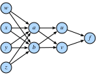
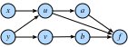

# 多变量微积分
:label:`sec_multivariable_calculus`

现在，我们已经较为深入地理解了单变量函数的导数。下面回到最初的问题：如何处理可能包含数十亿个权重的损失函数？

## 高维微分

:numref:`sec_single_variable_calculus`告诉我们，如果只改变数十亿个权重中的一个，并固定其他所有权重，就能知道会发生什么。这不过是一个单变量函数，因此可以写成

$$L(w_1+\epsilon_1, w_2, \ldots, w_N) \approx L(w_1, w_2, \ldots, w_N) + \epsilon_1 \frac{d}{dw_1} L(w_1, w_2, \ldots, w_N).$$
:eqlabel:`eq_part_der`

固定其他变量而只对一个变量求得的导数称为*偏导数*（partial derivative），并用$\frac{\partial}{\partial w_1}$表示:eqref:`eq_part_der`中的导数。

现在再把$w_2$微调为$w_2+\epsilon_2$：

$$
\begin{aligned}
L(w_1+\epsilon_1, w_2+\epsilon_2, \ldots, w_N) & \approx L(w_1, w_2+\epsilon_2, \ldots, w_N) + \epsilon_1 \frac{\partial}{\partial w_1} L(w_1, w_2+\epsilon_2, \ldots, w_N+\epsilon_N) \\
& \approx L(w_1, w_2, \ldots, w_N) \\
& \quad + \epsilon_2\frac{\partial}{\partial w_2} L(w_1, w_2, \ldots, w_N) \\
& \quad + \epsilon_1 \frac{\partial}{\partial w_1} L(w_1, w_2, \ldots, w_N) \\
& \quad + \epsilon_1\epsilon_2\frac{\partial}{\partial w_2}\frac{\partial}{\partial w_1} L(w_1, w_2, \ldots, w_N) \\
& \approx L(w_1, w_2, \ldots, w_N) \\
& \quad + \epsilon_2\frac{\partial}{\partial w_2} L(w_1, w_2, \ldots, w_N) \\
& \quad + \epsilon_1 \frac{\partial}{\partial w_1} L(w_1, w_2, \ldots, w_N).
\end{aligned}
$$

这里再次用到$\epsilon_1\epsilon_2$是高阶项这一事实，可以像上一节忽略$\epsilon^2$那样将其舍去，同时还使用了:eqref:`eq_part_der`。继续以同样方式处理，可以写出

$$
L(w_1+\epsilon_1, w_2+\epsilon_2, \ldots, w_N+\epsilon_N) \approx L(w_1, w_2, \ldots, w_N) + \sum_i \epsilon_i \frac{\partial}{\partial w_i} L(w_1, w_2, \ldots, w_N).
$$

这个表达式看起来有些杂乱，但右边的求和恰好具有点积的形式。令

$$
\boldsymbol{\epsilon} = [\epsilon_1, \ldots, \epsilon_N]^\top, \qquad
\nabla_{\mathbf{x}} L = \left[\frac{\partial L}{\partial x_1}, \ldots, \frac{\partial L}{\partial x_N}\right]^\top,
$$

then

$$L(\mathbf{w} + \boldsymbol{\epsilon}) \approx L(\mathbf{w}) + \boldsymbol{\epsilon}\cdot \nabla_{\mathbf{w}} L(\mathbf{w}).$$
:eqlabel:`eq_nabla_use`

向量$\nabla_{\mathbf{w}}L$称为$L$的*梯度*（gradient）。

公式:eqref:`eq_nabla_use`值得仔细思考。它与一维情形中的形式完全相同，只是把所有量换成了向量和点积。对于输入的任意扰动，它都能近似说明函数$L$将如何变化。下一节将看到，它为我们从几何角度理解如何利用梯度中的信息进行学习提供了重要工具。

不过，先通过一个例子观察这种近似。假设处理函数

$$
f(x, y) = \log(e^x + e^y), \qquad \nabla f (x, y) = \left[\frac{e^x}{e^x+e^y}, \frac{e^y}{e^x+e^y}\right].
$$

在点$(0,\log(2))$处，

$$
f(x, y) = \log(3), \qquad \nabla f (x, y) = \left[\frac{1}{3}, \frac{2}{3}\right].
$$

因此，如果要近似$f$在$(\epsilon_1,\log(2)+\epsilon_2)$处的值，:eqref:`eq_nabla_use`在这里具体写为

$$
f(\epsilon_1, \log(2) + \epsilon_2) \approx \log(3) + \frac{1}{3}\epsilon_1 + \frac{2}{3}\epsilon_2.
$$

可以用代码检验这个近似的效果。

```{.python .input}
#@tab mxnet
%matplotlib inline
from d2l import mxnet as d2l
from IPython import display
from mpl_toolkits import mplot3d
from mxnet import autograd, np, npx
npx.set_np()

def f(x, y):
    return np.log(np.exp(x) + np.exp(y))
def grad_f(x, y):
    return np.array([np.exp(x) / (np.exp(x) + np.exp(y)),
                     np.exp(y) / (np.exp(x) + np.exp(y))])

epsilon = np.array([0.01, -0.03])
grad_approx = f(0, np.log(2)) + epsilon.dot(grad_f(0, np.log(2)))
true_value = f(0 + epsilon[0], np.log(2) + epsilon[1])
f'近似值：{grad_approx}，真实值：{true_value}'
```

```{.python .input}
#@tab pytorch
%matplotlib inline
from d2l import torch as d2l
from IPython import display
from mpl_toolkits import mplot3d
import torch
import numpy as np

def f(x, y):
    return torch.log(torch.exp(x) + torch.exp(y))
def grad_f(x, y):
    return torch.tensor([torch.exp(x) / (torch.exp(x) + torch.exp(y)),
                     torch.exp(y) / (torch.exp(x) + torch.exp(y))])

epsilon = torch.tensor([0.01, -0.03])
grad_approx = f(torch.tensor([0.]), torch.log(
    torch.tensor([2.]))) + epsilon.dot(
    grad_f(torch.tensor([0.]), torch.log(torch.tensor(2.))))
true_value = f(torch.tensor([0.]) + epsilon[0], torch.log(
    torch.tensor([2.])) + epsilon[1])
f'近似值：{grad_approx}，真实值：{true_value}'
```

```{.python .input}
#@tab tensorflow
%matplotlib inline
from d2l import tensorflow as d2l
from IPython import display
from mpl_toolkits import mplot3d
import tensorflow as tf
import numpy as np

def f(x, y):
    return tf.math.log(tf.exp(x) + tf.exp(y))
def grad_f(x, y):
    return tf.constant([(tf.exp(x) / (tf.exp(x) + tf.exp(y))).numpy(),
                        (tf.exp(y) / (tf.exp(x) + tf.exp(y))).numpy()])

epsilon = tf.constant([0.01, -0.03])
grad_approx = f(tf.constant([0.]), tf.math.log(
    tf.constant([2.]))) + tf.tensordot(
    epsilon, grad_f(tf.constant([0.]), tf.math.log(tf.constant(2.))), axes=1)
true_value = f(tf.constant([0.]) + epsilon[0], tf.math.log(
    tf.constant([2.])) + epsilon[1])
f'近似值：{grad_approx}，真实值：{true_value}'
```

## 梯度与梯度下降的几何解释

再次考察:eqref:`eq_nabla_use`中的表达式：

$$
L(\mathbf{w} + \boldsymbol{\epsilon}) \approx L(\mathbf{w}) + \boldsymbol{\epsilon}\cdot \nabla_{\mathbf{w}} L(\mathbf{w}).
$$

假设要利用它最小化损失$L$。先从几何角度理解:numref:`sec_autograd`首次介绍的梯度下降算法。具体步骤如下：

1. 随机选择初始参数$\mathbf{w}$；
2. 找到使$L$在$\mathbf{w}$处下降最快的方向$\mathbf{v}$；
3. 沿该方向迈出一小步：$\mathbf{w}\rightarrow\mathbf{w}+\epsilon\mathbf{v}$；
4. 重复上述过程。

唯一还不知道如何完成的是第二步中向量$\mathbf{v}$的计算。这样的方向称为*最速下降方向*（direction of steepest descent）。利用:numref:`sec_geometry-linear-algebraic-ops`中对点积的几何理解，可以把:eqref:`eq_nabla_use`改写为

$$
L(\mathbf{w} + \mathbf{v}) \approx L(\mathbf{w}) + \mathbf{v}\cdot \nabla_{\mathbf{w}} L(\mathbf{w}) = L(\mathbf{w}) + \|\nabla_{\mathbf{w}} L(\mathbf{w})\|\cos(\theta).
$$

为方便起见，这里令所选方向的长度为一，并用$\theta$表示$\mathbf{v}$与$\nabla_{\mathbf{w}}L(\mathbf{w})$之间的夹角。为了找到使$L$下降最快的方向，要让这个表达式尽可能小。所选方向只通过$\cos(\theta)$进入公式，因此要让余弦尽可能小。回顾余弦函数可知，当$\cos(\theta)=-1$时取得最小值；等价地，梯度与所选方向之间的夹角为$\pi$弧度，即$180$度。实现这一点的唯一方法是沿完全相反的方向前进，也就是令$\mathbf{v}$指向$\nabla_{\mathbf{w}}L(\mathbf{w})$的反方向。

由此得到机器学习中最重要的数学概念之一：最速下降方向就是$-\nabla_{\mathbf{w}}L(\mathbf{w})$的方向。因此，上述非形式化算法可以改写如下。

1. 随机选择初始参数$\mathbf{w}$；
2. 计算$\nabla_{\mathbf{w}}L(\mathbf{w})$；
3. 沿梯度的反方向迈出一小步：$\mathbf{w}\leftarrow\mathbf{w}-\epsilon\nabla_{\mathbf{w}}L(\mathbf{w})$；
4. 重复上述过程。


许多研究人员以各种方式修改和调整了这一基本算法，但核心概念始终不变：利用梯度找到使损失下降最快的方向，并更新参数，沿该方向迈出一步。

## 关于数学优化

本书始终重点讨论数值优化技术，原因很实际：深度学习中遇到的函数都过于复杂，无法显式求出其最小值。

不过，思考上述几何理解对直接优化函数有何启示，仍是一项有益的练习。

假设要寻找使函数$L(\mathbf{x})$最小的$\mathbf{x}_0$。再假设有人给出一个值，声称它能使$L$最小。能否检查这个答案是否可能正确？

再次考察:eqref:`eq_nabla_use`：
$$
L(\mathbf{x}_0 + \boldsymbol{\epsilon}) \approx L(\mathbf{x}_0) + \boldsymbol{\epsilon}\cdot \nabla_{\mathbf{x}} L(\mathbf{x}_0).
$$

如果梯度不为零，就可以沿$-\epsilon\nabla_{\mathbf{x}}L(\mathbf{x}_0)$方向迈出一步，找到更小的$L$值。因此，如果确实位于极小值，这种情况就不可能发生。于是可知，若$\mathbf{x}_0$为极小值，则$\nabla_{\mathbf{x}}L(\mathbf{x}_0)=0$。满足$\nabla_{\mathbf{x}}L(\mathbf{x}_0)=0$的点称为*临界点*（critical point）。

这一结论很有用，因为在少数情况下，确实可以显式找出所有梯度为零的点，再从中找到函数值最小者。

来看一个具体例子，考虑函数
$$
f(x) = 3x^4 - 4x^3 -12x^2.
$$

其导数为
$$
\frac{df}{dx} = 12x^3 - 12x^2 -24x = 12x(x-2)(x+1).
$$

极小值只可能出现在$x=-1,0,2$处，对应函数值分别为$-5,0,-32$，因此函数在$x=2$处取得最小值。简单绘图即可验证这一点。

```{.python .input}
#@tab mxnet
x = np.arange(-2, 3, 0.01)
f = (3 * x**4) - (4 * x**3) - (12 * x**2)

d2l.plot(x, f, 'x', 'f(x)')
```

```{.python .input}
#@tab pytorch
x = torch.arange(-2, 3, 0.01)
f = (3 * x**4) - (4 * x**3) - (12 * x**2)

d2l.plot(x, f, 'x', 'f(x)')
```

```{.python .input}
#@tab tensorflow
x = tf.range(-2, 3, 0.01)
f = (3 * x**4) - (4 * x**3) - (12 * x**2)

d2l.plot(x, f, 'x', 'f(x)')
```

这突出了理论分析和数值计算中都应了解的重要事实：函数只可能在梯度为零的点处取得极小值（或极大值），但并非每个梯度为零的点都是真正的*全局*极小值（或极大值）。

## 多变量链式法则

假设有一个由多项复合而成的四变量函数，其变量为$w,x,y,z$：

$$\begin{aligned}f(u, v) & = (u+v)^{2} \\u(a, b) & = (a+b)^{2}, \qquad v(a, b) = (a-b)^{2}, \\a(w, x, y, z) & = (w+x+y+z)^{2}, \qquad b(w, x, y, z) = (w+x-y-z)^2.\end{aligned}$$
:eqlabel:`eq_multi_func_def`

这种方程链在神经网络中很常见，因此理解如何计算此类函数的梯度非常关键。观察哪些变量直接相关，可以从:numref:`fig_chain-1`中直观地看出这种联系。


:label:`fig_chain-1`

当然可以直接复合:eqref:`eq_multi_func_def`中的所有表达式，写出

$$
f(w, x, y, z) = \left(\left((w+x+y+z)^2+(w+x-y-z)^2\right)^2+\left((w+x+y+z)^2-(w+x-y-z)^2\right)^2\right)^2.
$$

随后可以只用单变量求导来计算导数，但这样很快就会淹没在大量项中，而且许多项会重复。例如，

$$
\begin{aligned}
\frac{\partial f}{\partial w} & = 2 \left(2 \left(2 (w + x + y + z) - 2 (w + x - y - z)\right) \left((w + x + y + z)^{2}- (w + x - y - z)^{2}\right) + \right.\\
& \left. \quad 2 \left(2 (w + x - y - z) + 2 (w + x + y + z)\right) \left((w + x - y - z)^{2}+ (w + x + y + z)^{2}\right)\right) \times \\
& \quad \left(\left((w + x + y + z)^{2}- (w + x - y - z)^2\right)^{2}+ \left((w + x - y - z)^{2}+ (w + x + y + z)^{2}\right)^{2}\right).
\end{aligned}
$$

如果还要计算$\frac{\partial f}{\partial x}$，又会得到一个含有许多重复项的类似方程，并且两个导数之间还会*共享*大量重复项。这会浪费巨量计算；如果只能用这种方式求导，深度学习革命还未开始就会停滞。


下面拆解这个问题。首先考察改变$a$时$f$如何变化，相当于暂时不考虑$w,x,y,z$。沿用首次讨论梯度时的推理，为$a$增加一个小量$\epsilon$。

$$
\begin{aligned}
& f(u(a+\epsilon, b), v(a+\epsilon, b)) \\
\approx & f\left(u(a, b) + \epsilon\frac{\partial u}{\partial a}(a, b), v(a, b) + \epsilon\frac{\partial v}{\partial a}(a, b)\right) \\
\approx & f(u(a, b), v(a, b)) + \epsilon\left[\frac{\partial f}{\partial u}(u(a, b), v(a, b))\frac{\partial u}{\partial a}(a, b) + \frac{\partial f}{\partial v}(u(a, b), v(a, b))\frac{\partial v}{\partial a}(a, b)\right].
\end{aligned}
$$

第一行来自偏导数的定义，第二行来自梯度的定义。像$\frac{\partial f}{\partial u}(u(a,b),v(a,b))$这样精确记录每个导数的求值位置，会使记号十分繁重，因此通常简写为更易记的形式

$$
\frac{\partial f}{\partial a} = \frac{\partial f}{\partial u}\frac{\partial u}{\partial a}+\frac{\partial f}{\partial v}\frac{\partial v}{\partial a}.
$$

理解这个过程的含义很有帮助。我们试图判断$a$变化时，形如$f(u(a,b),v(a,b))$的函数值如何变化。变化可以沿两条路径传递：$a\rightarrow u\rightarrow f$和$a\rightarrow v\rightarrow f$。利用链式法则分别计算两条路径的贡献，再将它们相加即可。

再设想一个不同的函数网络，其中右侧函数依赖于与之相连的左侧函数，如:numref:`fig_chain-2`所示。


:label:`fig_chain-2`

要计算$\frac{\partial f}{\partial y}$，需要对从$y$到$f$的所有路径（这里有$3$条）求和，得到

$$
\frac{\partial f}{\partial y} = \frac{\partial f}{\partial a} \frac{\partial a}{\partial u} \frac{\partial u}{\partial y} + \frac{\partial f}{\partial u} \frac{\partial u}{\partial y} + \frac{\partial f}{\partial b} \frac{\partial b}{\partial v} \frac{\partial v}{\partial y}.
$$

以这种方式理解链式法则，对于理解梯度如何流经网络大有裨益，也有助于理解LSTM（:numref:`sec_lstm`）或残差层（:numref:`sec_resnet`）等架构选择为何能通过控制梯度流来塑造学习过程。

## 反向传播算法

回到上一节:eqref:`eq_multi_func_def`中的例子：

$$
\begin{aligned}
f(u, v) & = (u+v)^{2} \\
u(a, b) & = (a+b)^{2}, \qquad v(a, b) = (a-b)^{2}, \\
a(w, x, y, z) & = (w+x+y+z)^{2}, \qquad b(w, x, y, z) = (w+x-y-z)^2.
\end{aligned}
$$

如果要计算$\frac{\partial f}{\partial w}$，可以应用多变量链式法则：

$$
\begin{aligned}
\frac{\partial f}{\partial w} & = \frac{\partial f}{\partial u}\frac{\partial u}{\partial w} + \frac{\partial f}{\partial v}\frac{\partial v}{\partial w}, \\
\frac{\partial u}{\partial w} & = \frac{\partial u}{\partial a}\frac{\partial a}{\partial w}+\frac{\partial u}{\partial b}\frac{\partial b}{\partial w}, \\
\frac{\partial v}{\partial w} & = \frac{\partial v}{\partial a}\frac{\partial a}{\partial w}+\frac{\partial v}{\partial b}\frac{\partial b}{\partial w}.
\end{aligned}
$$

尝试用这一分解计算$\frac{\partial f}{\partial w}$。注意，只需要各个单步偏导数：

$$
\begin{aligned}
\frac{\partial f}{\partial u} = 2(u+v), & \quad\frac{\partial f}{\partial v} = 2(u+v), \\
\frac{\partial u}{\partial a} = 2(a+b), & \quad\frac{\partial u}{\partial b} = 2(a+b), \\
\frac{\partial v}{\partial a} = 2(a-b), & \quad\frac{\partial v}{\partial b} = -2(a-b), \\
\frac{\partial a}{\partial w} = 2(w+x+y+z), & \quad\frac{\partial b}{\partial w} = 2(w+x-y-z).
\end{aligned}
$$

将其写成代码后，表达式相当易于处理。

```{.python .input}
#@tab all
# 从输入到输出计算函数值
w, x, y, z = -1, 0, -2, 1
a, b = (w + x + y + z)**2, (w + x - y - z)**2
u, v = (a + b)**2, (a - b)**2
f = (u + v)**2
print(f'当输入为{w}, {x}, {y}, {z}时，f为{f}')

# 计算单步偏导数
df_du, df_dv = 2*(u + v), 2*(u + v)
du_da, du_db, dv_da, dv_db = 2*(a + b), 2*(a + b), 2*(a - b), -2*(a - b)
da_dw, db_dw = 2*(w + x + y + z), 2*(w + x - y - z)

# 从输入到输出计算最终结果
du_dw, dv_dw = du_da*da_dw + du_db*db_dw, dv_da*da_dw + dv_db*db_dw
df_dw = df_du*du_dw + df_dv*dv_dw
print(f'当输入为{w}, {x}, {y}, {z}时，df/dw为{df_dw}')
```

不过，这仍然没有使$\frac{\partial f}{\partial x}$之类的量变得容易计算，原因在于应用链式法则的*方式*。上面的计算总是尽可能把$\partial w$保留在分母中，也就是考察$w$如何改变其他每个变量。如果这正是目标，那么这种方式很好。但回想深度学习中的动机：我们想知道每个参数如何改变*损失*。本质上，应当应用链式法则，并尽可能把$\partial f$保留在分子中。

更明确地说，可以写成

$$
\begin{aligned}
\frac{\partial f}{\partial w} & = \frac{\partial f}{\partial a}\frac{\partial a}{\partial w} + \frac{\partial f}{\partial b}\frac{\partial b}{\partial w}, \\
\frac{\partial f}{\partial a} & = \frac{\partial f}{\partial u}\frac{\partial u}{\partial a}+\frac{\partial f}{\partial v}\frac{\partial v}{\partial a}, \\
\frac{\partial f}{\partial b} & = \frac{\partial f}{\partial u}\frac{\partial u}{\partial b}+\frac{\partial f}{\partial v}\frac{\partial v}{\partial b}.
\end{aligned}
$$

以这种方式应用链式法则，会显式计算$\frac{\partial f}{\partial u}$、$\frac{\partial f}{\partial v}$、$\frac{\partial f}{\partial a}$、$\frac{\partial f}{\partial b}$和$\frac{\partial f}{\partial w}$。还可以加入以下等式：

$$
\begin{aligned}
\frac{\partial f}{\partial x} & = \frac{\partial f}{\partial a}\frac{\partial a}{\partial x} + \frac{\partial f}{\partial b}\frac{\partial b}{\partial x}, \\
\frac{\partial f}{\partial y} & = \frac{\partial f}{\partial a}\frac{\partial a}{\partial y}+\frac{\partial f}{\partial b}\frac{\partial b}{\partial y}, \\
\frac{\partial f}{\partial z} & = \frac{\partial f}{\partial a}\frac{\partial a}{\partial z}+\frac{\partial f}{\partial b}\frac{\partial b}{\partial z}.
\end{aligned}
$$

于是可以跟踪整个网络中*任意*节点变化时$f$如何变化。下面实现这一过程。

```{.python .input}
#@tab all
# 从输入到输出计算函数值
w, x, y, z = -1, 0, -2, 1
a, b = (w + x + y + z)**2, (w + x - y - z)**2
u, v = (a + b)**2, (a - b)**2
f = (u + v)**2
print(f'当输入为{w}, {x}, {y}, {z}时，f为{f}')

# 使用上述分解计算导数
# 首先计算单步偏导数
df_du, df_dv = 2*(u + v), 2*(u + v)
du_da, du_db, dv_da, dv_db = 2*(a + b), 2*(a + b), 2*(a - b), -2*(a - b)
da_dw, db_dw = 2*(w + x + y + z), 2*(w + x - y - z)
da_dx, db_dx = 2*(w + x + y + z), 2*(w + x - y - z)
da_dy, db_dy = 2*(w + x + y + z), -2*(w + x - y - z)
da_dz, db_dz = 2*(w + x + y + z), -2*(w + x - y - z)

# 从输出到输入，计算任意值变化时f如何变化
df_da, df_db = df_du*du_da + df_dv*dv_da, df_du*du_db + df_dv*dv_db
df_dw, df_dx = df_da*da_dw + df_db*db_dw, df_da*da_dx + df_db*db_dx
df_dy, df_dz = df_da*da_dy + df_db*db_dy, df_da*da_dz + df_db*db_dz

print(f'当输入为{w}, {x}, {y}, {z}时，df/dw为{df_dw}')
print(f'当输入为{w}, {x}, {y}, {z}时，df/dx为{df_dx}')
print(f'当输入为{w}, {x}, {y}, {z}时，df/dy为{df_dy}')
print(f'当输入为{w}, {x}, {y}, {z}时，df/dz为{df_dz}')
```

这个算法之所以称为*反向传播*（backpropagation），是因为我们从$f$向输入反向计算导数，而不是像第一段代码那样从输入向输出正向计算。整个过程有两个步骤：

1. 从前向后计算函数值和单步偏导数。虽然上面的代码没有合并，但这些计算可以放在一次*前向传播*（forward pass）中完成；
2. 从后向前计算$f$的梯度，这称为*反向传播*（backward pass）。

这正是每种深度学习算法所实现的过程，使我们能在一次传播中计算损失相对于网络中每个权重的梯度。能够进行这样的分解，是一个令人惊叹的事实。

下面通过一个例子看看如何封装这一过程。

```{.python .input}
#@tab mxnet
# 初始化为ndarray，然后附加梯度
w, x, y, z = np.array(-1), np.array(0), np.array(-2), np.array(1)

w.attach_grad()
x.attach_grad()
y.attach_grad()
z.attach_grad()

# 像往常一样计算，同时跟踪梯度
with autograd.record():
    a, b = (w + x + y + z)**2, (w + x - y - z)**2
    u, v = (a + b)**2, (a - b)**2
    f = (u + v)**2

# 执行反向传播
f.backward()

print(f'当输入为{w}, {x}, {y}, {z}时，df/dw为{w.grad}')
print(f'当输入为{w}, {x}, {y}, {z}时，df/dx为{x.grad}')
print(f'当输入为{w}, {x}, {y}, {z}时，df/dy为{y.grad}')
print(f'当输入为{w}, {x}, {y}, {z}时，df/dz为{z.grad}')
```

```{.python .input}
#@tab pytorch
# 初始化为张量，然后启用梯度
w = torch.tensor([-1.], requires_grad=True)
x = torch.tensor([0.], requires_grad=True)
y = torch.tensor([-2.], requires_grad=True)
z = torch.tensor([1.], requires_grad=True)
# 像往常一样计算，同时跟踪梯度
a, b = (w + x + y + z)**2, (w + x - y - z)**2
u, v = (a + b)**2, (a - b)**2
f = (u + v)**2

# 执行反向传播
f.backward()

print(f'当输入为{w.data.item()}, {x.data.item()}, {y.data.item()}, '
      f'{z.data.item()}时，df/dw为{w.grad.data.item()}')
print(f'当输入为{w.data.item()}, {x.data.item()}, {y.data.item()}, '
      f'{z.data.item()}时，df/dx为{x.grad.data.item()}')
print(f'当输入为{w.data.item()}, {x.data.item()}, {y.data.item()}, '
      f'{z.data.item()}时，df/dy为{y.grad.data.item()}')
print(f'当输入为{w.data.item()}, {x.data.item()}, {y.data.item()}, '
      f'{z.data.item()}时，df/dz为{z.grad.data.item()}')
```

```{.python .input}
#@tab tensorflow
# 初始化为变量
w = tf.Variable(tf.constant([-1.]))
x = tf.Variable(tf.constant([0.]))
y = tf.Variable(tf.constant([-2.]))
z = tf.Variable(tf.constant([1.]))
# 像往常一样计算，同时跟踪梯度
with tf.GradientTape(persistent=True) as t:
    a, b = (w + x + y + z)**2, (w + x - y - z)**2
    u, v = (a + b)**2, (a - b)**2
    f = (u + v)**2

# 执行反向传播
w_grad = t.gradient(f, w).numpy()
x_grad = t.gradient(f, x).numpy()
y_grad = t.gradient(f, y).numpy()
z_grad = t.gradient(f, z).numpy()

print(f'当输入为{w.numpy()}, {x.numpy()}, {y.numpy()}, '
      f'{z.numpy()}时，df/dw为{w_grad}')
print(f'当输入为{w.numpy()}, {x.numpy()}, {y.numpy()}, '
      f'{z.numpy()}时，df/dx为{x_grad}')
print(f'当输入为{w.numpy()}, {x.numpy()}, {y.numpy()}, '
      f'{z.numpy()}时，df/dy为{y_grad}')
print(f'当输入为{w.numpy()}, {x.numpy()}, {y.numpy()}, '
      f'{z.numpy()}时，df/dz为{z_grad}')
```

上述所有工作都可以通过调用`f.backward()`自动完成。


## Hessian矩阵

与单变量微积分一样，考察高阶导数有助于理解如何获得比单独使用梯度更好的函数近似。

处理多变量函数的高阶导数时，会立刻遇到一个问题：导数的数量很多。如果$f(x_1,\ldots,x_n)$是$n$变量函数，那么共有$n^2$个二阶导数。对于任意$i$和$j$，有

$$
\frac{d^2f}{dx_idx_j} = \frac{d}{dx_i}\left(\frac{d}{dx_j}f\right).
$$

通常将它们组成一个称为*Hessian矩阵*（Hessian）的矩阵：

$$\mathbf{H}_f = \begin{bmatrix} \frac{d^2f}{dx_1dx_1} & \cdots & \frac{d^2f}{dx_1dx_n} \\ \vdots & \ddots & \vdots \\ \frac{d^2f}{dx_ndx_1} & \cdots & \frac{d^2f}{dx_ndx_n} \\ \end{bmatrix}.$$
:eqlabel:`eq_hess_def`

这个矩阵的各元素并非全都相互独立。可以证明，只要两个*混合偏导数*（mixed partial，即相对于多个变量的偏导数）存在且连续，那么对于任意$i,j$，都有

$$
\frac{d^2f}{dx_idx_j} = \frac{d^2f}{dx_jdx_i}.
$$

可以这样理解：先沿$x_i$方向扰动函数，再沿$x_j$方向扰动，并把结果与先扰动$x_j$再扰动$x_i$的情况比较。由于两种顺序最终会使$f$的输出发生相同变化，所以两个混合偏导数相等。

与单变量情形一样，可以利用这些导数更准确地了解函数在某点附近的行为。特别地，可以像单变量情形那样，找出点$\mathbf{x}_0$附近拟合效果最佳的二次函数。

来看一个例子。设$f(x_1,x_2)=a+b_1x_1+b_2x_2+c_{11}x_1^2+c_{12}x_1x_2+c_{22}x_2^2$，这是二元二次函数的一般形式。在零点处考察函数值、梯度和Hessian矩阵:eqref:`eq_hess_def`：

$$
\begin{aligned}
f(0,0) & = a, \\
\nabla f (0,0) & = \begin{bmatrix}b_1 \\ b_2\end{bmatrix}, \\
\mathbf{H} f (0,0) & = \begin{bmatrix}2 c_{11} & c_{12} \\ c_{12} & 2c_{22}\end{bmatrix},
\end{aligned}
$$

可以恢复原多项式：

$$
f(\mathbf{x}) = f(0) + \nabla f (0) \cdot \mathbf{x} + \frac{1}{2}\mathbf{x}^\top \mathbf{H} f (0) \mathbf{x}.
$$

一般地，在任意点$\mathbf{x}_0$处进行这种展开，可得

$$
f(\mathbf{x}) = f(\mathbf{x}_0) + \nabla f (\mathbf{x}_0) \cdot (\mathbf{x}-\mathbf{x}_0) + \frac{1}{2}(\mathbf{x}-\mathbf{x}_0)^\top \mathbf{H} f (\mathbf{x}_0) (\mathbf{x}-\mathbf{x}_0).
$$

它适用于任意维输入，并给出任意函数在某一点处的最佳二次近似。例如，绘制函数

$$
f(x, y) = xe^{-x^2-y^2}.
$$

可以计算出其梯度和Hessian矩阵为
$$
\nabla f(x, y) = e^{-x^2-y^2}\begin{pmatrix}1-2x^2 \\ -2xy\end{pmatrix}, \qquad \mathbf{H}f(x, y) = e^{-x^2-y^2}\begin{pmatrix} 4x^3 - 6x & 4x^2y - 2y \\ 4x^2y-2y &4xy^2-2x\end{pmatrix}.
$$

经过简单代数运算可知，在$[-1,0]^\top$处的二次近似为

$$
f(x, y) \approx e^{-1}\left(-1 - (x+1) +(x+1)^2+y^2\right).
$$

```{.python .input}
#@tab mxnet
# 构造网格并计算函数
x, y = np.meshgrid(np.linspace(-2, 2, 101),
                   np.linspace(-2, 2, 101), indexing='ij')
z = x*np.exp(- x**2 - y**2)

# 用(-1, 0)处的梯度和Hessian矩阵计算二次近似
w = np.exp(-1)*(-1 - (x + 1) + (x + 1)**2 + y**2)

# 绘制函数
ax = d2l.plt.figure().add_subplot(111, projection='3d')
ax.plot_wireframe(x.asnumpy(), y.asnumpy(), z.asnumpy(),
                  **{'rstride': 10, 'cstride': 10})
ax.plot_wireframe(x.asnumpy(), y.asnumpy(), w.asnumpy(),
                  **{'rstride': 10, 'cstride': 10}, color='purple')
d2l.plt.xlabel('x')
d2l.plt.ylabel('y')
d2l.set_figsize()
ax.set_xlim(-2, 2)
ax.set_ylim(-2, 2)
ax.set_zlim(-1, 1)
ax.dist = 12
```

```{.python .input}
#@tab pytorch
# 构造网格并计算函数
x, y = torch.meshgrid(torch.linspace(-2, 2, 101),
                   torch.linspace(-2, 2, 101))

z = x*torch.exp(- x**2 - y**2)

# 用(-1, 0)处的梯度和Hessian矩阵计算二次近似
w = torch.exp(torch.tensor([-1.]))*(-1 - (x + 1) + 2 * (x + 1)**2 + 2 * y**2)

# 绘制函数
ax = d2l.plt.figure().add_subplot(111, projection='3d')
ax.plot_wireframe(x.numpy(), y.numpy(), z.numpy(),
                  **{'rstride': 10, 'cstride': 10})
ax.plot_wireframe(x.numpy(), y.numpy(), w.numpy(),
                  **{'rstride': 10, 'cstride': 10}, color='purple')
d2l.plt.xlabel('x')
d2l.plt.ylabel('y')
d2l.set_figsize()
ax.set_xlim(-2, 2)
ax.set_ylim(-2, 2)
ax.set_zlim(-1, 1)
ax.dist = 12
```

```{.python .input}
#@tab tensorflow
# 构造网格并计算函数
x, y = tf.meshgrid(tf.linspace(-2., 2., 101),
                   tf.linspace(-2., 2., 101))

z = x*tf.exp(- x**2 - y**2)

# 用(-1, 0)处的梯度和Hessian矩阵计算二次近似
w = tf.exp(tf.constant([-1.]))*(-1 - (x + 1) + 2 * (x + 1)**2 + 2 * y**2)

# 绘制函数
ax = d2l.plt.figure().add_subplot(111, projection='3d')
ax.plot_wireframe(x.numpy(), y.numpy(), z.numpy(),
                  **{'rstride': 10, 'cstride': 10})
ax.plot_wireframe(x.numpy(), y.numpy(), w.numpy(),
                  **{'rstride': 10, 'cstride': 10}, color='purple')
d2l.plt.xlabel('x')
d2l.plt.ylabel('y')
d2l.set_figsize()
ax.set_xlim(-2, 2)
ax.set_ylim(-2, 2)
ax.set_zlim(-1, 1)
ax.dist = 12
```

这构成了:numref:`sec_gd`中牛顿法的基础。该方法反复寻找最佳拟合二次函数，再精确最小化该二次函数，以完成数值优化。

## 矩阵微积分初步

涉及矩阵的函数，其导数往往具有特别简洁的形式。本节的记号较多，初次阅读时可以跳过。不过，考虑到矩阵运算在深度学习应用中的核心地位，了解常见矩阵运算所构成函数的导数通常比想象中更简洁，仍然很有帮助。

从一个例子开始。假设有固定列向量$\boldsymbol{\beta}$，考虑乘积函数$f(\mathbf{x})=\boldsymbol{\beta}^\top\mathbf{x}$，并研究$\mathbf{x}$变化时点积如何变化。

机器学习中处理矩阵导数时，一个有用的记号称为*分母布局矩阵导数*（denominator layout matrix derivative）：把偏导数组成与微分分母中的向量、矩阵或张量相同的形状。本例写为

$$
\frac{df}{d\mathbf{x}} = \begin{bmatrix}
\frac{df}{dx_1} \\
\vdots \\
\frac{df}{dx_n}
\end{bmatrix},
$$

其形状与列向量$\mathbf{x}$相同。

将函数按分量展开，得到

$$
f(\mathbf{x}) = \sum_{i = 1}^{n} \beta_ix_i = \beta_1x_1 + \cdots + \beta_nx_n.
$$

现在以对$x_1$求偏导为例。除第一项外，其他项的导数都为零，而第一项就是$\beta_1$乘以$x_1$，因此

$$
\frac{df}{dx_1} = \beta_1,
$$

更一般地，

$$
\frac{df}{dx_i} = \beta_i.
$$

重新组成矩阵可得

$$
\frac{df}{d\mathbf{x}} = \begin{bmatrix}
\frac{df}{dx_1} \\
\vdots \\
\frac{df}{dx_n}
\end{bmatrix} = \begin{bmatrix}
\beta_1 \\
\vdots \\
\beta_n
\end{bmatrix} = \boldsymbol{\beta}.
$$

这个例子说明了本节会反复遇到的矩阵微积分特点：

* 第一，计算过程可能相当复杂。
* 第二，最终结果通常比中间过程简洁得多，而且总与单变量情形相似。本例中，$\frac{d}{dx}(bx)=b$与$\frac{d}{d\mathbf{x}}(\boldsymbol{\beta}^\top\mathbf{x})=\boldsymbol{\beta}$就十分相似。
* 第三，转置有时看似凭空出现。根本原因是结果形状要与分母匹配，因此在矩阵相乘时，需要通过转置使结果回到原项的形状。

为了继续培养直觉，尝试一个稍难的计算。假设有列向量$\mathbf{x}$和方阵$A$，要计算

$$\frac{d}{d\mathbf{x}}(\mathbf{x}^\top A \mathbf{x}).$$
:eqlabel:`eq_mat_goal_1`

为了得到更易处理的记号，使用爱因斯坦记号考察这个问题。此时函数可以写为

$$
\mathbf{x}^\top A \mathbf{x} = x_ia_{ij}x_j.
$$

为计算导数，需要对每个$k$确定下式的值：

$$
\frac{d}{dx_k}(\mathbf{x}^\top A \mathbf{x}) = \frac{d}{dx_k}x_ia_{ij}x_j.
$$

根据乘积法则，

$$
\frac{d}{dx_k}x_ia_{ij}x_j = \frac{dx_i}{dx_k}a_{ij}x_j + x_ia_{ij}\frac{dx_j}{dx_k}.
$$

对于$\frac{dx_i}{dx_k}$这样的项，不难看出，当$i=k$时它为一，否则为零。这意味着求和中所有$i\ne k$的项都消失，所以第一项求和只保留$i=k$的项。第二项同理，只保留$j=k$的项。因此

$$
\frac{d}{dx_k}x_ia_{ij}x_j = a_{kj}x_j + x_ia_{ik}.
$$

爱因斯坦记号中的指标名称是任意的，此时$i$与$j$名称不同并不影响计算。因此，可以重新编号，使二者都使用$i$：

$$
\frac{d}{dx_k}x_ia_{ij}x_j = a_{ki}x_i + x_ia_{ik} = (a_{ki} + a_{ik})x_i.
$$

从这里继续需要一些练习。尝试用矩阵运算识别这个结果。$a_{ki}+a_{ik}$是$\mathbf{A}+\mathbf{A}^\top$的第$k,i$个分量，因此

$$
\frac{d}{dx_k}x_ia_{ij}x_j = [\mathbf{A} + \mathbf{A}^\top]_{ki}x_i.
$$

类似地，该项是矩阵$\mathbf{A}+\mathbf{A}^\top$与向量$\mathbf{x}$的乘积，因此

$$
\left[\frac{d}{d\mathbf{x}}(\mathbf{x}^\top A \mathbf{x})\right]_k = \frac{d}{dx_k}x_ia_{ij}x_j = [(\mathbf{A} + \mathbf{A}^\top)\mathbf{x}]_k.
$$

由此可见，:eqref:`eq_mat_goal_1`中所求导数的第$k$个分量正是右侧向量的第$k$个分量，二者相同。因此得到

$$
\frac{d}{d\mathbf{x}}(\mathbf{x}^\top A \mathbf{x}) = (\mathbf{A} + \mathbf{A}^\top)\mathbf{x}.
$$

这比上一个例子需要更多工作，但最终结果依然简洁。再考虑传统单变量导数的计算：

$$
\frac{d}{dx}(xax) = \frac{dx}{dx}ax + xa\frac{dx}{dx} = (a+a)x.
$$

等价地，$\frac{d}{dx}(ax^2)=2ax=(a+a)x$。我们再次得到一个与单变量结果十分相似、只是加入转置的表达式。

此时这种模式已经十分明显，下面解释其中原因。计算这类矩阵导数时，先假设结果仍是一个矩阵表达式，即可以用矩阵及其转置的积与和写成。如果这样的表达式存在，它就必须对所有矩阵成立，特别是对$1\times1$矩阵也成立。此时矩阵乘积就是数的乘积，矩阵之和就是数的和，而转置不起任何作用。换言之，所得表达式*必须*与单变量表达式一致。因此，经过一些练习，只要知道相应的单变量表达式是什么样，往往就能猜出矩阵导数。

下面试一试。设$\mathbf{X}$是$n\times m$矩阵，$\mathbf{U}$是$n\times r$矩阵，$\mathbf{V}$是$r\times m$矩阵。尝试计算

$$\frac{d}{d\mathbf{V}} \|\mathbf{X} - \mathbf{U}\mathbf{V}\|_2^{2} = \;?$$
:eqlabel:`eq_mat_goal_2`

这个计算在矩阵分解领域十分重要。不过，对我们来说，它只是一个待求导数。先想象所有矩阵都是$1\times1$矩阵，此时得到

$$
\frac{d}{dv} (x-uv)^{2}= -2(x-uv)u,
$$

这是一个很普通的导数。尝试将其转换回矩阵表达式，得到

$$
\frac{d}{d\mathbf{V}} \|\mathbf{X} - \mathbf{U}\mathbf{V}\|_2^{2}= -2(\mathbf{X} - \mathbf{U}\mathbf{V})\mathbf{U}.
$$

然而，这个表达式并不成立。回顾$\mathbf{X}$和$\mathbf{U}\mathbf{V}$都是$n\times m$矩阵，所以$2(\mathbf{X}-\mathbf{U}\mathbf{V})$也是$n\times m$矩阵。另一方面，$\mathbf{U}$是$n\times r$矩阵。由于维度不匹配，无法将$n\times m$矩阵与$n\times r$矩阵相乘。

所求$\frac{d}{d\mathbf{V}}$应与$\mathbf{V}$形状相同，即$r\times m$。因此，需要将一个$n\times m$矩阵与一个$n\times r$矩阵通过适当转置后相乘，得到$r\times m$矩阵。可以用$U^\top$乘以$(\mathbf{X}-\mathbf{U}\mathbf{V})$做到这一点。因此，猜测:eqref:`eq_mat_goal_2`的答案为

$$
\frac{d}{d\mathbf{V}} \|\mathbf{X} - \mathbf{U}\mathbf{V}\|_2^{2}= -2\mathbf{U}^\top(\mathbf{X} - \mathbf{U}\mathbf{V}).
$$

为了证明它成立，下面给出详细计算。如果已经相信这条经验法则，可以跳过推导。为计算

$$
\frac{d}{d\mathbf{V}} \|\mathbf{X} - \mathbf{U}\mathbf{V}\|_2^2,
$$

必须对每个$a,b$求出

$$
\frac{d}{dv_{ab}} \|\mathbf{X} - \mathbf{U}\mathbf{V}\|_2^{2}= \frac{d}{dv_{ab}} \sum_{i, j}\left(x_{ij} - \sum_k u_{ik}v_{kj}\right)^2.
$$

对于$\frac{d}{dv_{ab}}$而言，$\mathbf{X}$与$\mathbf{U}$的所有元素都是常数，因此可以把导数移入求和，并对平方项应用链式法则，得到

$$
\frac{d}{dv_{ab}} \|\mathbf{X} - \mathbf{U}\mathbf{V}\|_2^{2}= \sum_{i, j}2\left(x_{ij} - \sum_k u_{ik}v_{kj}\right)\left(-\sum_k u_{ik}\frac{dv_{kj}}{dv_{ab}} \right).
$$

与前面的推导一样，只有当$k=a$且$j=b$时，$\frac{dv_{kj}}{dv_{ab}}$才非零。只要其中一个条件不成立，求和中的相应项就为零，可以舍去。因此

$$
\frac{d}{dv_{ab}} \|\mathbf{X} - \mathbf{U}\mathbf{V}\|_2^{2}= -2\sum_{i}\left(x_{ib} - \sum_k u_{ik}v_{kb}\right)u_{ia}.
$$

这里有一个重要的细节：条件$k=a$不会作用于内层求和，因为内层的$k$是求和所用的哑变量。作为记号更简洁的例子，可以思考为什么

$$
\frac{d}{dx_1} \left(\sum_i x_i \right)^{2}= 2\left(\sum_i x_i \right).
$$

从这里开始识别求和中的各个分量。首先，

$$
\sum_k u_{ik}v_{kb} = [\mathbf{U}\mathbf{V}]_{ib}.
$$

因此，求和内部的完整表达式为

$$
x_{ib} - \sum_k u_{ik}v_{kb} = [\mathbf{X}-\mathbf{U}\mathbf{V}]_{ib}.
$$

于是可以把导数写为

$$
\frac{d}{dv_{ab}} \|\mathbf{X} - \mathbf{U}\mathbf{V}\|_2^{2}= -2\sum_{i}[\mathbf{X}-\mathbf{U}\mathbf{V}]_{ib}u_{ia}.
$$

我们希望它具有某个矩阵第$a,b$个元素的形式，从而像前例那样得到矩阵表达式。这需要交换$u_{ia}$的指标顺序。注意到$u_{ia}=[\mathbf{U}^\top]_{ai}$，可以写成

$$
\frac{d}{dv_{ab}} \|\mathbf{X} - \mathbf{U}\mathbf{V}\|_2^{2}= -2\sum_{i} [\mathbf{U}^\top]_{ai}[\mathbf{X}-\mathbf{U}\mathbf{V}]_{ib}.
$$

这是一个矩阵乘积，因此

$$
\frac{d}{dv_{ab}} \|\mathbf{X} - \mathbf{U}\mathbf{V}\|_2^{2}= -2[\mathbf{U}^\top(\mathbf{X}-\mathbf{U}\mathbf{V})]_{ab}.
$$

由此可以写出:eqref:`eq_mat_goal_2`的答案：

$$
\frac{d}{d\mathbf{V}} \|\mathbf{X} - \mathbf{U}\mathbf{V}\|_2^{2}= -2\mathbf{U}^\top(\mathbf{X} - \mathbf{U}\mathbf{V}).
$$

这与上面的猜测完全一致。

此时很自然会问：“为什么不直接写出所有已学微积分法则的矩阵版本？这显然仍是机械过程，何不一次完成？”这样的法则确实存在，:cite:`Petersen.Pedersen.ea.2008`给出了很好的总结。不过，与标量相比，矩阵运算的组合方式极为丰富，因此矩阵求导法则远多于单变量法则。很多时候，最好直接使用指标计算，或在适当情况下交给自动微分。

## 小结

* 在高维空间中，可以定义与一维导数作用相同的梯度。梯度说明输入发生任意微小变化时，多变量函数将如何变化。
* 反向传播算法可以看作组织多变量链式法则的一种方法，使大量偏导数得以高效计算。
* 矩阵微积分可以简洁地表示矩阵表达式的导数。

## 练习

1. 给定列向量$\boldsymbol{\beta}$，分别计算$f(\mathbf{x})=\boldsymbol{\beta}^\top\mathbf{x}$和$g(\mathbf{x})=\mathbf{x}^\top\boldsymbol{\beta}$的导数。为什么答案相同？
2. 设$\mathbf{v}$为$n$维向量，$\frac{\partial}{\partial\mathbf{v}}\|\mathbf{v}\|_2$是什么？
3. 设$L(x,y)=\log(e^x+e^y)$。计算其梯度。梯度各分量之和是多少？
4. 设$f(x,y)=x^2y+xy^2$。证明唯一的临界点是$(0,0)$。通过考察$f(x,x)$，判断$(0,0)$是极大值点、极小值点还是二者都不是。
5. 假设要最小化函数$f(\mathbf{x})=g(\mathbf{x})+h(\mathbf{x})$。如何根据$g$和$h$从几何角度解释条件$\nabla f=0$？


:begin_tab:`mxnet`
[讨论](https://discuss.d2l.ai/t/413)
:end_tab:

:begin_tab:`pytorch`
[讨论](https://discuss.d2l.ai/t/1090)
:end_tab:


:begin_tab:`tensorflow`
[讨论](https://discuss.d2l.ai/t/1091)
:end_tab:
