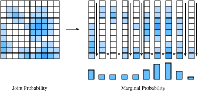

# 随机变量
:label:`sec_random_variables`

在 :numref:`sec_prob`中，我们学习了处理离散随机变量的基础知识。这里的离散随机变量是指只取有限个可能值或整数值的随机变量。本节将发展*连续随机变量*（continuous random variable）的理论，这类随机变量可以取任意实数值。

## 连续随机变量

连续随机变量比离散随机变量微妙得多。可以类比为：从离散到连续的技术跨度，大致相当于从一列数字求和跨越到对函数积分。因此，需要花些时间逐步建立相关理论。

### 从离散到连续

为了理解连续随机变量带来的额外技术困难，考虑一个思想实验。假设向飞镖盘投掷飞镖，并想知道它恰好击中距靶心$2\textrm{cm}$处的概率。

首先，设想只精确测量到一位，也就是设置$0\textrm{cm}$、$1\textrm{cm}$、$2\textrm{cm}$等区间。向飞镖盘投掷100支飞镖，如果其中20支落入$2\textrm{cm}$这一组，就得出结论：$20\%$的飞镖击中了距靶心$2\textrm{cm}$的位置。

但仔细观察会发现，这并没有回答原问题。我们要求距离精确等于$2\textrm{cm}$，而该组包含了所有落在$1.5\textrm{cm}$到$2.5\textrm{cm}$之间的飞镖。

继续提高测量精度，设置$1.9\textrm{cm}$、$2.0\textrm{cm}$、$2.1\textrm{cm}$等更细的分组。现在100支飞镖中可能有3支落入$2.0\textrm{cm}$这一组，于是得到概率$3\%$。

然而，这仍没有解决问题，只是把问题又向后一位推迟了。稍作抽象：假设已知测量值前$k$位与$2.00000\ldots$相符的概率，现在想知道前$k+1$位也相符的概率。可以合理地假设，第$k+1$位基本上是从集合$\{0,1,2,\ldots,9\}$中随机选出的。至少，我们无法想象某种有物理意义的过程，会迫使距靶心的微米数偏好以$7$而不是$3$结尾。

这意味着，精度每增加一位，相符概率基本上都会缩小到原来的$\frac{1}{10}$。换言之，可以预期

$$
P(\textrm{距离在前}\;k\;\textrm{位与}\;2.00\ldots\;\textrm{相符}) \approx p\cdot10^{-k}.
$$

$p$基本上编码了前几位的情况，而$10^{-k}$则处理其余位数。

注意，如果位置精确到小数点后$k=4$位，就意味着已知该值落在$[1.99995,2.00005]$这样的区间内，其长度为$2.00005-1.99995=10^{-4}$。将这个区间的长度记为$\epsilon$，可以写出

$$
P(\textrm{距离位于}\;2\;\textrm{附近长度为}\;\epsilon\;\textrm{的区间内}) \approx \epsilon \cdot p.
$$

最后再推广一步。此前始终考察点$2$，却没有考虑其他点。其他点在本质上没有不同，但$p$值很可能不同。至少可以期望，投掷者更容易击中靠近靶心的$2\textrm{cm}$处，而不是$20\textrm{cm}$处。因此，$p$并非常数，而应依赖于点$x$。于是可以预期

$$P(\textrm{距离位于}\;x\;\textrm{附近长度为}\;\epsilon\;\textrm{的区间内}) \approx \epsilon \cdot p(x).$$
:eqlabel:`eq_pdf_deriv`

事实上， :eqref:`eq_pdf_deriv`正确定义了*概率密度函数*（probability density function）。函数$p(x)$编码了落在一个点附近相对于另一个点附近的可能性。下面将这种函数可视化。

```{.python .input}
#@tab mxnet
%matplotlib inline
from d2l import mxnet as d2l
from IPython import display
from mxnet import np, npx
npx.set_np()

# 绘制某个随机变量的概率密度函数
x = np.arange(-5, 5, 0.01)
p = 0.2*np.exp(-(x - 3)**2 / 2)/np.sqrt(2 * np.pi) + \
    0.8*np.exp(-(x + 1)**2 / 2)/np.sqrt(2 * np.pi)

d2l.plot(x, p, 'x', '密度')
```

```{.python .input}
#@tab pytorch
%matplotlib inline
from d2l import torch as d2l
from IPython import display
import torch
torch.pi = torch.acos(torch.zeros(1)).item() * 2  # 在torch中定义pi

# 绘制某个随机变量的概率密度函数
x = torch.arange(-5, 5, 0.01)
p = 0.2*torch.exp(-(x - 3)**2 / 2)/torch.sqrt(2 * torch.tensor(torch.pi)) + \
    0.8*torch.exp(-(x + 1)**2 / 2)/torch.sqrt(2 * torch.tensor(torch.pi))

d2l.plot(x, p, 'x', '密度')
```

```{.python .input}
#@tab tensorflow
%matplotlib inline
from d2l import tensorflow as d2l
from IPython import display
import tensorflow as tf
tf.pi = tf.acos(tf.zeros(1)).numpy() * 2  # 在TensorFlow中定义pi

# 绘制某个随机变量的概率密度函数
x = tf.range(-5, 5, 0.01)
p = 0.2*tf.exp(-(x - 3)**2 / 2)/tf.sqrt(2 * tf.constant(tf.pi)) + \
    0.8*tf.exp(-(x + 1)**2 / 2)/tf.sqrt(2 * tf.constant(tf.pi))

d2l.plot(x, p, 'x', '密度')
```

函数值较大的位置表示随机值更可能出现的区域，函数值较小的位置则表示随机值不太可能出现的区域。

### 概率密度函数

下面进一步研究。我们已经直观地了解了随机变量$X$的概率密度函数：密度函数$p(x)$满足

$$P(X\;\textrm{位于}\;x\;\textrm{附近长度为}\;\epsilon\;\textrm{的区间内}) \approx \epsilon \cdot p(x).$$
:eqlabel:`eq_pdf_def`

这对$p(x)$的性质有什么要求？

首先，概率永远非负，因此$p(x)\geq0$。

其次，设想把$\mathbb{R}$切分为无穷多个宽度为$\epsilon$的区间，例如$(\epsilon i,\epsilon(i+1)]$。根据 :eqref:`eq_pdf_def`，每个区间对应的概率近似为

$$
P(X\;\textrm{位于}\;x\;\textrm{附近长度为}\;\epsilon\;\textrm{的区间内}) \approx \epsilon \cdot p(\epsilon i),
$$

因此，对所有区间求和应得到

$$
P(X\in\mathbb{R}) \approx \sum_i \epsilon \cdot p(\epsilon\cdot i).
$$

这正是 :numref:`sec_integral_calculus`中讨论的积分近似，因此

$$
P(X\in\mathbb{R}) = \int_{-\infty}^{\infty} p(x) \; dx.
$$

由于随机变量必然取*某个*数，所以$P(X\in\mathbb{R})=1$。由此可知，任何密度函数都满足

$$
\int_{-\infty}^{\infty} p(x) \; dx = 1.
$$

进一步可以证明，对于任意$a,b$，有

$$
P(X\in(a, b]) = \int _ {a}^{b} p(x) \; dx.
$$

可以使用与此前相同的离散近似方法，用代码近似该积分。这里近似计算随机变量落入蓝色区域的概率。

```{.python .input}
#@tab mxnet
# 使用数值积分近似概率
epsilon = 0.01
x = np.arange(-5, 5, 0.01)
p = 0.2*np.exp(-(x - 3)**2 / 2) / np.sqrt(2 * np.pi) + \
    0.8*np.exp(-(x + 1)**2 / 2) / np.sqrt(2 * np.pi)

d2l.set_figsize()
d2l.plt.plot(x, p, color='black')
d2l.plt.fill_between(x.tolist()[300:800], p.tolist()[300:800])
d2l.plt.show()

f'近似概率：{np.sum(epsilon*p[300:800])}'
```

```{.python .input}
#@tab pytorch
# 使用数值积分近似概率
epsilon = 0.01
x = torch.arange(-5, 5, 0.01)
p = 0.2*torch.exp(-(x - 3)**2 / 2) / torch.sqrt(2 * torch.tensor(torch.pi)) +\
    0.8*torch.exp(-(x + 1)**2 / 2) / torch.sqrt(2 * torch.tensor(torch.pi))

d2l.set_figsize()
d2l.plt.plot(x, p, color='black')
d2l.plt.fill_between(x.tolist()[300:800], p.tolist()[300:800])
d2l.plt.show()

f'近似概率：{torch.sum(epsilon*p[300:800])}'
```

```{.python .input}
#@tab tensorflow
# 使用数值积分近似概率
epsilon = 0.01
x = tf.range(-5, 5, 0.01)
p = 0.2*tf.exp(-(x - 3)**2 / 2) / tf.sqrt(2 * tf.constant(tf.pi)) +\
    0.8*tf.exp(-(x + 1)**2 / 2) / tf.sqrt(2 * tf.constant(tf.pi))

d2l.set_figsize()
d2l.plt.plot(x, p, color='black')
d2l.plt.fill_between(x.numpy().tolist()[300:800], p.numpy().tolist()[300:800])
d2l.plt.show()

f'近似概率：{tf.reduce_sum(epsilon*p[300:800])}'
```

事实证明，这两个性质恰好刻画了所有可能的概率密度函数（常缩写为p.d.f.）。它们是满足下式的非负函数$p(x)\geq0$：

$$\int_{-\infty}^{\infty} p(x) \; dx = 1.$$
:eqlabel:`eq_pdf_int_one`

通过积分得到随机变量落入特定区间的概率，以此解释该函数：

$$P(X\in(a, b]) = \int _ {a}^{b} p(x) \; dx.$$
:eqlabel:`eq_pdf_int_int`

在 :numref:`sec_distributions`中会看到许多常见分布，不过这里继续进行抽象讨论。

### 累积分布函数

上一小节介绍了概率密度函数。实践中，人们经常用它讨论连续随机变量，但它有一个容易误解之处：概率密度函数的取值本身不是概率，必须对其积分才能得到概率。只要密度大于$10$的区间长度不超过$1/10$，密度值大于$10$完全没有问题。这可能违背直觉，因此人们也常使用*累积分布函数*（cumulative distribution function，c.d.f.），它的取值本身*就是*概率。

具体而言，利用 :eqref:`eq_pdf_int_int`，将密度为$p(x)$的随机变量$X$的累积分布函数定义为

$$
F(x) = \int _ {-\infty}^{x} p(x) \; dx = P(X \le x).
$$

下面观察它的几个性质。

* 当$x\rightarrow-\infty$时，$F(x)\rightarrow0$。
* 当$x\rightarrow\infty$时，$F(x)\rightarrow1$。
* $F(x)$单调不减（$y>x\implies F(y)\geq F(x)$）。
* 如果$X$是连续随机变量，则$F(x)$连续（没有跳跃）。

对于第四条，如果$X$是离散的，该性质就不成立。例如，设$X$以相同的$1/2$概率取值$0$和$1$，此时

$$
F(x) = \begin{cases}
0 & x < 0, \\
\frac{1}{2} & x < 1, \\
1 & x \ge 1.
\end{cases}
$$

这个例子展示了使用累积分布函数的一项优点：可以在同一框架下处理连续或离散随机变量，甚至处理二者的混合（例如抛硬币：正面时返回骰子的点数，反面时返回飞镖落点与靶心的距离）。

### 均值

假设正在处理随机变量$X$。分布本身可能难以解释，因此用简洁方式概括随机变量的行为通常很有帮助。用于刻画随机变量行为的数称为*汇总统计量*（summary statistic），最常见的是*均值*、*方差*和*标准差*。

*均值*（mean）表示随机变量的平均值。如果离散随机变量$X$以概率$p_i$取值$x_i$，那么均值就是加权平均：把每个取值乘以随机变量取该值的概率，再求和：

$$\mu_X = E[X] = \sum_i x_i p_i.$$
:eqlabel:`eq_exp_def`

可以谨慎地把均值理解为随机变量通常位于何处。

考虑一个贯穿本节的简单例子：随机变量$X$以概率$p$取值$a-2$，以概率$p$取值$a+2$，以概率$1-2p$取值$a$。利用 :eqref:`eq_exp_def`可知，无论如何选择$a$和$p$，均值都是

$$
\mu_X = E[X] = \sum_i x_i p_i = (a-2)p + a(1-2p) + (a+2)p = a.
$$

因此均值为$a$，这与直觉一致，因为随机变量正是以$a$为中心。

下面总结几个有用的性质。

* 对任意随机变量$X$和数$a,b$，有$\mu_{aX+b}=a\mu_X+b$。
* 对两个随机变量$X,Y$，有$\mu_{X+Y}=\mu_X+\mu_Y$。

均值有助于理解随机变量的平均行为，但仅有均值还不足以形成完整的直观认识。每笔交易盈利$\$10\pm\$1$与盈利$\$10\pm\$15$虽然平均值相同，含义却大不相同。后一种情况波动大得多，因而风险也大得多。因此，要理解随机变量的行为，至少还需要一个度量其波动幅度的指标。

### 方差

这引出了随机变量的*方差*（variance），它定量衡量随机变量偏离均值的程度。表达式$X-\mu_X$表示随机变量与其均值的偏差。该值可能为正或为负，因此需要将它变为非负，才能度量偏差的大小。

一种合理做法是考察$\left|X-\mu_X\right|$，它确实导出了称为*平均绝对偏差*（mean absolute deviation）的有用量。不过，由于与数学和统计学其他领域的联系，人们通常采用另一种方法。

具体而言，考察$(X-\mu_X)^2$。对这个量取均值以衡量其典型大小，就得到方差：

$$\sigma_X^2 = \textrm{Var}(X) = E\left[(X-\mu_X)^2\right] = E[X^2] - \mu_X^2.$$
:eqlabel:`eq_var_def`

:eqref:`eq_var_def`中的最后一个等号，可以通过展开中间的定义并应用期望的性质得到。

回到前面的例子：$X$以概率$p$取$a-2$，以概率$p$取$a+2$，以概率$1-2p$取$a$。此时$\mu_X=a$，所以只需计算$E[X^2]$：

$$
E\left[X^2\right] = (a-2)^2p + a^2(1-2p) + (a+2)^2p = a^2 + 8p.
$$

因此，根据 :eqref:`eq_var_def`，方差为

$$
\sigma_X^2 = \textrm{Var}(X) = E[X^2] - \mu_X^2 = a^2 + 8p - a^2 = 8p.
$$

这个结果也符合直觉。$p$最大为$1/2$，对应于通过抛硬币选择$a-2$或$a+2$。此时方差为$4$，因为两个取值与均值的距离都是$2$，且$2^2=4$。在另一个极端，如果$p=0$，随机变量始终取$a$，所以方差为零。

下面列出方差的几个性质：

* 对任意随机变量$X$，$\textrm{Var}(X)\geq0$；当且仅当$X$为常数时，$\textrm{Var}(X)=0$。
* 对任意随机变量$X$和数$a,b$，有$\textrm{Var}(aX+b)=a^2\textrm{Var}(X)$。
* 对两个*独立*随机变量$X,Y$，有$\textrm{Var}(X+Y)=\textrm{Var}(X)+\textrm{Var}(Y)$。

解释这些量时会遇到一点困难。设想在整个计算中始终跟踪单位。假设研究网页上对产品给出的星级评分，那么$a$、$a-2$和$a+2$的单位都是“星”。同样，均值$\mu_X$作为加权平均，其单位也是“星”。然而，计算方差时要考察$(X-\mu_X)^2$，其单位变成了*平方星*。这意味着方差无法与原始测量值直接比较。为了便于解释，需要回到原来的单位。

### 标准差

这个汇总统计量总能通过对方差开平方得到。因此，将*标准差*（standard deviation）定义为

$$
\sigma_X = \sqrt{\textrm{Var}(X)}.
$$

在前面的例子中，标准差为$\sigma_X=2\sqrt{2p}$。如果评分示例的单位是“星”，那么$\sigma_X$的单位也重新变为“星”。

方差的性质可以重新表述为标准差的性质。

* 对任意随机变量$X$，$\sigma_X\geq0$。
* 对任意随机变量$X$和数$a,b$，有$\sigma_{aX+b}=|a|\sigma_X$。
* 对两个*独立*随机变量$X,Y$，有$\sigma_{X+Y}=\sqrt{\sigma_X^2+\sigma_Y^2}$。

此时自然会问：“既然标准差与原随机变量单位相同，它能否表示某种可以在随机变量图上画出的量？”答案是肯定的。均值告诉我们随机变量的典型位置，而标准差则给出随机变量的典型波动范围。利用*切比雪夫不等式*（Chebyshev's inequality）可以严格表述这一点：

$$P\left(X \not\in [\mu_X - \alpha\sigma_X, \mu_X + \alpha\sigma_X]\right) \le \frac{1}{\alpha^2}.$$
:eqlabel:`eq_chebyshev`

用文字表述，当$\alpha=10$时，任意随机变量都有$99\%$的样本落在均值上下$10$个标准差以内。这为这些标准汇总统计量提供了直接解释。

为了理解这个陈述的微妙之处，再看贯穿本节的例子。$X$以概率$p$取$a-2$，以概率$p$取$a+2$，以概率$1-2p$取$a$。其均值为$a$，标准差为$2\sqrt{2p}$。在切比雪夫不等式 :eqref:`eq_chebyshev`中取$\alpha=2$，得到

$$
P\left(X \not\in [a - 4\sqrt{2p}, a + 4\sqrt{2p}]\right) \le \frac{1}{4}.
$$

这意味着，无论$p$取何值，随机变量都有$75\%$的概率落入该区间。注意，当$p\rightarrow0$时，区间也收敛到单点$a$。但随机变量只取$a-2,a,a+2$，所以最终$a-2$和$a+2$必然落在区间外。问题是，这从哪个$p$开始发生？求解$a+4\sqrt{2p}=a+2$可得$p=1/8$。这*恰好*是最早可能发生且不违背“分布中落在区间外的样本不超过$1/4$”这一结论的$p$值：左侧概率为$1/8$，右侧概率也为$1/8$。

下面将其可视化。用三条高度与概率成正比的竖线表示三个取值的概率，并在中间用水平线画出区间。第一幅图展示$p>1/8$的情形，此时区间包含全部三个点。

```{.python .input}
#@tab mxnet
# 定义绘制这些图的辅助函数
def plot_chebyshev(a, p):
    d2l.set_figsize()
    d2l.plt.stem([a-2, a, a+2], [p, 1-2*p, p], use_line_collection=True)
    d2l.plt.xlim([-4, 4])
    d2l.plt.xlabel('x')
    d2l.plt.ylabel('p.m.f.')

    d2l.plt.hlines(0.5, a - 4 * np.sqrt(2 * p),
                   a + 4 * np.sqrt(2 * p), 'black', lw=4)
    d2l.plt.vlines(a - 4 * np.sqrt(2 * p), 0.53, 0.47, 'black', lw=1)
    d2l.plt.vlines(a + 4 * np.sqrt(2 * p), 0.53, 0.47, 'black', lw=1)
    d2l.plt.title(f'p = {p:.3f}')

    d2l.plt.show()

# 绘制p>1/8时的区间
plot_chebyshev(0.0, 0.2)
```

```{.python .input}
#@tab pytorch
# 定义绘制这些图的辅助函数
def plot_chebyshev(a, p):
    d2l.set_figsize()
    d2l.plt.stem([a-2, a, a+2], [p, 1-2*p, p], use_line_collection=True)
    d2l.plt.xlim([-4, 4])
    d2l.plt.xlabel('x')
    d2l.plt.ylabel('p.m.f.')

    d2l.plt.hlines(0.5, a - 4 * torch.sqrt(2 * p),
                   a + 4 * torch.sqrt(2 * p), 'black', lw=4)
    d2l.plt.vlines(a - 4 * torch.sqrt(2 * p), 0.53, 0.47, 'black', lw=1)
    d2l.plt.vlines(a + 4 * torch.sqrt(2 * p), 0.53, 0.47, 'black', lw=1)
    d2l.plt.title(f'p = {p:.3f}')

    d2l.plt.show()

# 绘制p>1/8时的区间
plot_chebyshev(0.0, torch.tensor(0.2))
```

```{.python .input}
#@tab tensorflow
# 定义绘制这些图的辅助函数
def plot_chebyshev(a, p):
    d2l.set_figsize()
    d2l.plt.stem([a-2, a, a+2], [p, 1-2*p, p], use_line_collection=True)
    d2l.plt.xlim([-4, 4])
    d2l.plt.xlabel('x')
    d2l.plt.ylabel('p.m.f.')

    d2l.plt.hlines(0.5, a - 4 * tf.sqrt(2 * p),
                   a + 4 * tf.sqrt(2 * p), 'black', lw=4)
    d2l.plt.vlines(a - 4 * tf.sqrt(2 * p), 0.53, 0.47, 'black', lw=1)
    d2l.plt.vlines(a + 4 * tf.sqrt(2 * p), 0.53, 0.47, 'black', lw=1)
    d2l.plt.title(f'p = {p:.3f}')

    d2l.plt.show()

# 绘制p>1/8时的区间
plot_chebyshev(0.0, tf.constant(0.2))
```

第二幅图展示$p=1/8$的情形，此时区间恰好接触两侧的点。这说明该不等式是*紧的*（sharp），因为再缩小区间就无法保持不等式成立。

```{.python .input}
#@tab mxnet
# 绘制p=1/8时的区间
plot_chebyshev(0.0, 0.125)
```

```{.python .input}
#@tab pytorch
# 绘制p=1/8时的区间
plot_chebyshev(0.0, torch.tensor(0.125))
```

```{.python .input}
#@tab tensorflow
# 绘制p=1/8时的区间
plot_chebyshev(0.0, tf.constant(0.125))
```

第三幅图展示$p<1/8$的情形，此时区间只包含中间点。这并不否定不等式，因为只需保证落在区间外的概率不超过$1/4$；当$p<1/8$时，可以把$a-2$和$a+2$两个点排除在区间之外。

```{.python .input}
#@tab mxnet
# 绘制p<1/8时的区间
plot_chebyshev(0.0, 0.05)
```

```{.python .input}
#@tab pytorch
# 绘制p<1/8时的区间
plot_chebyshev(0.0, torch.tensor(0.05))
```

```{.python .input}
#@tab tensorflow
# 绘制p<1/8时的区间
plot_chebyshev(0.0, tf.constant(0.05))
```

### 连续情形中的均值和方差

以上讨论都针对离散随机变量，但连续随机变量的情况与之类似。为了直观理解，设想把实数轴切分成长度为$\epsilon$的区间$(\epsilon i,\epsilon(i+1)]$。这样就把连续随机变量离散化了，并可利用 :eqref:`eq_exp_def`写出

$$
\begin{aligned}
\mu_X & \approx \sum_{i} (\epsilon i)P(X \in (\epsilon i, \epsilon (i+1)]) \\
& \approx \sum_{i} (\epsilon i)p_X(\epsilon i)\epsilon, \\
\end{aligned}
$$

其中$p_X$是$X$的密度函数。这是积分$xp_X(x)$的近似，因此

$$
\mu_X = \int_{-\infty}^\infty xp_X(x) \; dx.
$$

类似地，利用 :eqref:`eq_var_def`，方差可以写为

$$
\sigma^2_X = E[X^2] - \mu_X^2 = \int_{-\infty}^\infty x^2p_X(x) \; dx - \left(\int_{-\infty}^\infty xp_X(x) \; dx\right)^2.
$$

此前关于均值、方差和标准差的所有结论在连续情形中仍然适用。例如，考虑密度函数为

$$
p(x) = \begin{cases}
1 & x \in [0,1], \\
0 & \textrm{其他情况}.
\end{cases}
$$

可以计算出

$$
\mu_X = \int_{-\infty}^\infty xp(x) \; dx = \int_0^1 x \; dx = \frac{1}{2}.
$$

以及

$$
\sigma_X^2 = \int_{-\infty}^\infty x^2p(x) \; dx - \left(\frac{1}{2}\right)^2 = \frac{1}{3} - \frac{1}{4} = \frac{1}{12}.
$$

作为警示，再考察一个称为*柯西分布*（Cauchy distribution）的例子，其概率密度函数为

$$
p(x) = \frac{1}{1+x^2}.
$$

```{.python .input}
#@tab mxnet
# 绘制柯西分布的概率密度函数
x = np.arange(-5, 5, 0.01)
p = 1 / (1 + x**2)

d2l.plot(x, p, 'x', 'p.d.f.')
```

```{.python .input}
#@tab pytorch
# 绘制柯西分布的概率密度函数
x = torch.arange(-5, 5, 0.01)
p = 1 / (1 + x**2)

d2l.plot(x, p, 'x', 'p.d.f.')
```

```{.python .input}
#@tab tensorflow
# 绘制柯西分布的概率密度函数
x = tf.range(-5, 5, 0.01)
p = 1 / (1 + x**2)

d2l.plot(x, p, 'x', 'p.d.f.')
```

这个函数看起来毫无异常，查积分表也会发现其曲线下方面积为一，因此它确实定义了一个连续随机变量。

为了看出问题所在，尝试计算它的方差。根据 :eqref:`eq_var_def`，需要计算

$$
\int_{-\infty}^\infty \frac{x^2}{1+x^2}\; dx.
$$

被积函数如下所示：

```{.python .input}
#@tab mxnet
# 绘制计算方差所需的被积函数
x = np.arange(-20, 20, 0.01)
p = x**2 / (1 + x**2)

d2l.plot(x, p, 'x', '被积函数')
```

```{.python .input}
#@tab pytorch
# 绘制计算方差所需的被积函数
x = torch.arange(-20, 20, 0.01)
p = x**2 / (1 + x**2)

d2l.plot(x, p, 'x', '被积函数')
```

```{.python .input}
#@tab tensorflow
# 绘制计算方差所需的被积函数
x = tf.range(-20, 20, 0.01)
p = x**2 / (1 + x**2)

d2l.plot(x, p, 'x', '被积函数')
```

这个函数基本上是常数一，只在零附近略有下凹，因此其曲线下方面积显然为无穷大。事实上可以证明

$$
\int_{-\infty}^\infty \frac{x^2}{1+x^2}\; dx = \infty.
$$

这意味着该分布没有定义良好的有限方差。

进一步研究会得到更令人不安的结果。利用 :eqref:`eq_exp_def`尝试计算均值，再应用变量替换公式，可得

$$
\mu_X = \int_{-\infty}^{\infty} \frac{x}{1+x^2} \; dx = \frac{1}{2}\int_1^\infty \frac{1}{u} \; du.
$$

其中的积分正是对数的定义，本质上等于$\log(\infty)=\infty$，所以该分布也没有定义良好的均值。

机器学习研究者通常会适当定义模型，从而无需处理这些问题；绝大多数情况下，所用随机变量都有定义良好的均值和方差。不过，具有*重尾*（heavy tail）的随机变量有时有助于对物理系统建模。这类随机变量取大值的概率足够高，以至于均值或方差等量没有定义，因此值得知道它们的存在。

### 联合密度函数

以上工作都假设只处理单个实值随机变量。如果要处理两个或更多可能高度相关的随机变量，又该怎么办？这种情况在机器学习中十分常见。例如，随机变量$R_{i,j}$可以编码图像中坐标$(i,j)$处像素的红色通道值，$P_t$可以表示时刻$t$的股票价格。相邻像素往往颜色相近，相邻时刻的价格也往往相近。不能把它们当作互不相关的随机变量，却仍期待建立成功的模型（ :numref:`sec_naive_bayes`将看到一个正因这种假设而表现不佳的模型）。我们需要发展处理这些相关连续随机变量的数学语言。

幸运的是，借助 :numref:`sec_integral_calculus`中的多重积分，可以建立这样的语言。为简单起见，假设有两个可能相关的随机变量$X,Y$。与单变量情形类似，可以提出如下问题：

$$
P(X\;\textrm{位于}\;x\;\textrm{附近长度为}\;\epsilon\;\textrm{的区间内，且}\;Y\;\textrm{位于}\;y\;\textrm{附近长度为}\;\epsilon\;\textrm{的区间内}).
$$

与单变量情形类似的推理表明，这个概率应近似为

$$
P(X\;\textrm{位于}\;x\;\textrm{附近长度为}\;\epsilon\;\textrm{的区间内，且}\;Y\;\textrm{位于}\;y\;\textrm{附近长度为}\;\epsilon\;\textrm{的区间内}) \approx \epsilon^{2}p(x, y),
$$

其中$p(x,y)$是某个函数，称为$X$与$Y$的联合密度。它具有与单变量情形类似的性质：

* $p(x, y) \ge 0$;
* $\int _ {\mathbb{R}^2} p(x, y) \;dx \;dy = 1$;
* $P((X, Y) \in \mathcal{D}) = \int _ {\mathcal{D}} p(x, y) \;dx \;dy$.

这样就能处理多个可能相关的随机变量。如果要处理两个以上的随机变量，可以考虑$p(\mathbf{x})=p(x_1,\ldots,x_n)$，把多变量密度推广到任意多个坐标。其非负性和总积分为一的性质仍然成立。

### 边缘分布

处理多个变量时，常常希望忽略变量之间的关系，只问“这一个变量如何分布？”这样的分布称为*边缘分布*（marginal distribution）。

具体来说，假设两个随机变量$X,Y$的联合密度为$p_{X,Y}(x,y)$。这里用下标标明密度所对应的随机变量。求边缘分布，就是根据这个函数求出$p_X(x)$。

与许多问题一样，回到直观图景最容易看清结论。回顾密度函数$p_X$满足

$$
P(X \in [x, x+\epsilon]) \approx \epsilon \cdot p _ X(x).
$$

这里没有提到$Y$，但如果只给出了$p_{X,Y}$，就必须以某种方式把$Y$包括进来。首先注意，上式等价于

$$
P(X \in [x, x+\epsilon], Y \in \mathbb{R}) \approx \epsilon \cdot p _ X(x).
$$

联合密度不能直接给出这个概率，还需要把$y$也切分为小区间。因此可以写成

$$
\begin{aligned}
\epsilon \cdot p _ X(x) & \approx \sum _ {i} P(X \in [x, x+\epsilon], Y \in [\epsilon i, \epsilon(i+1)]) \\
& \approx \sum _ {i} \epsilon^{2} p _ {X, Y}(x, \epsilon\cdot i).
\end{aligned}
$$


:width:`400px`
:label:`fig_marginal`

这说明需要沿一列正方形把密度值相加，如 :numref:`fig_marginal`所示。消去两边的一个$\epsilon$因子，并认出右侧求和就是对$y$的积分，可得

$$
\begin{aligned}
 p _ X(x) &  \approx \sum _ {i} \epsilon p _ {X, Y}(x, \epsilon\cdot i) \\
 & \approx \int_{-\infty}^\infty p_{X, Y}(x, y) \; dy.
\end{aligned}
$$

因此

$$
p _ X(x) = \int_{-\infty}^\infty p_{X, Y}(x, y) \; dy.
$$

要得到边缘分布，需要对不关心的变量积分。这个过程通常称为将不需要的变量*积分掉*（integrating out）或*边缘化掉*（marginalizing out）。

### 协方差

处理多个随机变量时，还需要了解一个汇总统计量：*协方差*（covariance）。它衡量两个随机变量共同波动的程度。

假设有两个随机变量$X$和$Y$。先假设它们是离散的，以概率$p_{ij}$取值$(x_i,y_j)$。此时协方差定义为

$$\sigma_{XY} = \textrm{Cov}(X, Y) = \sum_{i, j} (x_i - \mu_X) (y_j-\mu_Y) p_{ij} = E[XY] - E[X]E[Y].$$
:eqlabel:`eq_cov_def`

为了直观理解，考虑下面一对随机变量。设$X$取值$1$或$3$，$Y$取值$-1$或$3$，且概率如下：

$$
\begin{aligned}
P(X = 1, Y = -1) & = \frac{p}{2}, \\
P(X = 1, Y = 3) & = \frac{1-p}{2}, \\
P(X = 3, Y = -1) & = \frac{1-p}{2}, \\
P(X = 3, Y = 3) & = \frac{p}{2},
\end{aligned}
$$

其中$p$是可在$[0,1]$中选择的参数。注意，当$p=1$时，二者总是同时取各自的最小值或最大值；当$p=0$时，二者必然取相反方向的值，即一个大时另一个小，反之亦然。当$p=1/2$时，四种可能性等概率出现，二者应当互不相关。下面计算协方差。注意$\mu_X=2$且$\mu_Y=1$，根据 :eqref:`eq_cov_def`可得

$$
\begin{aligned}
\textrm{Cov}(X, Y) & = \sum_{i, j} (x_i - \mu_X) (y_j-\mu_Y) p_{ij} \\
& = (1-2)(-1-1)\frac{p}{2} + (1-2)(3-1)\frac{1-p}{2} + (3-2)(-1-1)\frac{1-p}{2} + (3-2)(3-1)\frac{p}{2} \\
& = 4p-2.
\end{aligned}
$$

当$p=1$时（二者同时取最大值或最小值），协方差为$2$；当$p=0$时（二者反向取值），协方差为$-2$；当$p=1/2$时（二者不相关），协方差为$0$。由此可见，协方差衡量两个随机变量之间的关系。

需要注意，协方差只能度量线性关系，可能遗漏更复杂的关系。例如，令$X=Y^2$，其中$Y$从$\{-2,-1,0,1,2\}$中等概率随机取值。简单计算表明，尽管一个变量是另一个变量的确定性函数，二者的协方差仍为零。

连续随机变量的情况大致相同。现在我们已经熟悉从离散到连续的转换，因此直接给出 :eqref:`eq_cov_def`的连续形式，不再推导。

$$
\sigma_{XY} = \int_{\mathbb{R}^2} (x-\mu_X)(y-\mu_Y)p(x, y) \;dx \;dy.
$$

下面将一组协方差可调的随机变量可视化。

```{.python .input}
#@tab mxnet
# 绘制几组协方差可调的随机变量
covs = [-0.9, 0.0, 1.2]
d2l.plt.figure(figsize=(12, 3))
for i in range(3):
    X = np.random.normal(0, 1, 500)
    Y = covs[i]*X + np.random.normal(0, 1, (500))

    d2l.plt.subplot(1, 4, i+1)
    d2l.plt.scatter(X.asnumpy(), Y.asnumpy())
    d2l.plt.xlabel('X')
    d2l.plt.ylabel('Y')
    d2l.plt.title(f'cov = {covs[i]}')
d2l.plt.show()
```

```{.python .input}
#@tab pytorch
# 绘制几组协方差可调的随机变量
covs = [-0.9, 0.0, 1.2]
d2l.plt.figure(figsize=(12, 3))
for i in range(3):
    X = torch.randn(500)
    Y = covs[i]*X + torch.randn(500)

    d2l.plt.subplot(1, 4, i+1)
    d2l.plt.scatter(X.numpy(), Y.numpy())
    d2l.plt.xlabel('X')
    d2l.plt.ylabel('Y')
    d2l.plt.title(f'cov = {covs[i]}')
d2l.plt.show()
```

```{.python .input}
#@tab tensorflow
# 绘制几组协方差可调的随机变量
covs = [-0.9, 0.0, 1.2]
d2l.plt.figure(figsize=(12, 3))
for i in range(3):
    X = tf.random.normal((500, ))
    Y = covs[i]*X + tf.random.normal((500, ))

    d2l.plt.subplot(1, 4, i+1)
    d2l.plt.scatter(X.numpy(), Y.numpy())
    d2l.plt.xlabel('X')
    d2l.plt.ylabel('Y')
    d2l.plt.title(f'cov = {covs[i]}')
d2l.plt.show()
```

下面列出协方差的一些性质：

* 对任意随机变量$X$，$\textrm{Cov}(X,X)=\textrm{Var}(X)$。
* 对任意随机变量$X,Y$和数$a,b$，$\textrm{Cov}(aX+b,Y)=\textrm{Cov}(X,aY+b)=a\textrm{Cov}(X,Y)$。
* 如果$X$与$Y$独立，则$\textrm{Cov}(X,Y)=0$。

此外，可以利用协方差推广此前见过的一个关系。回顾当$X$和$Y$是两个独立随机变量时，

$$
\textrm{Var}(X+Y) = \textrm{Var}(X) + \textrm{Var}(Y).
$$

借助协方差，可以把这个关系推广到一般情形。经过一些代数运算可证明，

$$
\textrm{Var}(X+Y) = \textrm{Var}(X) + \textrm{Var}(Y) + 2\textrm{Cov}(X, Y).
$$

这就把方差求和法则推广到了相关随机变量。

### 相关系数

与讨论均值和方差时一样，现在考虑单位。如果$X$使用一种单位（如英寸），$Y$使用另一种单位（如美元），那么协方差的单位就是二者之积，即$\textrm{英寸}\times\textrm{美元}$，很难解释。此时通常需要一种无量纲的相关性度量。事实上，人们往往不关心精确的定量相关性，而是关心相关方向是否相同，以及关系有多强。

为了确定合理的度量，做一个思想实验。假设把以英寸和美元计量的随机变量，改为以英寸和美分计量。此时随机变量$Y$乘以$100$。根据定义，$\textrm{Cov}(X,Y)$也会乘以$100$。可见，单位变化使协方差扩大了$100$倍。因此，要得到不随单位变化的相关性度量，需要除以另一个也扩大$100$倍的量。标准差正是明确的候选。定义*相关系数*（correlation coefficient）为

$$\rho(X, Y) = \frac{\textrm{Cov}(X, Y)}{\sigma_{X}\sigma_{Y}},$$
:eqlabel:`eq_cor_def`

它是一个无量纲的值。简单的数学推导可以证明，该值位于$-1$到$1$之间，其中$1$表示最大正相关，$-1$表示最大负相关。

回到上面的离散示例，$\sigma_X=1$且$\sigma_Y=2$，所以利用 :eqref:`eq_cor_def`可得两个随机变量的相关系数：

$$
\rho(X, Y) = \frac{4p-2}{1\cdot 2} = 2p-1.
$$

该值位于$-1$到$1$之间，符合预期：$1$表示最大正相关，$-1$表示最大负相关。

再看一个例子。令$X$为任意随机变量，$Y=aX+b$为$X$的任意线性确定性函数。可以计算出

$$\sigma_{Y} = \sigma_{aX+b} = |a|\sigma_{X},$$

$$\textrm{Cov}(X, Y) = \textrm{Cov}(X, aX+b) = a\textrm{Cov}(X, X) = a\textrm{Var}(X),$$

再由 :eqref:`eq_cor_def`得到

$$
\rho(X, Y) = \frac{a\textrm{Var}(X)}{|a|\sigma_{X}^2} = \frac{a}{|a|} = \textrm{sign}(a).
$$

因此，对任意$a>0$，相关系数为$+1$；对任意$a<0$，相关系数为$-1$。这说明相关系数衡量两个随机变量关系的强度和方向，而不是变化的尺度。

再次绘制一组相关系数可调的随机变量。

```{.python .input}
#@tab mxnet
# 绘制几组相关系数可调的随机变量
cors = [-0.9, 0.0, 1.0]
d2l.plt.figure(figsize=(12, 3))
for i in range(3):
    X = np.random.normal(0, 1, 500)
    Y = cors[i] * X + np.sqrt(1 - cors[i]**2) * np.random.normal(0, 1, 500)

    d2l.plt.subplot(1, 4, i + 1)
    d2l.plt.scatter(X.asnumpy(), Y.asnumpy())
    d2l.plt.xlabel('X')
    d2l.plt.ylabel('Y')
    d2l.plt.title(f'cor = {cors[i]}')
d2l.plt.show()
```

```{.python .input}
#@tab pytorch
# 绘制几组相关系数可调的随机变量
cors = [-0.9, 0.0, 1.0]
d2l.plt.figure(figsize=(12, 3))
for i in range(3):
    X = torch.randn(500)
    Y = cors[i] * X + torch.sqrt(torch.tensor(1) -
                                 cors[i]**2) * torch.randn(500)

    d2l.plt.subplot(1, 4, i + 1)
    d2l.plt.scatter(X.numpy(), Y.numpy())
    d2l.plt.xlabel('X')
    d2l.plt.ylabel('Y')
    d2l.plt.title(f'cor = {cors[i]}')
d2l.plt.show()
```

```{.python .input}
#@tab tensorflow
# 绘制几组相关系数可调的随机变量
cors = [-0.9, 0.0, 1.0]
d2l.plt.figure(figsize=(12, 3))
for i in range(3):
    X = tf.random.normal((500, ))
    Y = cors[i] * X + tf.sqrt(tf.constant(1.) -
                                 cors[i]**2) * tf.random.normal((500, ))

    d2l.plt.subplot(1, 4, i + 1)
    d2l.plt.scatter(X.numpy(), Y.numpy())
    d2l.plt.xlabel('X')
    d2l.plt.ylabel('Y')
    d2l.plt.title(f'cor = {cors[i]}')
d2l.plt.show()
```

下面列出相关系数的几个性质。

* 对任意随机变量$X$，$\rho(X,X)=1$。
* 对任意随机变量$X,Y$和数$a,b$，$\rho(aX+b,Y)=\rho(X,aY+b)=\rho(X,Y)$。
* 如果$X$与$Y$独立且方差非零，则$\rho(X,Y)=0$。

最后，读者可能觉得其中一些公式很熟悉。事实上，假设$\mu_X=\mu_Y=0$并展开所有项，可以得到

$$
\rho(X, Y) = \frac{\sum_{i, j} x_iy_ip_{ij}}{\sqrt{\sum_{i, j}x_i^2 p_{ij}}\sqrt{\sum_{i, j}y_j^2 p_{ij}}}.
$$

它具有“乘积之和除以两个平方和的平方根”这一形式。这恰好是两个向量$\mathbf{v},\mathbf{w}$夹角余弦的公式，只是不同坐标由$p_{ij}$加权：

$$
\cos(\theta) = \frac{\mathbf{v}\cdot \mathbf{w}}{\|\mathbf{v}\|\|\mathbf{w}\|} = \frac{\sum_{i} v_iw_i}{\sqrt{\sum_{i}v_i^2}\sqrt{\sum_{i}w_i^2}}.
$$

如果把范数看作与标准差相关，把相关系数看作夹角的余弦，那么许多几何直觉都可以用于理解随机变量。

## 小结

* 连续随机变量可以取连续范围内的值。与离散随机变量相比，它们存在一些额外的技术困难，处理起来更具挑战性。
* 概率密度函数使我们能够处理连续随机变量：函数曲线在某个区间下方的面积，就是样本点落入该区间的概率。
* 累积分布函数给出随机变量小于某个阈值的概率。它提供了一个统一离散变量与连续变量的有用视角。
* 均值是随机变量的平均值。
* 方差是随机变量与其均值之差的平方的期望。
* 标准差是方差的平方根，可以理解为衡量随机变量可能取值的波动范围。
* 切比雪夫不等式给出一个在大多数情况下包含随机变量的明确区间，从而严格表达上述直觉。
* 联合密度使我们能够处理相关随机变量。对不需要的随机变量积分，可以将联合密度边缘化，得到所需随机变量的分布。
* 协方差和相关系数可以度量两个相关随机变量之间的线性关系。

## 练习

1. 假设随机变量在$x\geq1$时的密度为$p(x)=\frac{1}{x^2}$，其他情况下$p(x)=0$。$P(X>2)$是多少？
2. 拉普拉斯分布的密度为$p(x)=\frac{1}{2}e^{-|x|}$。该分布的均值和标准差是多少？提示：$\int_0^\infty xe^{-x}\;dx=1$且$\int_0^\infty x^2e^{-x}\;dx=2$。
3. 有人对你说：“我有一个均值为$1$、标准差为$2$的随机变量，并观察到$25\%$的样本取值大于$9$。”你相信吗？为什么？
4. 假设两个随机变量$X,Y$在$x,y\in[0,1]$时的联合密度为$p_{XY}(x,y)=4xy$，其他情况下$p_{XY}(x,y)=0$。$X$与$Y$的协方差是多少？


:begin_tab:`mxnet`
[讨论](https://discuss.d2l.ai/t/415)
:end_tab:

:begin_tab:`pytorch`
[讨论](https://discuss.d2l.ai/t/1094)
:end_tab:


:begin_tab:`tensorflow`
[讨论](https://discuss.d2l.ai/t/1095)
:end_tab:
