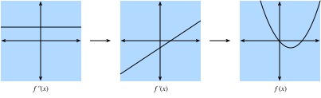
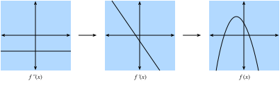
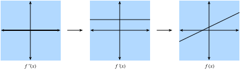

# 单变量微积分
:label:`sec_single_variable_calculus`

在:numref:`sec_calculus`中，我们学习了微分学的基本要素。本节将进一步探讨微积分的基础，以及如何在机器学习的背景下理解和应用它。

## 微分学

微分学从根本上研究函数在发生微小变化时的行为。为了理解它为何是深度学习的核心基础之一，下面来看一个例子。

假设有一个深度神经网络，为方便起见，将其权重连接成一个向量$\mathbf{w}=(w_1,\ldots,w_n)$。给定训练数据集，将神经网络在该数据集上的损失记为$\mathcal{L}(\mathbf{w})$。

这个函数极其复杂，它编码了给定架构下所有可能模型在该数据集上的表现，因此几乎不可能直接判断哪组权重$\mathbf{w}$能使损失最小。在实践中，我们通常先*随机*初始化权重，再沿着能使损失尽快下降的方向反复迈出一小步。

于是问题变成了一个表面上同样困难的问题：如何找到使损失下降最快的权重变化方向？为了深入理解这一点，先考察只有一个权重的情形，即对于单个实数$x$，有$L(\mathbf{w})=L(x)$。

取$x$并将它微调为$x+\epsilon$，观察会发生什么。具体来说，可以把$\epsilon$想成$0.0000001$这样的小数。为便于直观理解，下面在区间$[0,3]$上绘制示例函数$f(x)=\sin(x^x)$。

```{.python .input}
#@tab mxnet
%matplotlib inline
from d2l import mxnet as d2l
from IPython import display
from mxnet import np, npx
npx.set_np()

# 在常规范围内绘制函数
x_big = np.arange(0.01, 3.01, 0.01)
ys = np.sin(x_big**x_big)
d2l.plot(x_big, ys, 'x', 'f(x)')
```

```{.python .input}
#@tab pytorch
%matplotlib inline
from d2l import torch as d2l
from IPython import display
import torch
torch.pi = torch.acos(torch.zeros(1)).item() * 2  # 在torch中定义pi

# 在常规范围内绘制函数
x_big = torch.arange(0.01, 3.01, 0.01)
ys = torch.sin(x_big**x_big)
d2l.plot(x_big, ys, 'x', 'f(x)')
```

```{.python .input}
#@tab tensorflow
%matplotlib inline
from d2l import tensorflow as d2l
from IPython import display
import tensorflow as tf
tf.pi = tf.acos(tf.zeros(1)).numpy() * 2  # 在TensorFlow中定义pi

# 在常规范围内绘制函数
x_big = tf.range(0.01, 3.01, 0.01)
ys = tf.sin(x_big**x_big)
d2l.plot(x_big, ys, 'x', 'f(x)')
```

在这样的大尺度下，函数的行为并不简单。不过，如果把范围缩小到$[1.75,2.25]$，就会看到图像变得简单得多。

```{.python .input}
#@tab mxnet
# 在较小范围内绘制同一函数
x_med = np.arange(1.75, 2.25, 0.001)
ys = np.sin(x_med**x_med)
d2l.plot(x_med, ys, 'x', 'f(x)')
```

```{.python .input}
#@tab pytorch
# 在较小范围内绘制同一函数
x_med = torch.arange(1.75, 2.25, 0.001)
ys = torch.sin(x_med**x_med)
d2l.plot(x_med, ys, 'x', 'f(x)')
```

```{.python .input}
#@tab tensorflow
# 在较小范围内绘制同一函数
x_med = tf.range(1.75, 2.25, 0.001)
ys = tf.sin(x_med**x_med)
d2l.plot(x_med, ys, 'x', 'f(x)')
```

继续将尺度缩到极小的一段，函数的行为会变得更加简单：它看起来就是一条直线。

```{.python .input}
#@tab mxnet
# 在极小范围内绘制同一函数
x_small = np.arange(2.0, 2.01, 0.0001)
ys = np.sin(x_small**x_small)
d2l.plot(x_small, ys, 'x', 'f(x)')
```

```{.python .input}
#@tab pytorch
# 在极小范围内绘制同一函数
x_small = torch.arange(2.0, 2.01, 0.0001)
ys = torch.sin(x_small**x_small)
d2l.plot(x_small, ys, 'x', 'f(x)')
```

```{.python .input}
#@tab tensorflow
# 在极小范围内绘制同一函数
x_small = tf.range(2.0, 2.01, 0.0001)
ys = tf.sin(x_small**x_small)
d2l.plot(x_small, ys, 'x', 'f(x)')
```

这就是单变量微积分的关键观察：在足够小的范围内，常见函数的行为可以用直线近似。这意味着对于大多数函数，当输入$x$发生微小变化时，可以预期输出$f(x)$也发生微小变化。唯一需要回答的问题是：“与输入变化相比，输出变化有多大？是一半，还是两倍？”

因此，可以考察函数输入发生微小变化时，输出变化量与输入变化量之比。形式化地写为

$$
\frac{L(x+\epsilon) - L(x)}{(x+\epsilon) - x} = \frac{L(x+\epsilon) - L(x)}{\epsilon}.
$$

这已经足以让我们用代码进行尝试。例如，假设已知$L(x)=x^2+1701(x-4)^3$，可以按如下方式查看该比值在$x=4$处的大小。

```{.python .input}
#@tab all
# 定义函数
def L(x):
    return x**2 + 1701*(x-4)**3

# 对多个epsilon打印差值与epsilon之比
for epsilon in [0.1, 0.001, 0.0001, 0.00001]:
    print(f'epsilon = {epsilon:.5f} -> {(L(4+epsilon) - L(4)) / epsilon:.5f}')
```

仔细观察会发现，输出值非常接近$8$。事实上，随着$\epsilon$减小，该值会逐渐逼近$8$。因此可以正确地断定，在$x=4$处，我们所求的值（输入变化引起输出变化的程度）应为$8$。数学上将这一事实表示为

$$
\lim_{\epsilon \rightarrow 0}\frac{L(4+\epsilon) - L(4)}{\epsilon} = 8.
$$

顺便回顾一段历史：在神经网络研究最初的几十年里，科学家使用这种算法（即*有限差分法*（method of finite differences））评估损失函数在微小扰动下如何变化，也就是改变权重并观察损失的变化。这种方法的计算效率很低，因为要判断一个变量的变化如何影响损失，就需要计算两次损失函数。即使只有区区几千个参数，也需要在整个数据集上运行网络数千次！直到1986年，:citet:`Rumelhart.Hinton.Williams.ea.1988`介绍的*反向传播算法*（backpropagation algorithm）才解决了这个问题：它能以网络在数据集上完成一次预测所需的计算时间，算出所有权重的任意共同变化将如何改变损失。

回到前面的例子，对于不同的$x$，这个值$8$也会不同，因此很自然地把它定义为$x$的函数。更形式化地说，这个依赖于$x$取值的变化率称为*导数*（derivative），记为

$$\frac{df}{dx}(x) = \lim_{\epsilon \rightarrow 0}\frac{f(x+\epsilon) - f(x)}{\epsilon}.$$
:eqlabel:`eq_der_def`

不同教材会采用不同的导数记号。例如，下面这些记号表示同一个概念：

$$
\frac{df}{dx} = \frac{d}{dx}f = f' = \nabla_xf = D_xf = f_x.
$$

大多数作者会选定一种记号并始终使用，但这也并非绝对。最好熟悉所有这些记号。本书通常使用$\frac{df}{dx}$；如果要对复杂表达式求导，则使用$\frac{d}{dx}f$，从而写出如下表达式：
$$
\frac{d}{dx}\left[x^4+\cos\left(\frac{x^2+1}{2x-1}\right)\right].
$$

为了直观理解$x$发生微小变化时函数如何变化，常常可以再次展开导数定义:eqref:`eq_der_def`：

$$\begin{aligned} \frac{df}{dx}(x) = \lim_{\epsilon \rightarrow 0}\frac{f(x+\epsilon) - f(x)}{\epsilon} & \implies \frac{df}{dx}(x) \approx \frac{f(x+\epsilon) - f(x)}{\epsilon} \\ & \implies \epsilon \frac{df}{dx}(x) \approx f(x+\epsilon) - f(x) \\ & \implies f(x+\epsilon) \approx f(x) + \epsilon \frac{df}{dx}(x). \end{aligned}$$
:eqlabel:`eq_small_change`

最后一个等式尤其值得强调。它说明，对于任意函数，当输入发生一个微小变化时，输出的变化近似等于这个微小变化乘以导数。

因此，可以把导数理解为一个缩放因子，它告诉我们输入的变化会引起多大的输出变化。

## 微积分法则
:label:`sec_derivative_table`

下面讨论如何计算显式函数的导数。完整而形式化的微积分教程会从第一性原理推导一切。本节不作这种展开，而是着重理解常用法则。

### 常见导数

正如:numref:`sec_calculus`所示，计算导数时通常可以利用一系列法则，将计算归结为少数几个基本函数。为方便查阅，这里再次列出这些法则。

* **常数的导数。** $\frac{d}{dx}c=0$。
* **线性函数的导数。** $\frac{d}{dx}(ax)=a$。
* **幂法则。** $\frac{d}{dx}x^n=nx^{n-1}$。
* **指数函数的导数。** $\frac{d}{dx}e^x=e^x$。
* **对数函数的导数。** $\frac{d}{dx}\log(x)=\frac{1}{x}$。

### 求导法则

如果每个导数都必须单独计算并存入表格，微分学几乎无法使用。幸运的是，我们可以推广上述导数，进而计算更复杂的导数，例如$f(x)=\log\left(1+(x-1)^{10}\right)$的导数。正如:numref:`sec_calculus`所述，关键在于把函数以不同方式组合时发生的规律形式化，其中最重要的是求和、求积与复合。

* **求和法则。** $\frac{d}{dx}\left(g(x)+h(x)\right)=\frac{dg}{dx}(x)+\frac{dh}{dx}(x)$。
* **乘积法则。** $\frac{d}{dx}\left(g(x)\cdot h(x)\right)=g(x)\frac{dh}{dx}(x)+\frac{dg}{dx}(x)h(x)$。
* **链式法则。** $\frac{d}{dx}g(h(x))=\frac{dg}{dh}(h(x))\cdot\frac{dh}{dx}(x)$。

下面看看如何利用:eqref:`eq_small_change`理解这些法则。对于求和法则，考虑以下推导：

$$
\begin{aligned}
f(x+\epsilon) & = g(x+\epsilon) + h(x+\epsilon) \\
& \approx g(x) + \epsilon \frac{dg}{dx}(x) + h(x) + \epsilon \frac{dh}{dx}(x) \\
& = g(x) + h(x) + \epsilon\left(\frac{dg}{dx}(x) + \frac{dh}{dx}(x)\right) \\
& = f(x) + \epsilon\left(\frac{dg}{dx}(x) + \frac{dh}{dx}(x)\right).
\end{aligned}
$$

将这个结果与$f(x+\epsilon)\approx f(x)+\epsilon\frac{df}{dx}(x)$比较，就会如愿得到$\frac{df}{dx}(x)=\frac{dg}{dx}(x)+\frac{dh}{dx}(x)$。直观上，当输入$x$改变时，$g$和$h$分别以$\frac{dg}{dx}(x)$和$\frac{dh}{dx}(x)$共同影响输出的变化。


乘积法则更为微妙，需要对这些表达式作一个新的观察。仍然从:eqref:`eq_small_change`出发：

$$
\begin{aligned}
f(x+\epsilon) & = g(x+\epsilon)\cdot h(x+\epsilon) \\
& \approx \left(g(x) + \epsilon \frac{dg}{dx}(x)\right)\cdot\left(h(x) + \epsilon \frac{dh}{dx}(x)\right) \\
& = g(x)\cdot h(x) + \epsilon\left(g(x)\frac{dh}{dx}(x) + \frac{dg}{dx}(x)h(x)\right) + \epsilon^2\frac{dg}{dx}(x)\frac{dh}{dx}(x) \\
& = f(x) + \epsilon\left(g(x)\frac{dh}{dx}(x) + \frac{dg}{dx}(x)h(x)\right) + \epsilon^2\frac{dg}{dx}(x)\frac{dh}{dx}(x). \\
\end{aligned}
$$


这与上面的计算很相似，而且所求答案$\frac{df}{dx}(x)=g(x)\frac{dh}{dx}(x)+\frac{dg}{dx}(x)h(x)$确实出现在$\epsilon$旁边，但还多了一个大小为$\epsilon^2$的项。由于$\epsilon^2$的次数高于$\epsilon^1$，称其为*高阶项*（higher-order term）。后文会看到，有时需要跟踪这些项；不过现在只需注意，如果$\epsilon=0.0000001$，那么$\epsilon^2=0.0000000000001$，小得多。当$\epsilon\rightarrow0$时，可以安全地忽略高阶项。本附录约定用“$\approx$”表示两项除高阶项外相等。如果希望更加形式化，可以考察差商

$$
\frac{f(x+\epsilon) - f(x)}{\epsilon} = g(x)\frac{dh}{dx}(x) + \frac{dg}{dx}(x)h(x) + \epsilon \frac{dg}{dx}(x)\frac{dh}{dx}(x),
$$

可以看到，当$\epsilon\rightarrow0$时，最右边的一项也趋于零。

最后，对于链式法则，再次利用:eqref:`eq_small_change`，可以得到

$$
\begin{aligned}
f(x+\epsilon) & = g(h(x+\epsilon)) \\
& \approx g\left(h(x) + \epsilon \frac{dh}{dx}(x)\right) \\
& \approx g(h(x)) + \epsilon \frac{dh}{dx}(x) \frac{dg}{dh}(h(x))\\
& = f(x) + \epsilon \frac{dg}{dh}(h(x))\frac{dh}{dx}(x),
\end{aligned}
$$

在第二行中，可以把函数$g$看作其输入$h(x)$发生了微小变化$\epsilon\frac{dh}{dx}(x)$。

这些法则提供了一套灵活工具，几乎可以计算任何所需表达式的导数。例如，

$$
\begin{aligned}
\frac{d}{dx}\left[\log\left(1+(x-1)^{10}\right)\right] & = \left(1+(x-1)^{10}\right)^{-1}\frac{d}{dx}\left[1+(x-1)^{10}\right]\\
& = \left(1+(x-1)^{10}\right)^{-1}\left(\frac{d}{dx}[1] + \frac{d}{dx}[(x-1)^{10}]\right) \\
& = \left(1+(x-1)^{10}\right)^{-1}\left(0 + 10(x-1)^9\frac{d}{dx}[x-1]\right) \\
& = 10\left(1+(x-1)^{10}\right)^{-1}(x-1)^9 \\
& = \frac{10(x-1)^9}{1+(x-1)^{10}}.
\end{aligned}
$$

各行依次使用了以下法则：

1. 链式法则和对数函数的导数；
2. 求和法则；
3. 常数的导数、链式法则和幂法则；
4. 求和法则、线性函数的导数和常数的导数。

完成这个例子后，有两点应当很清楚：

1. 任何能用和、积、常数、幂、指数和对数写出的函数，都可以按照这些法则机械地计算导数；
2. 让人逐步执行这些法则既繁琐又容易出错！

幸运的是，这两点共同提示了解决方向：求导非常适合自动化！本节稍后还会讨论的反向传播，正是这样一种自动化方法。

### 线性近似

处理导数时，从几何角度理解上面的近似通常很有帮助。特别地，注意等式

$$
f(x+\epsilon) \approx f(x) + \epsilon \frac{df}{dx}(x),
$$

用一条经过点$(x,f(x))$、斜率为$\frac{df}{dx}(x)$的直线近似$f$的值。因此，我们说导数给出了函数$f$的线性近似，如下所示：

```{.python .input}
#@tab mxnet
# 计算正弦函数
xs = np.arange(-np.pi, np.pi, 0.01)
plots = [np.sin(xs)]

# 计算若干线性近似，使用d(sin(x))/dx=cos(x)
for x0 in [-1.5, 0, 2]:
    plots.append(np.sin(x0) + (xs - x0) * np.cos(x0))

d2l.plot(xs, plots, 'x', 'f(x)', ylim=[-1.5, 1.5])
```

```{.python .input}
#@tab pytorch
# 计算正弦函数
xs = torch.arange(-torch.pi, torch.pi, 0.01)
plots = [torch.sin(xs)]

# 计算若干线性近似，使用d(sin(x))/dx=cos(x)
for x0 in [-1.5, 0.0, 2.0]:
    plots.append(torch.sin(torch.tensor(x0)) + (xs - x0) *
                 torch.cos(torch.tensor(x0)))

d2l.plot(xs, plots, 'x', 'f(x)', ylim=[-1.5, 1.5])
```

```{.python .input}
#@tab tensorflow
# 计算正弦函数
xs = tf.range(-tf.pi, tf.pi, 0.01)
plots = [tf.sin(xs)]

# 计算若干线性近似，使用d(sin(x))/dx=cos(x)
for x0 in [-1.5, 0.0, 2.0]:
    plots.append(tf.sin(tf.constant(x0)) + (xs - x0) *
                 tf.cos(tf.constant(x0)))

d2l.plot(xs, plots, 'x', 'f(x)', ylim=[-1.5, 1.5])
```

### 高阶导数

下面做一件乍看有些奇怪的事情。取函数$f$并计算导数$\frac{df}{dx}$，它给出了$f$在任意点的变化率。

然而，导数$\frac{df}{dx}$本身也可以看作一个函数，因此还可以对它求导，得到$\frac{d^2f}{dx^2}=\frac{d}{dx}\left(\frac{df}{dx}\right)$，称为$f$的二阶导数。它表示$f$的变化率本身的变化率，换言之，就是变化率如何变化。可以反复求导任意多次，得到所谓的$n$阶导数。为使记号简洁，将$n$阶导数记为

$$
f^{(n)}(x) = \frac{d^{n}f}{dx^{n}} = \left(\frac{d}{dx}\right)^{n} f.
$$

下面理解这个概念*为什么*有用。我们将可视化$f^{(2)}(x)$、$f^{(1)}(x)$和$f(x)$。

首先，考虑二阶导数$f^{(2)}(x)$为正常数的情况。这意味着一阶导数的斜率为正。因此，一阶导数$f^{(1)}(x)$起初可能为负，在某一点变为零，最后变为正。这描述了原函数$f$的斜率，所以$f$本身先下降，随后变平，再开始上升。换言之，函数$f$向上弯曲，并且只有一个极小值，如:numref:`fig_positive-second`所示。


:width:`420px`
:label:`fig_positive-second`


其次，如果二阶导数为负常数，就意味着一阶导数递减。一阶导数可能起初为正，在某一点变为零，随后变为负。因此，函数$f$本身先上升，随后变平，再开始下降。换言之，函数$f$向下弯曲，并且只有一个极大值，如:numref:`fig_negative-second`所示。


:width:`420px`
:label:`fig_negative-second`


第三，如果二阶导数始终为零，那么一阶导数永远不变，也就是一个常数。这意味着$f$以固定速率上升（或下降），所以$f$本身是一条直线，如:numref:`fig_zero-second`所示。


:width:`420px`
:label:`fig_zero-second`

总之，可以把二阶导数理解为对函数$f$弯曲方式的描述。二阶导数为正时函数向上弯曲，为负时函数向下弯曲，为零时函数完全不弯曲。

再进一步，考虑函数$g(x)=ax^2+bx+c$。可以计算得到

$$
\begin{aligned}
\frac{dg}{dx}(x) & = 2ax + b \\
\frac{d^2g}{dx^2}(x) & = 2a.
\end{aligned}
$$

对于给定的原函数$f(x)$，可以计算其前两阶导数，再寻找$a$、$b$和$c$，使二次函数的相应结果与之匹配。上一小节看到，一阶导数给出了最佳的直线近似；类似地，这种构造给出了最佳的二次函数近似。下面对$f(x)=\sin(x)$进行可视化。

```{.python .input}
#@tab mxnet
# 计算正弦函数
xs = np.arange(-np.pi, np.pi, 0.01)
plots = [np.sin(xs)]

# 计算若干二次近似，使用d(sin(x))/dx=cos(x)
for x0 in [-1.5, 0, 2]:
    plots.append(np.sin(x0) + (xs - x0) * np.cos(x0) -
                              (xs - x0)**2 * np.sin(x0) / 2)

d2l.plot(xs, plots, 'x', 'f(x)', ylim=[-1.5, 1.5])
```

```{.python .input}
#@tab pytorch
# 计算正弦函数
xs = torch.arange(-torch.pi, torch.pi, 0.01)
plots = [torch.sin(xs)]

# 计算若干二次近似，使用d(sin(x))/dx=cos(x)
for x0 in [-1.5, 0.0, 2.0]:
    plots.append(torch.sin(torch.tensor(x0)) + (xs - x0) *
                 torch.cos(torch.tensor(x0)) - (xs - x0)**2 *
                 torch.sin(torch.tensor(x0)) / 2)

d2l.plot(xs, plots, 'x', 'f(x)', ylim=[-1.5, 1.5])
```

```{.python .input}
#@tab tensorflow
# 计算正弦函数
xs = tf.range(-tf.pi, tf.pi, 0.01)
plots = [tf.sin(xs)]

# 计算若干二次近似，使用d(sin(x))/dx=cos(x)
for x0 in [-1.5, 0.0, 2.0]:
    plots.append(tf.sin(tf.constant(x0)) + (xs - x0) *
                 tf.cos(tf.constant(x0)) - (xs - x0)**2 *
                 tf.sin(tf.constant(x0)) / 2)

d2l.plot(xs, plots, 'x', 'f(x)', ylim=[-1.5, 1.5])
```

下一小节将把这一思想推广到*泰勒级数*（Taylor series）。

### 泰勒级数


如果已知函数$f(x)$在点$x_0$处前$n$阶导数的值，即$\left\{f(x_0),f^{(1)}(x_0),f^{(2)}(x_0),\ldots,f^{(n)}(x_0)\right\}$，*泰勒级数*提供了一种近似$f(x)$的方法。其思想是寻找一个$n$次多项式，使它在$x_0$处的各阶导数都与给定值匹配。

上一小节已经见过$n=2$的情况，简单的代数运算表明，此时

$$
f(x) \approx \frac{1}{2}\frac{d^2f}{dx^2}(x_0)(x-x_0)^{2}+ \frac{df}{dx}(x_0)(x-x_0) + f(x_0).
$$

可以看到，分母中的$2$用来抵消对$x^2$求两次导数时得到的$2$，而其他项的二阶导数都为零。同样的逻辑也适用于一阶导数和函数值本身。

把这一逻辑推广到$n=3$，可得

$$
f(x) \approx \frac{\frac{d^3f}{dx^3}(x_0)}{6}(x-x_0)^3 + \frac{\frac{d^2f}{dx^2}(x_0)}{2}(x-x_0)^{2}+ \frac{df}{dx}(x_0)(x-x_0) + f(x_0).
$$

其中$6=3\times2=3!$来自对$x^3$求三次导数时得到的系数。


进一步，可以得到$n$次多项式

$$
P_n(x) = \sum_{i = 0}^{n} \frac{f^{(i)}(x_0)}{i!}(x-x_0)^{i}.
$$

其中采用记号

$$
f^{(n)}(x) = \frac{d^{n}f}{dx^{n}} = \left(\frac{d}{dx}\right)^{n} f.
$$


实际上，可以把$P_n(x)$看作函数$f(x)$的最佳$n$次多项式近似。

本节不会深入分析上述近似的误差，但值得讨论项数趋于无穷的极限。对于$\cos(x)$或$e^x$这类性质良好的函数（称为实解析函数），可以写出无穷多项，并精确还原原函数：

$$
f(x) = \sum_{n = 0}^\infty \frac{f^{(n)}(x_0)}{n!}(x-x_0)^{n}.
$$

以$f(x)=e^x$为例。由于$e^x$的导数仍是它自身，所以$f^{(n)}(x)=e^x$。因此，在$x_0=0$处展开泰勒级数即可重构$e^x$，即

$$
e^{x} = \sum_{n = 0}^\infty \frac{x^{n}}{n!} = 1 + x + \frac{x^2}{2} + \frac{x^3}{6} + \cdots.
$$

下面用代码观察这一过程，并看看随着泰勒近似次数增加，近似如何逐渐逼近目标函数$e^x$。

```{.python .input}
#@tab mxnet
# 计算指数函数
xs = np.arange(0, 3, 0.01)
ys = np.exp(xs)

# 计算几个泰勒级数近似
P1 = 1 + xs
P2 = 1 + xs + xs**2 / 2
P5 = 1 + xs + xs**2 / 2 + xs**3 / 6 + xs**4 / 24 + xs**5 / 120

d2l.plot(xs, [ys, P1, P2, P5], 'x', 'f(x)', legend=[
    "指数函数", "一阶泰勒级数", "二阶泰勒级数", "五阶泰勒级数"])
```

```{.python .input}
#@tab pytorch
# 计算指数函数
xs = torch.arange(0, 3, 0.01)
ys = torch.exp(xs)

# 计算几个泰勒级数近似
P1 = 1 + xs
P2 = 1 + xs + xs**2 / 2
P5 = 1 + xs + xs**2 / 2 + xs**3 / 6 + xs**4 / 24 + xs**5 / 120

d2l.plot(xs, [ys, P1, P2, P5], 'x', 'f(x)', legend=[
    "指数函数", "一阶泰勒级数", "二阶泰勒级数", "五阶泰勒级数"])
```

```{.python .input}
#@tab tensorflow
# 计算指数函数
xs = tf.range(0, 3, 0.01)
ys = tf.exp(xs)

# 计算几个泰勒级数近似
P1 = 1 + xs
P2 = 1 + xs + xs**2 / 2
P5 = 1 + xs + xs**2 / 2 + xs**3 / 6 + xs**4 / 24 + xs**5 / 120

d2l.plot(xs, [ys, P1, P2, P5], 'x', 'f(x)', legend=[
    "指数函数", "一阶泰勒级数", "二阶泰勒级数", "五阶泰勒级数"])
```

泰勒级数有两类主要应用：

1. *理论应用*：当函数过于复杂而难以理解时，泰勒级数常常能将其转化为便于直接处理的多项式。

2. *数值应用*：$e^x$或$\cos(x)$等函数很难由机器直接计算。机器可以按固定精度存储数值表（实际中也常这样做），但仍无法回答“$\cos(1)$的第1000位小数是什么？”这类问题。泰勒级数通常有助于回答此类问题。


## 小结

* 导数可以描述输入发生微小变化时函数如何变化。
* 利用求导法则组合基本导数，可以计算任意复杂的导数。
* 反复求导可以得到二阶或更高阶导数；阶数每提高一次，就能获得关于函数行为的更精细信息。
* 利用函数在单个点处的各阶导数信息，可以用泰勒级数得到的多项式近似性质良好的函数。


## 练习

1. $x^3-4x+1$的导数是什么？
2. $\log(\frac{1}{x})$的导数是什么？
3. 判断正误：如果$f'(x)=0$，那么$f$在$x$处取得极大值或极小值。
4. 当$x\ge0$时，$f(x)=x\log(x)$在何处取得最小值？这里假设$f(0)$取极限值$0$。


:begin_tab:`mxnet`
[讨论](https://discuss.d2l.ai/t/412)
:end_tab:

:begin_tab:`pytorch`
[讨论](https://discuss.d2l.ai/t/1088)
:end_tab:


:begin_tab:`tensorflow`
[讨论](https://discuss.d2l.ai/t/1089)
:end_tab:
